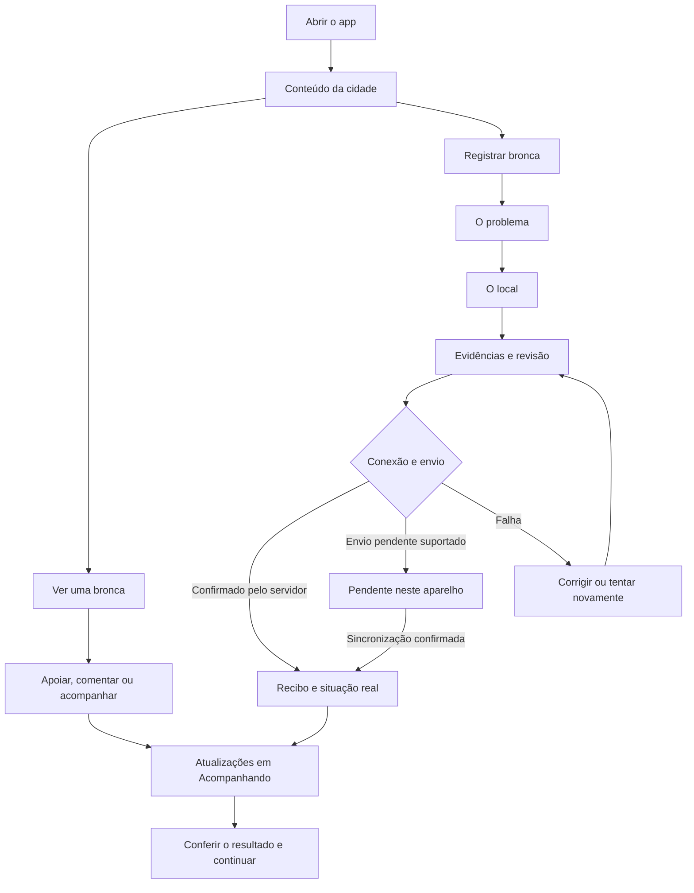
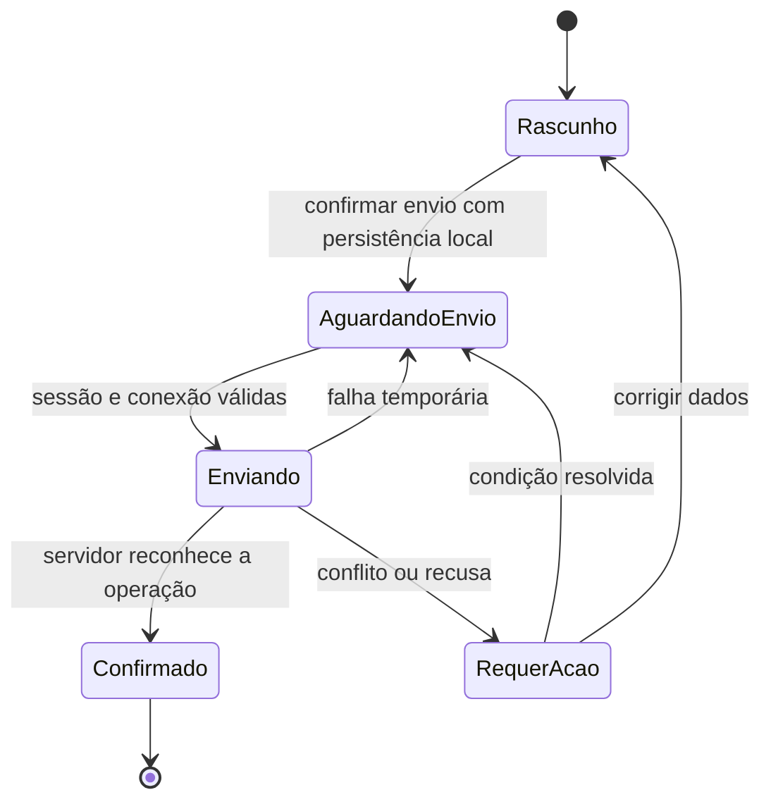

# Trombone Cidadão — plano de evolução da experiência mobile

Data: 04/11/2026. Status: implementação por etapas iniciada; acompanhamento na seção 20.

**Preferência do cliente confirmada em 05/11/2026:** manter o cabeçalho antigo com menu hambúrguer também no aplicativo. As melhorias de fluxo e organização partem desse cabeçalho; a variante compacta não é o padrão.

## 1. Direção do projeto

**Transformar as funções do Trombone em jornadas guiadas, visuais e fáceis de concluir.** A pessoa deve abrir o app, entender o que está acontecendo na cidade, encontrar uma forma de participar e receber retorno sobre o que fez.

O problema relatado é a experiência engessada: muitas funções, pouca orientação, pouca interação e organização visual insuficiente. A melhoria precisa alcançar o percurso inteiro: entrada, descoberta, ação, confirmação, acompanhamento e retorno ao aplicativo. Trocar cores e arredondar cartões resolve apenas uma parte.

As referências pedidas são Duolingo, Instagram e TikTok. A aplicação desses padrões ao Trombone é uma proposta de design, a ser validada com usuários; não pressupõe que os aplicativos tenham hoje uma composição de telas idêntica à descrita aqui.

| Referência | Qualidade a trazer | Aplicação no Trombone |
| --- | --- | --- |
| Duolingo | Próximo passo evidente, tarefas pequenas e progresso compreensível | Formulários guiados, uma sugestão de participação por vez, retomada de rascunho e celebração proporcional |
| Instagram | Conteúdo visual, identidade das pessoas e ações reconhecíveis | Feed com cartões consistentes, fotos bem apresentadas, acompanhar, comentar e compartilhar em posições previsíveis |
| TikTok | Entrada rápida no conteúdo e pouca distração durante a interação | Conteúdo principal com destaque, ações próximas e passagem simples para o próximo item; visualizador imersivo de mídia como evolução opcional |

**Decisão recomendada:** manter React e Capacitor e evoluir a experiência atual por partes. A base já permite recursos de aplicativo. Uma reescrita completa não é requisito deste plano.

### Como a experiência deve ser percebida

1. “Entendi onde estou e o que posso fazer.”
2. “O app me ajuda sem interromper o que estou tentando fazer.”
3. “Preenchi pouco, recebi orientação e não perdi meu trabalho.”
4. “Sei se minha participação foi salva, enviada, publicada ou atendida.”
5. “Quando volto, encontro minhas coisas e continuo de onde parei.”

### Primeira entrega que demonstra a mudança

Criar uma jornada completa e bem acabada: **abrir → reconhecer a cidade → ver uma bronca → participar ou registrar → receber confirmação → acompanhar**. Em seguida, aplicar os mesmos componentes e comportamentos aos outros módulos.

## 2. Base analisada e limites do diagnóstico

Este diagnóstico registra o estado anterior à primeira implementação e considera o código local, as rotas, componentes, dependências e documentos do repositório. Não houve sessão de uso em aparelho, inspeção visual de todas as telas, medição de desempenho ou consulta ao banco de produção. Problemas percebidos pelo usuário são o ponto de partida; hipóteses de usabilidade ainda precisam de validação prática. As mudanças posteriores estão registradas na seção 20.

### O que já existe e deve ser aproveitado

| Evidência local | Situação observada | Consequência para o plano |
| --- | --- | --- |
| `package.json`, `capacitor.config.ts`, `android/app/build.gradle` | React, Capacitor 7, Android/iOS e integrações de câmera, compartilhamento, háptica e notificações | Melhorar a experiência sobre a estrutura atual; dependência instalada não comprova funcionamento em todos os aparelhos |
| `src/pages/HomeRouter.jsx`, `src/lib/homeEntry.js` | A entrada nativa resolve para o feed; há guardas e redirecionamentos adicionais em `App.jsx` | Preservar entrada direta para cidadãos e respeitar os espaços de trabalho institucionais |
| `src/contexts/NativeUIModeContext.jsx` | O modo inicia como `default`; `interactive` depende de preferência persistida | Manter o cabeçalho clássico desde a abertura, conforme preferência posterior do cliente, e evoluir os fluxos mobile |
| `src/App.jsx` | Header mobile depende do modo interativo; há rolagem para o topo a cada mudança de caminho | Planejar inicialização sem troca visual de shell e restauração de contexto ao voltar |
| `src/components/BottomNav.jsx` | Início, Explorar, ação de Bronca, Mapa e Perfil; há suporte a háptica e safe area | Reaproveitar os destinos conhecidos e distinguir criação de conteúdo de troca de aba |
| `src/pages/NativePreferencesPage.jsx` | A descrição do modo interativo menciona “Mais”, mas a navegação atual usa Perfil | Atualizar textos e retirar uma decisão técnica do caminho principal do usuário |
| `src/pages/FeedPage.jsx`, `src/components/feed/FeedTabs.jsx` | Feed visual com Recentes, Perto de mim, Em alta, skeleton e carregamento incremental | Refinar hierarquia, descoberta e continuidade; não recriar essas funções |
| `src/components/ReportModal.jsx`, `src/lib/reportDraft.js` | Wizard Info/Local/Mídia, rascunho e recuperação de mídia; persistência usa escopo de sessão e prazo de mídia | Simplificar o percurso existente e verificar recuperação após encerramento do processo |
| `src/hooks/useCreateReport.jsx` | Criação do registro, envio de mídia, tentativa de compensação em falha e feedback de sucesso | Planejar reenvio seguro, consistência de anexos e confirmação fiel ao estado do servidor |
| `src/contexts/OfflineQueueContext.jsx`, `src/hooks/useOfflineQueue.js` | Fila compartilhada; alguns erros definitivos ou limite de tentativas removem itens com aviso | Projetar recuperação por tipo de operação antes de ampliar offline para todos os formulários |
| `src/contexts/NotificationContext.jsx`, `src/App.jsx` | Infraestrutura de push e navegação por notificações; handler de URLs em `App.jsx` trata broncas explicitamente | Unificar resolução de destinos sem apagar o tratamento já existente de notificações |
| `src/pages/MapPage.jsx`, `src/components/ui/drawer.jsx`, `src/components/ui/dialog.jsx` | Existem folhas inferiores, diálogos e variantes para formulário, com implementações distintas | Consolidar comportamento, foco, teclado e camadas visuais |
| `src/pages/ArborizationMapPage.jsx`, `src/pages/CommunityTreeProfilePage.jsx` | Mapa/lista, filtros, inventário, diário, fotos, comentários e cuidados | Organizar jornadas de consulta, cuidado e gestão usando os recursos atuais |
| `src/contexts/CityContext.jsx`, `src/hooks/useCreateReport.jsx` | Cidade de navegação e cidade determinada pelo local do registro têm papéis diferentes | Manter a diferença no modelo e explicá-la quando afetar uma ação |

Também foram considerados `docs/DESIGN.md`, `docs/ADOTE_UMA_ARVORE.md`, `docs/arvores-da-comunidade.md`, `docs/PLANO_PAINEL_ELETRICISTA_APP.md` e o inventário de rotas de `src/App.jsx`. Documentos anteriores servem de contexto; o estado atual de cada recurso deve ser conferido no código antes da implementação.

### Diagnóstico de experiência

O aplicativo já possui interações, mas elas estão distribuídas entre módulos com padrões diferentes. A hipótese principal é que o usuário precisa descobrir a organização interna do sistema antes de aproveitar suas funções. A solução proposta é dar destaque a objetivos, continuidade e retorno, mantendo as opções avançadas acessíveis em um segundo nível.

## 3. Princípios de navegação e interação

| Princípio | Regra prática |
| --- | --- |
| Uma tela tem uma intenção principal | A ação mais importante recebe o maior destaque; opções secundárias ficam próximas, com peso menor |
| Mostrar o próximo passo | Depois de salvar, explicar o que aconteceu e oferecer uma continuação útil |
| Orientar no momento certo | Instrução curta junto ao campo ou ação; apresentar ajuda adicional quando solicitada |
| Preservar o trabalho | Voltar, abrir câmera, fazer login ou perder conexão não pode apagar silenciosamente o preenchimento |
| Fazer a interface responder | Toque tem estado pressionado; envio mostra progresso; conclusão recebe feedback; falha oferece recuperação |
| Revelar complexidade aos poucos | Dados técnicos, filtros extensos e relatórios ficam em áreas expansíveis ou telas específicas |
| Manter linguagem reconhecível | Usar os mesmos nomes e significados para ações equivalentes em todo o app |
| Ajudar sem exigir tutorial | A tela funciona sem tour; o guia aparece como apoio contextual e pode ser dispensado |

## 4. Arquitetura de informação proposta

### Navegação principal do cidadão

Manter quatro destinos estáveis e uma ação de criação destacada:

| Destino | Pergunta que responde | Conteúdo principal |
| --- | --- | --- |
| Início | “O que acontece na minha cidade?” | Feed local, novidades acompanhadas e uma sugestão contextual de participação |
| Explorar | “O que posso fazer aqui?” | Jornadas por objetivo, busca e acesso ao catálogo completo de funções |
| Mapa | “O que existe neste lugar?” | Broncas, alternância mapa/lista e acessos claros aos mapas temáticos |
| Perfil | “Onde estão minhas coisas?” | Minhas broncas, Acompanhando, árvores, solicitações, progresso, configurações e trabalho |

**Registrar bronca** permanece sempre fácil de encontrar, como botão de ação separado das quatro abas. O posicionamento deve ser validado no protótipo: próximo à base da tela, com área reservada e sem sobrepor conteúdo, controles de mapa ou a navegação. Não introduzir um menu intermediário obrigatório para registrar.

A barra deve ter ícone e rótulo, estado ativo evidente e posição estável. A ação de criar não recebe semântica de aba. Essa separação segue a distinção entre navegação e ação descrita nas [diretrizes de tab bars da Apple](https://developer.apple.com/design/human-interface-guidelines/tab-bars). Quatro destinos também cabem na recomendação de três a cinco destinos para navegação compacta do [Android](https://developer.android.com/develop/ui/compose/components/navigation-bar).

“Acompanhando” terá atalho direto no Início e no Perfil. Manter esse acesso em até dois toques a partir das abas principais. Uma eventual quinta aba depende de evidência de uso; não faz parte da primeira entrega.

### Explorar deve apresentar objetivos

Na primeira área visível, apresentar três entradas grandes, com título e explicação de uma linha:

- **Resolver um problema:** registrar bronca, apoiar uma existente ou conferir atualização.
- **Cuidar da cidade:** árvores, adoção, missões e ações comunitárias.
- **Encontrar informações:** obras, ruas, serviços, notícias e indicadores.

Dentro de cada jornada, mostrar poucas escolhas relevantes e o próximo passo. “Ver todas as funções” mantém o catálogo completo acessível. O usuário frequente pode fixar até três atalhos; essa personalização entra depois de estabilizar a navegação.

### Regras de ida e volta

- Cada aba preserva sua lista, posição de rolagem, filtros e detalhe aberto quando apropriado.
- Abrir uma bronca no feed e voltar devolve a pessoa ao mesmo item.
- Alternar mapa/lista mantém cidade, região, filtros e seleção compatíveis.
- Voltar fecha primeiro a camada superior: visualizador, folha de ação ou formulário; depois retorna na navegação.
- No formulário, voltar atravessa as etapas; ao sair com alterações, oferecer **Guardar e sair**, **Continuar editando** e **Descartar**.
- Entrada por link externo usa uma rota de retorno interna quando não existe histórico válido. `window.history.length` isolado não define essa decisão.
- Na raiz Android, respeitar o comportamento da plataforma ao voltar. Testar navegação por gestos e botões; evitar interceptações concorrentes dos módulos.
- Em etapas de captura, patrulha e execução em campo, usar tela dedicada com saída clara e proteção do trabalho.

## 5. Sistema de orientação: o guia que falta hoje

O guia deve estar incorporado à experiência. A primeira versão não depende de chatbot, inteligência artificial ou uma sequência longa de pop-ups.

### Três formas de orientar

| Forma | Exemplo | Comportamento |
| --- | --- | --- |
| Convite contextual | “Quer melhorar algo na sua rua?” — **Registrar um problema** | Um convite por vez no Início; pode ser dispensado |
| Ajuda durante a ação | “Marque o lugar do problema. Pode ser diferente de onde você está.” | Texto curto no passo de localização, com exemplo se necessário |
| Continuidade | “Sua bronca foi recebida. Você pode acompanhar a análise aqui.” | Recibo com estado real e botão de acompanhamento |

### Prioridade das sugestões no Início

1. Retomar um rascunho iniciado pela própria pessoa.
2. Abrir uma atualização importante de algo que ela acompanha.
3. Resolver uma pendência que exige sua resposta, quando houver.
4. Sugerir uma participação simples e disponível na cidade.

Mostrar no máximo um cartão principal de orientação e um resumo discreto de novidades. A sugestão deve ter motivo compreensível, por exemplo “Porque você acompanha esta bronca”. Se não houver conteúdo apropriado, apresentar um convite geral útil.

### Comportamento do guia

- Primeira explicação curta e dispensável, sem bloquear a leitura do feed.
- Reapresentação disponível em “Como funciona”, no Perfil e nos módulos.
- Memória de dicas dispensadas por conta/versão; não reapresentar a mesma ajuda a cada visita.
- Progresso baseado em ações reais: “Cadastro iniciado”, “Local definido”, “Enviado”.
- Uma tarefa pode ser interrompida e retomada; a experiência não pune a ausência.
- Nenhuma participação é enviada automaticamente por uma recomendação.

## 6. Layout e identidade visual

### Estrutura das telas

| Tipo de tela | Composição proposta |
| --- | --- |
| Início | Cabeçalho clássico com menu hambúrguer e identidade atual; orientação contextual; feed; navegação inferior |
| Explorar | Busca; três jornadas por objetivo; atalhos; catálogo completo em segundo nível |
| Lista | Título curto; busca; filtros principais em chips; cartões; mais filtros em folha inferior |
| Detalhe | Mídia quando houver; título; situação; local; ação principal; histórico e informações complementares |
| Formulário | Título da etapa; progresso; pergunta central; ajuda; campos necessários; ação inferior visível |
| Mapa | Área ampla; cidade e busca compactas; filtros; prévia inferior do item selecionado; alternância para lista |
| Área de trabalho | Pendências, prioridade, local e ação operacional; navegação própria do papel |

### Tratamento visual recomendado

- Manter o vermelho da marca e os tokens existentes. Usar cor forte para ação principal e superfícies neutras para organizar conteúdo.
- Padronizar tipografia, raio de cantos, espaçamento, estados de botão, ícones e apresentação de status.
- Corpo de texto de referência em 16 CSS px, com títulos e rótulos em escala coerente; validar com ampliação de fonte.
- Fotos com proporções consistentes nos cartões; acomodar conteúdo sem foto com uma apresentação informativa.
- Cartões com título, localização, situação e ação facilmente reconhecíveis. Evitar indicadores e botões disputando o mesmo nível de destaque.
- Dados técnicos e textos longos aparecem após o resumo, em seções nomeadas.
- Usar divisórias e contornos quando necessários à compreensão e ao contraste; revisar a regra visual de “não usar linhas” de `docs/DESIGN.md` para acomodar necessidades mobile.
- Revisar o alvo de toque de 40 px sugerido no documento visual antigo. Este plano propõe 48 × 48 CSS px como referência da interface web, validada fisicamente na WebView; dp, pt e CSS px são unidades diferentes.
- Tela clara e escura devem ter o mesmo cuidado. Estado não pode depender apenas da cor.

### O que faz a interface parecer interativa

| Interação | Resposta visual/comportamental |
| --- | --- |
| Tocar em um cartão | Estado pressionado imediato e abertura previsível do detalhe |
| Apoiar ou salvar | Estado atualizado; reverter e explicar se o servidor recusar |
| Avançar no formulário | Progresso legível, foco no título da etapa e transição discreta |
| Tirar foto | Prévia imediata com substituir/remover; cancelar mantém o conteúdo anterior |
| Enviar | Estado identificável de preparação, envio e confirmação; saída para continuar depois quando suportada |
| Concluir uma tarefa | Confirmação curta, resultado real e uma continuação útil |
| Encontrar erro | Mensagem perto do problema, preenchimento preservado e ação de recuperação |

Animações de referência entre 150 e 250 ms, ajustadas ao uso e a `prefers-reduced-motion`. Usar háptica com propósito, especialmente em confirmação importante; não depender de vibração nem dispará-la em toda interação.

### Layouts maiores

No tablet e desktop, redistribuir listas, detalhes e mapas em colunas. Aplicar as regras do `AGENTS.md`: contêiner externo fluido, `.page-shell-fluid` ou equivalente, margens externas de até 64 px a partir de 1200 px, sem largura estreita limitando a página inteira. Limitar apenas colunas de leitura/formulário. Conferir 1440 e 1920 px, sem rolagem horizontal. Exceções de leitura devem ser documentadas no componente.

## 7. Jornada de entrada, autenticação e cidade

### Primeira abertura

1. Exibir a estrutura do aplicativo rapidamente, com skeleton quando necessário.
2. Se ainda não existe cidade definida, oferecer escolha manual e **Usar minha localização** como alternativa explícita.
3. Carregar conteúdo local e apresentar uma orientação curta: “Veja sua cidade, participe e acompanhe o resultado”.
4. Permitir exploração pública. Solicitar conta quando a pessoa iniciar uma ação que exige identificação.
5. Retomar exatamente a intenção após login ou conclusão cadastral, incluindo entidade, cidade, filtros necessários e rascunho.

Não exigir interesses, foto de perfil ou notificações para começar a navegar. Acesso ao feed público não precisa esperar informações que só são necessárias para publicar. Revisar o gate atual de completar cadastro com as regras reais de identidade do produto; isso exige alinhar validação no cliente e no servidor.

### Aberturas seguintes

Usar a cidade escolhida, carregar o último contexto válido e priorizar retomada ou novidades. Se existe link de notificação, abrir o destino correto depois de resolver sessão e permissões. Contas institucionais mantêm sua entrada operacional e podem acessar a área pública pelos caminhos permitidos.

### Cidade sem ambiguidade

- Mostrar “Você está vendo: cidade” nos pontos de troca global.
- Filtro local de um módulo deve ter escopo explícito e não alterar silenciosamente todo o app.
- Em registros geográficos, a cidade deriva do ponto confirmado. Se diferir da cidade de navegação, explicar antes do envio.
- Ao mover o marcador, atualizar endereço/cidade de forma consistente; descartar respostas antigas de geocodificação que cheguem fora de ordem.
- Falha no serviço de endereço mantém ponto e campos. Oferecer endereço manual e validação posterior quando permitida pelo domínio.
- Mudança de cidade em formulário aberto deve preservar o rascunho e pedir uma decisão apenas se afetar o registro.

### Permissões no contexto

| Permissão/recurso | Momento apropriado | Alternativa |
| --- | --- | --- |
| Localização | Perto de mim, centralizar mapa ou localizar problema | Cidade/endereço e marcador manuais |
| Câmera | Tocar em Tirar foto | Galeria ou continuidade conforme regra do formulário |
| Notificações | Escolher acompanhar ou concluir participação relevante | Central de novidades dentro do app |
| Acesso a arquivos | Anexar ou salvar arquivo | Mensagem de falha com retomada |

Recusa não pode gerar pedidos repetidos em ciclo. Quando o sistema exigir ajuste nas configurações, explicar e oferecer o caminho. Revisar os gatilhos de permissão já presentes em `NotificationContext.jsx`.

## 8. Jornada principal: descobrir, participar e acompanhar



Autenticação é uma etapa contextual nos pontos necessários. O caminho offline só fica disponível para operações com persistência e reenvio implementados e validados.

### 8.1 Feed e descoberta

- Aproveitar Recentes, Perto de mim e Em alta; tornar a seleção atual evidente.
- Feed inicial com informações locais e cartões de estrutura constante: autoria permitida, mídia, resumo, local aproximado, situação e ações.
- Priorizar conteúdo em vez de empilhar banners, resumos estatísticos, rankings e convites antes da primeira publicação.
- Mostrar a novidade de uma atualização: “Recebeu resposta”, “Nova foto”, “Situação alterada”.
- Ao puxar para atualizar, manter conteúdo visível durante a requisição e oferecer ação equivalente por botão. Não ativar o gesto sobre mapas ou formulários.
- Paginação não deve saltar a posição do usuário; falha ao carregar mais mantém o que já foi exibido.
- Feed vazio oferece um caminho relevante: mudar filtros, explorar o mapa ou fazer o primeiro registro. Falha de rede usa apresentação diferente de ausência de conteúdo.
- Conteúdos de broncas, árvores e notícias mantêm identificação de tipo. A composição de um feed misto depende de pesquisa e fica fora da primeira entrega.

### 8.2 Registrar bronca: três etapas fáceis

O formulário atual já tem três passos. A melhoria é torná-los mais claros e consistentes, sem inserir etapas obrigatórias desnecessárias.

| Etapa | Pergunta principal | Conteúdo e orientação |
| --- | --- | --- |
| 1. Problema | “O que precisa de atenção?” | Categorias em cartões com ícone e exemplo; título/descrição conforme regras atuais; campos específicos somente após escolher a categoria |
| 2. Local | “Onde isso acontece?” | Localização opcional do aparelho, mapa, endereço editável, referência e confirmação do ponto; poste/árvore quando necessário |
| 3. Evidências e revisão | “Está tudo certo para enviar?” | Câmera/galeria, prévias, resumo compacto, opções de identidade/visibilidade permitidas e links para editar as seções anteriores |

Regras do percurso:

- Progresso “Etapa 1 de 3”, **Continuar** e **Voltar** previsíveis. A última ação se chama **Enviar bronca**.
- Dizer quais campos são obrigatórios e por quê, preservando as exigências de cada categoria.
- Validar a etapa ao avançar; mostrar erro junto ao campo e mover foco para o primeiro problema.
- Encontrando relato potencialmente duplicado, apresentar prévia com **Acompanhar esta bronca** e opção de continuar quando permitido. Não perder o preenchimento.
- Rascunho salvo automaticamente, com estado real de persistência. Não dizer “Salvo” antes de confirmar a gravação local.
- Proteger a continuidade em câmera, login, segundo plano e encerramento do processo; avisar quando a mídia não puder ser recuperada.
- Mostrar progresso de upload e falhas por arquivo. Repetir a tentativa não deve criar outra bronca nem reenviar anexos já confirmados.
- Em categorias com foto opcional, não transformar câmera em barreira de entrada. Preservar as regras existentes até uma alteração explícita de produto.

### 8.3 Recibo e acompanhamento

O resultado deve mostrar protocolo quando já existir, resumo, situação atual e próximo passo.

| Estado | Mensagem de referência | Ação |
| --- | --- | --- |
| Rascunho | “Guardado neste aparelho. Ainda não foi enviado.” | Continuar |
| Pendente | “Guardado para enviar quando houver conexão.” | Ver envio |
| Recebido | “Recebemos sua bronca. Veja a análise e as próximas atualizações aqui.” | Acompanhar bronca |
| Aguardando análise | “Seu registro está em análise para publicação.” | Ver situação |
| Precisa de ajuste | “Falta uma informação para continuar.” | Corrigir registro |

Recebimento, publicação, apoio da comunidade e atendimento oficial são eventos diferentes. A interface deve respeitar os estados do domínio e não prometer encaminhamento ou prazo inexistentes.

O detalhe começa pelo resumo e situação. Depois apresenta localização permitida, ações, linha do tempo, evidências e respostas. O autor encontra suas pendências; visitantes encontram formas permitidas de apoiar e acompanhar. Confirmar resolução apresenta claramente o efeito da ação e quem a registrou.

## 9. Jornadas dos demais módulos

Cada módulo deve ter entrada compreensível, ação principal, orientação contextual e retorno. Os padrões abaixo são o contrato de experiência para o aplicativo inteiro.

| Área e rotas de referência | Jornada proposta | Melhoria central |
| --- | --- | --- |
| Mapa de broncas — `/mapa` | Buscar lugar → filtrar → tocar marcador → ver prévia → abrir detalhe ou acompanhar | Folha inferior compartilhada; manter mapa e filtros ao voltar |
| Arborização — `/mapa-arborizacao`, `/arborizacao/arvore/:id` | Encontrar árvore → entender situação → ver cuidados/serviços disponíveis → acompanhar | Consulta cidadã simples; dados de inventário em detalhe; gestão por papel |
| Adote uma árvore — `/adoteumaarvore` | Entender programa → escolher modalidade → definir local → espécie/fornecedor → revisar → acompanhar pedido | Reaproveitar etapas existentes; evidenciar disponibilidade, retirada/plantio e pendência; sem oferta, oferecer aviso já previsto |
| Comunidade — `/arvores-da-comunidade` e detalhes | Explorar ou Minhas árvores → cadastrar → acompanhar análise → registrar cuidado → ver evolução | Diário visual, convite “Registrar cuidado”, privacidade compreensível e moderação explícita |
| Pavimentação — `/mapa-pavimentacao`, detalhe da rua | Encontrar rua → ver condição → consultar evidências → realizar contribuição permitida | Resumo em linguagem comum e mapa/lista integrados; informações técnicas expansíveis |
| Obras — `/obras-publicas` e detalhes | Encontrar obra → entender andamento → acompanhar → receber atualização | Situação e data da informação primeiro; orçamento/documentos em segundo nível |
| Imóveis — `/imoveis-alugados` e detalhes | Buscar imóvel → ver finalidade e contrato → consultar documentos | Hierarquia entre resumo público, localização e informações contratuais |
| Abaixo-assinados — `/abaixo-assinados`, `/abaixo-assinado/:id` | Entender causa → ver responsável → assinar → receber confirmação → acompanhar | Formulário curto, consentimento claro e distinção entre assinatura, apoio e compartilhamento |
| Guia — `/guia-da-cidade` e detalhes | Escolher necessidade → filtrar → abrir ficha → ligar, abrir rota ou compartilhar | Categoria orientada à necessidade, informação de contato/horário disponível e ação direta |
| Notícias — `/noticias` e detalhes | Encontrar notícia → ler → salvar/compartilhar | Leitura confortável, autoria/data e retorno ao mesmo ponto da lista |
| Radar — `/agora` e detalhes | Ver acontecimento → entender local/data/situação → abrir ação disponível | Diferenciar notícia, alerta e bronca; validade da informação visível |
| Missões — `/missoes`, `/rota-do-dia`, `/colecao` | Escolher tarefa possível → receber orientação → participar → ver resultado | Recomendações pequenas e opcionais; aproveitar missões existentes e evitar tarefas sem oferta real |
| Patrulha/conferência — `/patrulhar...`, `/conferir...` | Preparar → iniciar → registrar → pausar/finalizar → revisar envio | Tela de campo, orientação, estado de GPS/rede e saída sem perda |
| Acompanhando — `/seguindo`, salvos | Ver o que mudou → abrir item → responder quando necessário | Separar novidades de lista de salvos; atalhos para broncas, pessoas e outros itens |
| Perfil e configurações — `/perfil`, `/configuracoes` | Encontrar minhas participações → retomar tarefa → ajustar preferências | Perfil como central pessoal; edição e configurações em segundo nível |
| Perfil público/vereadores | Conhecer pessoa ou atuação → ver contribuições → seguir/consultar | Identidade e papel claros; não confundir apoio político com apoio a uma ocorrência |
| Embaixador/moderação/administração | Entrar na área de trabalho → priorizar pendências → analisar → confirmar decisão | Filas e ações por papel; não exibir tabela administrativa comprimida como experiência mobile |
| Prefeitura, eletricista e executor — `/prefeitura/...` | Ver serviço → entender prioridade/local → executar → registrar → acompanhar conferência | Espaços operacionais próprios, contexto institucional visível e continuidade em campo |
| Ajuda, contato e conta | Encontrar ajuda → resolver ou pedir suporte → acompanhar resultado disponível | Ajuda contextual; recuperação de acesso e exclusão de conta com linguagem clara |

### Arborização e comunidade: atenção especial

- Manter entradas distintas para **Consultar árvores**, **Solicitar muda/plantio**, **Minhas árvores** e **Registrar cuidado**.
- Inventário técnico municipal, pedido de adoção e árvore da comunidade são entidades diferentes. Não unificar cadastros nem estados de aprovação por semelhança visual.
- No diário, destacar foto recente, último cuidado e a ação disponível ao papel atual. Filtros e histórico completo permanecem acessíveis.
- Depois de cuidar, mostrar o registro criado e uma continuação opcional. Datas e evolução vêm de dados reais.
- Aprovação do perfil, visibilidade da localização e privacidade de cada cuidado precisam de explicações próprias.
- Curtidas, comentários e compartilhamento respeitam autoria, acesso e moderação. Fotos e links não devem revelar localização privada.
- Aproveitar as regras existentes de remoção de EXIF, acesso às fotos e compartilhamento descritas em `docs/arvores-da-comunidade.md`.

### Espaços de trabalho

**As áreas da prefeitura fazem parte da experiência mobile desde a primeira entrega.** Cada papel precisa encontrar o trabalho do dia, entender a próxima ação e continuar em campo com o mesmo cuidado oferecido ao cidadão. O menu completo permanece disponível, mas não deve ser a única entrada para as atividades recorrentes.

| Papel | Entrada e orientação no celular | Percurso a simplificar |
| --- | --- | --- |
| Gestor/administrador | Resumo, solicitações e ordens em atalhos persistentes; cidade e papel visíveis | Identificar pendência → abrir caso → atribuir/decidir → receber confirmação |
| Atendente | Solicitações e ordens dentro da secretaria autorizada | Encontrar solicitação → conferir dados → registrar resposta ou encaminhamento permitido |
| Inventário | Atalhos apenas para as áreas técnicas autorizadas | Encontrar rua/árvore/poste → consultar → registrar atualização permitida |
| Eletricista/executor | Navegação operacional própria, cidade e atividade identificadas | Ver serviço → entender local e prioridade → executar → registrar resultado → conferir envio |

Na evolução dos formulários municipais, aplicar passos curtos, ações fixas acessíveis, câmera com prévia, confirmação clara e retomada. Preservar secretaria/cidade nos atalhos e nas transições. Estados de envio, conferência e conclusão devem refletir as regras atuais. Acompanhar as melhorias dessas jornadas em cada entrega, sem deixá-las para o final do redesenho público.

Preservar `MunicipalityLayout` e `ElectricianLayout` e verificar a navegação atual de executor antes de alterar. Administração, embaixador e trabalho de campo usam componentes visuais comuns, mas têm prioridades próprias. A área institucional deve indicar prefeitura/secretaria/papel ativo, permitindo reconhecer em nome de quem a ação será feita.

Este plano não altera regras de aceite, prioridade, conclusão ou conferência de ordens. Ele organiza a apresentação e a continuidade sobre as regras vigentes. Propostas funcionais anteriores precisam de reconciliação com a implementação atual antes de virar tarefa.

## 10. Biblioteca de componentes mobile

Consolidar os componentes existentes antes de criar novas variantes. Os nomes abaixo são responsabilidades propostas; não representam arquivos já implementados.

| Componente/padrão | Função | Requisito essencial |
| --- | --- | --- |
| AppShell mobile | Cabeçalho clássico com menu hambúrguer, conteúdo, navegação, safe areas e ação principal | Um único responsável pelas áreas ocupadas; sem header duplicado ou troca de variante na inicialização |
| Metadados de rota | Título, aba de origem, voltar e comportamento da tela | Substituir decisões espalhadas baseadas em listas de caminhos e `startsWith` |
| Navegação inferior | Trocar os quatro destinos | Preservar contexto e indicar estado ativo com semântica correta |
| Cartão de orientação | Retomada, novidade ou próxima participação | Um convite principal, dispensável e com motivo compreensível |
| Cartão de conteúdo | Exibir bronca, árvore, obra ou notícia | Estrutura consistente com identificação de tipo e situação |
| Folha inferior | Filtros, ações rápidas e prévias | Foco, botão fechar, retorno de foco, safe area e comportamento de voltar |
| Tela de tarefa guiada | Cadastro e ações com múltiplas etapas | Progresso, validação, rascunho e saída segura |
| Barra de ação | Confirmar, continuar ou registrar | Visível com teclado, sem sobreposição à navegação e ao último campo |
| Seletor de local | Mapa, endereço, cidade e precisão | Alternativa manual e resistência a erro de geocodificação |
| Captura e anexos | Câmera/galeria, prévia e upload | Cancelar sem perda, limites claros e recuperação de falhas |
| Situação e linha do tempo | Mostrar o que aconteceu e o que falta | Sem confundir estado local com estado público/oficial |
| Estados de tela | Carregando, vazio, erro, offline e restrito | Mensagens e ações específicas para cada caso |
| Central de envios | Pendências e falhas recuperáveis | Escopo por conta, detalhe do problema e tentativa segura |
| Feedback de ação | Confirmação e erro | Mensagem na tela; toast apenas para informação transitória |

Padronizar a escala de camadas entre mapa, barra, folha, diálogo e câmera. Hoje há componentes com valores de `z-index` diferentes; a migração precisa considerar os overlays existentes para evitar regressões.

Formulários longos usam tela de tarefa. Folhas inferiores atendem ações curtas e prévias. Diálogos de confirmação tratam decisões pontuais. Manter apenas uma camada de decisão ativa; fotografar e voltar deve retomar o mesmo formulário.

## 11. Offline, recuperação e confiança

### Estados de operação



Esses estados representam a operação de envio. O status da bronca, pedido, cuidado ou ordem continua no modelo de domínio.

### Requisitos

- Informar o que está disponível offline em cada módulo. Arquivos do app empacotados no aparelho não garantem conteúdo, mapas ou serviços de backend offline.
- Manter uma única fila coordenada e visível, aproveitando a infraestrutura atual. Cada tipo precisa de remetente e regra de recuperação próprios.
- Persistir texto, referências de mídia e estado de envio antes de oferecer “continuar depois”. Prever falta de espaço e falha na gravação local.
- Isolar rascunhos, cache e operações por usuário e contexto institucional. Ao trocar de conta, não exibir nem enviar material da conta anterior com a nova sessão.
- Bloqueio/expiração de sessão pausa o envio e oferece reautenticação. Dados incompatíveis ou sem permissão vão para tratamento explícito.
- Idempotência deve ser garantida no servidor para criação/reenvio crítico; um identificador apenas no cliente não impede duplicatas.
- Tratar registro e anexos como etapas recuperáveis. Falha após gravar o registro não pode gerar um segundo registro na tentativa seguinte.
- Rever a política atual de descarte por tipo: quando o conteúdo puder ser aproveitado, oferecer correção ou cópia recuperável; quando não puder, explicar a recusa e não criar registros alternativos automaticamente.
- Não prometer processamento contínuo com o app fechado. Separar fila que retoma ao abrir de upload nativo em segundo plano e validar os limites de Android/iOS.
- Ao retornar ao primeiro plano, reconciliar sessão, pendências e dados alterados sem apagar o formulário aberto.

## 12. Notificações, compartilhamento e integração com o aparelho

### Notificações

- Priorizar novidades de conteúdos acompanhados, respostas que exigem ação e alterações operacionais relevantes.
- Agrupar eventos semelhantes e evitar avisos repetidos sobre a mesma atualização.
- O toque abre a entidade e, quando possível, a atualização relevante, com a conta/contexto corretos.
- Caso o conteúdo esteja indisponível ou o acesso tenha mudado, mostrar explicação e caminho de retorno.
- Manter controle por categoria e acesso à central de novidades sem depender da permissão de push.

### Links e compartilhamento

Criar resolução central de destinos para bronca, árvore, pedido de adoção, obra, abaixo-assinado, notícia, perfil e ordem. Reaproveitar os caminhos de notificação existentes; validar esquema, origem e rotas suportadas, sem usar apenas buscas por trecho de URL.

Preservar retorno de login e query strings de cidade/aba/ação. Compartilhamento usa URL pública canônica e respeita a privacidade do conteúdo. Recurso indisponível abre uma tela explicativa. QR Code deve entrar pelo mesmo resolvedor. Suporte exige verificar também App Links/Universal Links e a configuração nativa, além do roteador React.

### Recursos de aparelho por prioridade

| Entrega inicial | Evolução após validação |
| --- | --- |
| Câmera/galeria consistentes, compartilhamento do sistema, safe areas, volta Android, retorno de segundo plano e push com destino correto | Atalhos do ícone para registrar/retomar, lembretes opcionais e modo econômico de mídia |

Biometria, widgets e novas integrações só entram quando houver uma necessidade concreta que justifique implementação e manutenção.

## 13. Acessibilidade e uso em condições reais

O público precisa conseguir participar com pouca familiaridade digital, internet instável e aparelho simples.

- Usar linguagem direta, rótulos visíveis e instruções perto da ação.
- Garantir alvo de toque confortável; a referência Android é pelo menos 48 dp, incluindo área além do ícone. Validar a aplicação em CSS/WebView com aparelho e ferramenta de acessibilidade. [Referência oficial](https://support.google.com/accessibility/android/answer/7101858?hl=pt-BR).
- Contraste de texto de pelo menos 4,5:1, ou 3:1 quando se enquadrar como texto grande; conferir os dois temas. [WCAG — contraste](https://www.w3.org/WAI/WCAG22/Understanding/contrast-minimum.html).
- A referência de 48 CSS px proposta aqui é uma meta de conforto, superior ao mínimo de 24 CSS px do critério WCAG 2.5.8, que possui exceções. [WCAG — tamanho de alvo](https://www.w3.org/WAI/WCAG22/Understanding/target-size-minimum).
- Oferecer botões e seleção textual para operações que dependem de arrastar, inclusive folhas e seleção de localização quando aplicável. [WCAG — movimentos de arrastar](https://www.w3.org/WAI/WCAG22/Understanding/dragging-movements.html).
- Leitura com TalkBack e VoiceOver: títulos, papéis, estado selecionado, erro associado e ordem de foco coerente.
- Ao fechar uma folha, devolver foco ao controle de origem; ao mudar etapa, anunciar título/progresso sem repetir a tela inteira.
- Testar fonte ampliada até 200%, teclado aberto, orientação horizontal e áreas seguras. Campo ativo, mensagem de erro e botão principal precisam continuar alcançáveis.
- Evitar reprodução com som automática. Vídeos devem ter controles e respeitar preferências de movimento/dados; orientar legendas quando fizerem parte do conteúdo.

## 14. Organização técnica da evolução

### Frontend

1. Inventariar as famílias de rota e os shells existentes; mapear cabeçalhos, barra inferior, overlays e proteções de saída.
2. Criar metadados de navegação e um modelo explícito de contexto por aba/rota/cidade/conta.
3. Definir persistência de estado sem manter todas as páginas montadas. Restauração deve aguardar dados e layout antes de reposicionar a lista/mapa.
4. Migrar primeiro a jornada de bronca e seus componentes compartilhados.
5. Reutilizar comportamentos nas jornadas de árvore/adoção, mapas e demais módulos.
6. Carregar módulos pesados sob demanda, depois de medir bundle e abertura. Otimizar mídia e consultas conforme gargalos observados.

### Plataforma mobile

Verificar as três configurações Capacitor presentes (`.ts`, `.js`, `.json`) e definir a fonte efetiva usada pelo processo de build antes de mudar comportamento global. Não remover configurações sem conferir scripts e plataformas geradas.

No código atual, `MobileHeader` e `BottomNav` são componentes React renderizados na WebView. A experiência pode seguir padrões mobile; descrevê-los como controles nativos do sistema seria impreciso.

Ajustar status bar, splash, teclado, volta, retorno de câmera e lifecycle sem duplicar responsabilidades entre CSS e código nativo. Android declara target SDK 36 em `android/variables.gradle`; conferir o comportamento de insets/edge-to-edge na configuração real. [Orientação Android](https://developer.android.com/develop/ui/views/layout/edge-to-edge).

Os eventos de lifecycle e restauração do [plugin App do Capacitor 7](https://capacitorjs.com/docs/v7/apis/app) ajudam a coordenar retorno ao primeiro plano, links e recuperação de resultados. A implementação precisa coexistir com os listeners já usados por autenticação, notificações, câmera e patrulha.

### Dados e backend

- Navegação, identidade visual e orientação básica podem evoluir primeiro no frontend.
- Reenvio seguro, cache institucional e novos agrupamentos de notificações exigem contratos e revisão de backend.
- Mudança em fluxo que altera quem pode ver/publicar/executar também exige validação em RPC/RLS; ocultar botões não define autorização.
- Criar migrações apenas quando a entrega realmente precisar de dados novos, com compatibilidade para versões anteriores do app e caminho de recuperação.

## 15. Backlog priorizado e critérios de aceite

P0: base necessária para a experiência principal. P1: expansão e organização dos módulos. P2: experimentos após a base validada. Tamanhos relativos: P = pequeno, M = médio, G = grande; não são estimativas de dias.

| ID | Prioridade / porte | Entrega e dependência | Critério de aceite |
| --- | --- | --- | --- |
| MOB-01 | P0 / M | Contrato de navegação e estados; ponto de partida | Todas as famílias de rota têm origem, retorno, ação principal e tratamento de acesso definidos |
| MOB-02 | P0 / M | Base mobile com cabeçalho clássico; depende de 01 | Aplicativo mantém o header antigo com menu hambúrguer desde a abertura, sem troca por preferência antiga; espaço institucional preservado |
| MOB-03 | P0 / M | Kit visual e estados compartilhados; depende de 01 | Botões, cartões, situação, skeleton, erro e vazio consistentes nas telas piloto |
| MOB-04 | P0 / G | Contexto e voltar; depende de 01–02 | Feed → detalhe → voltar e mapa → detalhe → voltar preservam item, filtros e posição |
| MOB-05 | P0 / M | Início guiado e Explorar por objetivos; depende de 03 | Usuário encontra registrar, acompanhar e árvores sem conhecer nomes internos dos módulos |
| MOB-06 | P0 / G | Wizard de bronca refinado; depende de 03–04 | Três etapas claras, erro contextual e continuidade após câmera/login/saída suportada |
| MOB-07 | P0 / M | Recibo e acompanhamento; depende de 06 | Usuário distingue rascunho, pendente, recebido e análise; encontra protocolo e próximo passo |
| MOB-08 | P0 / G | Recuperação e reenvio da jornada principal; contrato de backend | Interrupção/repetição não duplica bronca ou anexo; falha preserva material recuperável |
| MOB-09 | P0 / M | Safe areas, teclado, foco e toque; começa em 02–03 | CTA, campos e voltar acessíveis nos aparelhos/condições da matriz de teste |
| MOB-10 | P0 / M | Retorno de autenticação e cidade; depende de 01 | Login/cadastro devolvem à intenção correta sem mudar silenciosamente cidade/ponto |
| MOB-11 | P1 / G | Mapas e folhas compartilhadas; depende de 03–04 | Mapa/lista mantêm contexto; filtros funcionam com foco e alternativa ao gesto |
| MOB-12 | P1 / G | Arborização, adoção e comunidade; depende de 06–07, 11 | Consulta, pedido e cuidado têm orientação, confirmação e privacidade coerentes |
| MOB-13 | P1 / M | Perfil e Acompanhando; depende de 04, 07 | Minhas broncas, árvores, pedidos e novidades ficam acessíveis em até dois toques das entradas previstas |
| MOB-14 | P1 / G | Central de envios e escopo por conta; depende de 08 | Pendência tem proprietário, estado, motivo e recuperação; troca de conta não executa envio cruzado |
| MOB-15 | P1 / G | Push e resolução de links por família; depende de 01, 10 | Entidades prioritárias abrem com app fechado/aberto e acesso correto; indisponibilidade tem saída clara |
| MOB-16 | P1 / G | Obras, ruas, guia, notícias, radar e abaixo-assinados; depende do kit | Cada módulo atende ao contrato de jornada, estados e retorno definido na seção 9 |
| MOB-17 | P0/P1 / G | Áreas institucionais e campo; navegação e contexto na base, jornadas operacionais nas entregas seguintes | Papel/contexto visíveis; atalhos conforme permissão; captura e execução preservadas; sem regressão de autorização |
| MOB-18 | P1 / M | Missões guiadas e progresso útil | Tarefa disponível tem início, orientação, conclusão real e opção de interromper |
| MOB-19 | P2 / M | Atalhos pessoais, lembretes optativos e atalhos do ícone | Atalhos respeitam conta e retomam a ação correta; lembretes podem ser desligados |
| MOB-20 | P2 / G | Visualizador imersivo de mídia no estilo de descoberta rápida | Experimento melhora compreensão/participação, com privacidade, acessibilidade e uso de dados aceitáveis |

MOB-08 não pode esperar a central completa MOB-14: o fluxo principal precisa de recuperação antes de ampliar a interface. Segurança de conta, foco e privacidade são requisitos de cada entrega, mesmo quando há uma tarefa de consolidação posterior.

## 16. Plano de entregas

### Etapa A — desenhar e validar a jornada piloto

Produzir protótipo navegável de Início, Explorar, detalhe de bronca, cadastro em três etapas, recibo e Acompanhando. Incluir visitante, usuário autenticado, erro, falta de conexão e retomada. Representar também uma tarefa de árvore para confirmar que o padrão funciona além de broncas.

O protótipo deve mostrar aparência e transições, não apenas wireframes de páginas isoladas. Validar duas possibilidades de posição para Registrar bronca sem esconder o conteúdo.

**Saída:** fluxo compreensível sem explicação do designer e componentes visuais definidos para o piloto.

### Etapa B — entregar a experiência principal

Implementar MOB-01 a MOB-10 com dependências respeitadas e a base de navegação municipal de MOB-17. A entrega combina shell, guia, navegação pública e de trabalho, criação, retorno, recuperação e acessibilidade. Dar prioridade às falhas de continuidade antes de acrescentar novos efeitos visuais.

**Saída:** jornada completa testada em Android/iOS e web, com comportamento confiável.

### Etapa C — aplicar aos módulos e aos espaços de trabalho

Expandir primeiro para mapas, árvores/adoção/comunidade e área pessoal. Depois migrar os demais módulos e áreas institucionais conforme uso, impacto e risco operacional. Reaproveitar componentes e registrar exceções por necessidade real.

**Saída:** mesma qualidade de orientação e resposta em todas as famílias de jornada.

### Etapa D — experimentar personalização e imersão

Só então testar mídia imersiva, atalhos e sugestões mais personalizadas. Comparar efeito em participação concluída e compreensão, consumo de dados e desempenho. Progresso e conquistas devem representar contribuição real.

**Saída:** evoluções aprovadas por evidência de benefício ao usuário.

### Liberação

Separar as entregas por flags de produto ou mecanismo equivalente, com padrão de migração documentado e possibilidade de retorno. Começar com equipe interna e grupo piloto; ampliar após os critérios de aceite. Uma flag de rollout não deve virar uma escolha permanente de “layout web ou app” nas preferências do cidadão.

Prazo total deve ser estimado após o protótipo e a avaliação de persistência/backend. A cobertura inclui muitas famílias de produto; apresentar um prazo único agora ocultaria diferenças importantes entre refinamento visual e recuperação transacional de envio.

## 17. Verificação, métricas e definição de pronto

### Teste de usabilidade

Primeira rodada com 5 a 8 pessoas de perfis variados, incluindo baixa familiaridade digital. É uma rodada qualitativa para localizar problemas, sem representar estatisticamente toda a base.

| Tarefa sem instrução de navegação | Evidência esperada |
| --- | --- |
| Encontrar algo acontecendo na cidade | Reconhece cidade e conteúdo local sem procurar em vários menus |
| Registrar um problema e voltar após tirar foto | Conclui as etapas e mantém o preenchimento |
| Encontrar uma bronca já enviada | Acha o item e explica sua situação com as próprias palavras |
| Encontrar como pedir uma muda ou cuidar de uma árvore | Distingue as jornadas e identifica a próxima ação |
| Continuar uma tarefa interrompida | Localiza rascunho/pendência e entende o que já foi salvo |
| Acompanhar uma atualização | Abre o item correto e reconhece o que mudou |

Registrar taxa de conclusão, pedido de ajuda, erros de caminho e pontos de hesitação. Meta inicial do piloto: pelo menos 80% de conclusão sem intervenção nas tarefas principais; revisar cada dificuldade, inclusive as que a taxa agregada esconder.

### Matriz técnica mínima

| Dimensão | Casos |
| --- | --- |
| Tela | 360, 390 e 430 CSS px; tablet; desktop em 1440 e 1920 px |
| Aparelho | Android de entrada e intermediário, incluindo limite inferior suportado e Android recente; iPhone com e sem recorte |
| Navegação | Gestos e botões Android, voltar interno, link direto, troca de aba e retorno ao detalhe |
| Sessão | Visitante, usuário, conta institucional, sessão expirada, troca de conta e perda de acesso |
| Rede | Normal, lenta, intermitente, modo avião, reconexão e servidor indisponível |
| Ciclo de vida | Câmera cancelada, app em segundo plano, encerramento do processo e abertura por notificação |
| Conteúdo | Vazio, longo, sem imagem, imagem quebrada, vídeo e muitos resultados |
| Acessibilidade | Claro/escuro, fonte 200%, TalkBack/VoiceOver, movimento reduzido e teclado aberto |

Automatizar contratos de navegação, persistência, idempotência, autorização e reenvio. Usar verificações visuais e em aparelho para teclado, safe areas, gesto e foco. Ampliar as suítes existentes sem criar testes que apenas repitam classes CSS ou detalhes da implementação.

### Métricas de produto

| Métrica | Pergunta |
| --- | --- |
| Tempo até primeira ação útil | Quanto demora para ver detalhe relevante, acompanhar ou iniciar participação? |
| Conclusão do registro | Quantos usuários que iniciam conseguem enviar e receber confirmação? |
| Abandono por etapa | Qual pergunta, campo ou permissão interrompe o fluxo? |
| Retomada de rascunho | Pessoas conseguem terminar o que interromperam? |
| Recuperação de envio | Quantas falhas são recuperadas sem perda ou duplicação? |
| Retorno a Acompanhando | Quem participa consegue reencontrar o resultado? |
| Compreensão de situação | A pessoa distingue envio, publicação e atendimento? |
| Participação por jornada | Quais objetivos ajudam a descobrir funções antes pouco utilizadas? |

Instrumentar nomes de eventos por ação e etapa, com resultado e duração. Não coletar descrição livre, foto, coordenada precisa ou conteúdo privado nesses eventos. Coletar linha de base antes do rollout e comparar por versão, plataforma e perfil de acesso compatíveis.

Metas de desempenho são provisórias até medir: resposta visual ao toque em até 100 ms e conteúdo útil em até 3 s no percentil 75 em cenário definido de aparelho/rede. Separar abertura fria, retorno ao app, dados locais e rede. Não há medição atual que comprove esses valores.

### Definição de pronto por jornada

- A pessoa entende o objetivo e encontra a ação principal.
- Existe orientação contextual e próximo passo após concluir.
- Carregando, vazio, erro, restrito e offline têm comportamento definido.
- Voltar, login, câmera e reconexão preservam o contexto suportado.
- Confirmação representa o estado real do registro.
- Repetição de envio não duplica operações críticas.
- Layout funciona com teclado, ampliação de texto, temas e leitor de tela.
- Links, notificações e acesso direto respeitam a conta e as permissões.
- Desktop atende às regras de largura do projeto.
- A jornada foi verificada em aparelho; limitações restantes estão documentadas.

## 18. Decisões propostas e pontos a validar

### Direção recomendada para iniciar

1. Experiência mobile com o cabeçalho antigo e menu hambúrguer, conforme preferência do cliente.
2. Quatro abas estáveis e Registrar bronca como ação destacada.
3. Início com conteúdo local, uma orientação contextual e acesso a Acompanhando.
4. Explorar organizado por objetivos, com catálogo completo acessível.
5. Formulários guiados, pequenos passos, recuperação e feedback real.
6. Kit visual compartilhado, aproveitando a identidade e os componentes atuais.
7. Áreas operacionais próprias por papel, preservando as regras de trabalho.
8. Evolução incremental começando por uma jornada completa e por arborização na expansão.

### Validar no protótipo e no planejamento técnico

- Posição do botão Registrar bronca e legibilidade da navegação com fonte ampliada.
- Descoberta de Acompanhando sem uma aba exclusiva.
- Campos cadastrais realmente necessários para cada participação.
- Quais tipos de operação podem ser enviados offline e quais exigem confirmação online.
- Persistência de mídia após encerramento do processo e política de retenção por conta.
- Volume/qualidade de mídia que justificaria um visualizador imersivo.
- Frequência apropriada de dicas, sugestões e lembretes opcionais.
- Organização atual dos papéis institucionais e conflitos entre planos anteriores e código vigente.

Essas validações orientam implementação e rollout. O documento pode seguir para prototipação sem resolver antecipadamente todos os experimentos de P2.

## 19. Referências

Fontes consultadas em 04/11/2026. As diretrizes embasam padrões; decisões específicas do Trombone são propostas deste plano.

- [Duolingo — explicação do redesenho da tela inicial e caminho guiado](https://blog.duolingo.com/new-duolingo-home-screen-design/): referência para organizar uma próxima ação compreensível.
- [Meta — recursos de conexão do Instagram](https://about.fb.com/news/2025/08/new-instagram-features-help-you-connect/): referência de interação em torno de conteúdo e pessoas; não especifica a navegação proposta aqui.
- [TikTok — descoberta e exploração de vídeos](https://support.tiktok.com/en/using-tiktok/exploring-videos): referência de produto para descoberta; a experiência cívica e o eventual visualizador exigem validação própria.
- [Apple — tab bars](https://developer.apple.com/design/human-interface-guidelines/tab-bars).
- [Android — navigation bar](https://developer.android.com/develop/ui/compose/components/navigation-bar).
- [Android — tamanho da área de toque](https://support.google.com/accessibility/android/answer/7101858?hl=pt-BR).
- [Android — edge-to-edge e insets](https://developer.android.com/develop/ui/views/layout/edge-to-edge).
- [Capacitor 7 — App API](https://capacitorjs.com/docs/v7/apis/app).
- [W3C — contraste](https://www.w3.org/WAI/WCAG22/Understanding/contrast-minimum.html), [tamanho de alvo](https://www.w3.org/WAI/WCAG22/Understanding/target-size-minimum) e [alternativas a arrastar](https://www.w3.org/WAI/WCAG22/Understanding/dragging-movements.html).

## 20. Acompanhamento da implementação

### Parte 1 — base mobile e acesso ao trabalho municipal

Implementação local iniciada em 04/11/2026. Escopo: base de MOB-01, MOB-02, MOB-09 e MOB-17; isso não representa a conclusão integral desses itens.

- Cabeçalho clássico com menu hambúrguer também no aplicativo, desde o primeiro render, conforme ajuste solicitado em 05/11/2026. A antiga preferência de layout deixa de controlar o cabeçalho; links antigos levam às configurações atuais.
- Metadados compartilhados para títulos, seção ativa e retorno das famílias públicas. O mapa principal é uma raiz; mapas temáticos pertencem a Explorar.
- A variante compacta recebeu correções de títulos/ações por rota, mas fica inativa na configuração escolhida pelo cliente. No cabeçalho clássico, títulos e ações dos detalhes permanecem nas próprias páginas.
- Prefeitura recebe até três atalhos inferiores das áreas já autorizadas ao papel e acesso a Mais. Os atalhos preservam o contexto municipal definido pelas regras existentes.
- Cidade e papel/atividade ficam visíveis nos cabeçalhos mobile de gestão e execução. Eletricistas e executores continuam com sua navegação operacional própria.
- Confirmada no CLI local a precedência de `capacitor.config.ts`, sem servidor remoto nessa configuração. As configurações e os arquivos nativos não foram alterados.

Ao concluir a parte 1, a restauração completa de listas/mapas, o Início guiado, o kit visual, os formulários municipais e públicos e a recuperação transacional de envios seguiam pendentes. O avanço de organização visual está registrado na parte 2 abaixo. A verificação em aparelhos Android/iOS ainda é necessária antes de considerar o shell homologado para lançamento.

Verificações locais da parte 1 e da preferência de cabeçalho:

- 26 testes passaram cobrindo navegação, modo inicial, contexto do cabeçalho, retorno e acesso municipal; ESLint dos componentes alterados passou.
- Build de produção do frontend concluído após restaurar a seleção do cabeçalho clássico.
- 40 cenários do cabeçalho clássico e navegação pública em Chrome, com temas claro/escuro e larguras de 360, 390, 430, 1440 e 1920 px. O menu hambúrguer abre, navega e fecha ao trocar de tela.
- 32 cenários municipais no recorte de navegação, com gestor/administrador, atendente, inventário e executores; inclui simulação de áreas seguras em retrato/paisagem. Asserções de conteúdo sem erro, permissão, contexto e ausência de overflow.
- As verificações de navegador usam dados simulados e não validam o backend de produção ou substituem a homologação em aparelho. Os screenshots ficam em `.tmp/mobile-shell-ui` e `.tmp/municipal-responsibilities-ui`.

Comandos para repetir as verificações:

```powershell
node --import ./tools/test-alias.mjs --test --test-isolation=none src/test/mobileNavigation.test.mjs src/test/mobileShell.test.mjs src/test/homeEntry.test.mjs src/test/municipalityAccess.test.mjs src/test/executorActivities.test.mjs
node tools/validate-mobile-shell-ui.mjs
node tools/validate-municipal-responsibilities-ui.mjs --mobile-navigation
```

Esta etapa altera componentes locais. Não aplica migrações, não muda permissões de negócio e não publica uma versão nas lojas.

### Parte 2 — Início, Explorar e resumos municipais mais objetivos

Implementação local em 05/11/2026. Escopo: primeira aplicação de MOB-03 e MOB-05, com continuidade de MOB-17. O cabeçalho clássico com menu hambúrguer e a paleta atual foram mantidos.

- **Início:** uma apresentação comum a celular e desktop, com Registrar bronca como ação principal e acesso direto a Acompanhando. A orientação de primeiro uso fica em uma explicação opcional de três passos. Retirados os valores fixos “Nível 12” e “3 disponíveis”.
- **Explorar:** três objetivos visíveis — Resolver um problema, Cuidar da cidade e Encontrar informações. A página mostra as opções do objetivo selecionado; o catálogo completo fica disponível em Ver todas as funções.
- **Busca de funções:** pesquisa por nome e termos relacionados, incluindo palavras com/sem acento. Seleção e busca ficam na URL; a missão que exige conta mantém o destino no retorno de login.
- **Arborização acessível:** pedir muda/plantio, árvores da comunidade e consulta ao inventário têm entradas próprias em Cuidar da cidade.
- **Prefeitura:** acessos a solicitações e ordens aparecem antes dos indicadores. Detalhamento por categoria e gráficos ficam em seções expansíveis. Pontos de atenção com valores positivos continuam visíveis no resumo administrativo.
- **Padrões compartilhados:** cartões de ação e seções expansíveis reutilizam os tokens atuais de marca, superfícies, texto e borda. A composição usa espaçamento e hierarquia comuns nas jornadas públicas e municipais.
- **Desktop:** a página do feed usa contêiner fluido e laterais dentro do grid; foram removidos o limite externo de largura e o reposicionamento manual das laterais durante a rolagem.

Verificações desta parte:

- 31 testes de regressão passaram, incluindo navegação, acesso e contagens municipais; ESLint dos arquivos alterados passou.
- Build de produção do frontend concluído com os novos layouts.
- Início e Explorar verificados em 10 combinações de largura/tema: 360, 390, 430, 1440 e 1920 px, claro e escuro. As verificações também cobrem ajuda opcional, abertura do registro, busca com acentos, busca vazia, catálogo completo, missão com/sem conta e retorno de login.
- Ampliação de fonte para 200% conferida em 390 px, com ausência de rolagem horizontal nas duas páginas.
- 32 cenários municipais passaram no recorte de navegação, com verificação adicional das ações visíveis e abertura/fechamento das estatísticas detalhadas.
- O cenário público simula dados, seletor de cidade e cartões de publicação; testa os componentes reais de Início, Explorar e navegação. Não certifica as interações internas dos cartões de bronca ou o backend de produção. Evidências em `.tmp/civic-journeys-ui` e `.tmp/municipal-responsibilities-ui`.

```powershell
node tools/validate-mobile-shell-ui.mjs --journeys
node tools/validate-municipal-responsibilities-ui.mjs --mobile-navigation
node --import ./tools/test-alias.mjs --test --test-isolation=none src/test/mobileNavigation.test.mjs src/test/mobileShell.test.mjs src/test/homeEntry.test.mjs src/test/municipalityAccess.test.mjs src/test/executorActivities.test.mjs src/test/municipalOverview.test.mjs
```

Continuam nas próximas entregas: orientação personalizada por rascunho/atualização, restauração de contexto entre telas, refinamento dos formulários, recuperação de envio e expansão do kit às outras páginas. Esta parte entrega organização visual e descoberta de funções; a homologação em aparelho e a validação com usuários continuam pendentes.

### Parte 3 — acabamento dos componentes de Início e Explorar

Refinamento local em 05/11/2026, após o pedido de uma aparência mais moderna e interativa dentro do padrão visual existente. Escopo: componentes públicos dessas duas páginas, sem considerar concluída a modernização de todos os módulos.

- **Identidade preservada:** vermelho, fontes, tokens semânticos, temas claro/escuro e cabeçalho clássico com menu hambúrguer.
- **Explorar:** objetivos com rótulos curtos no celular e explicações no desktop. Uma ação principal recebe destaque; as demais formam uma lista com divisórias discretas, reduzindo cartões dentro de cartões. Busca, catálogo e retorno de login continuam funcionando.
- **Início:** apresentação com superfície suave, título em largura completa, botão de registro amplo e acesso a Acompanhando junto à ajuda opcional.
- **Cartões reais:** títulos e descrição maiores; ações com alvos mínimos de 48 × 48 CSS px e retorno pressionado; apoiar passa a mostrar “Apoiar”/“Apoiado”. Relatos sem imagem ou vídeo deixam de reservar uma capa vazia. A apresentação de miniaturas quadradas permanece própria do cartão horizontal.
- **Abas:** seleção em controle segmentado, navegação por setas/Home/End, uma aba na sequência de foco e associação entre aba ativa e painel. Transições novas respeitam redução de movimento.
- **Reuso:** variante `discovery` no `ActionCard` e estilos em `src/design-system/mobile-journeys.css`. O contêiner da página continua fluido; desktop redistribui as ações em duas ou três colunas.

Validação: ESLint dos componentes alterados; 26 testes de navegação, shell, entrada e acesso/resumo municipal; 98 pares de contraste dos tokens aprovados; build final de produção concluído. A tentativa adicional de executar `executorActivities.test.mjs` encontrou a dependência `fake-indexeddb` ausente na instalação local; esse teste não valida a alteração visual. O build final usou a opção local do V8 abaixo para contornar a lentidão observada no processamento de expressões regulares, sem alterar os scripts do projeto.

O comando abaixo usa os componentes reais de cartão, mídia, comentários, Início e Explorar com dados e serviços simulados. Cobre 360, 390, 430, 1440 e 1920 px, dois temas, busca, objetivos, catálogo, retorno do login, navegação das abas, apoio reversível, tamanho das ações e fonte a 200%. Não certifica gravações no backend ou o uso em aparelhos. Evidências em `.tmp/civic-components-ui`.

```sh
# Se o Chrome não estiver no caminho padrão, informe o executável em CHROME_PATH.
node tools/validate-mobile-shell-ui.mjs --journeys --real-cards
node --import ./tools/test-alias.mjs --test src/test/mobileNavigation.test.mjs src/test/mobileShell.test.mjs src/test/homeEntry.test.mjs src/test/municipalityAccess.test.mjs src/test/municipalOverview.test.mjs
node --max-old-space-size=1536 --enable-experimental-regexp-engine-on-excessive-backtracks node_modules/vite/bin/vite.js build
```

### Parte 4 — capa da cidade e ações em uma composição única

Refinamento local em 05/11/2026. A entrada do feed usa a imagem institucional `civic_thumbnail_url`, já carregada pelo contexto de cidade. A capa é baixa, com degradê para leitura do nome e os cards parcialmente sobrepostos. Cidade sem imagem, ou com falha ao carregá-la, mantém o nome e as ações sem reservar uma capa vazia. A tela administrativa de identidade visual informa também o uso da imagem no feed.

- **Cidade:** seleção pelo ícone de localização no cabeçalho clássico, também no feed mobile e na raiz. O nome na capa é informativo; não existe um segundo seletor sobre a foto.
- **Quatro ações:** Cadastrar sua bronca, Painel do embaixador, Patrulha e missões e Convidar. No celular formam uma grade 2 × 2, com ícones, cantos e espaçamentos comuns; no desktop ficam em uma linha. O painel abre a área do embaixador para esse papel ou a apresentação do programa para os demais usuários, preservando o comportamento anterior.
- **Convite:** compartilhamento nativo ou Web Share; alternativa de copiar o link e, se necessário, exibição do endereço para cópia manual. O link usa a origem pública configurada, inclusive no desenvolvimento local e na WebView. Cancelar o compartilhamento não exibe confirmação de sucesso.
- **Ordenação:** Recentes, Perto de mim e Em alta ficam em um menu contextual. A tela deixa de empilhar uma faixa de botões com uma barra de tabs.
- **Feed vazio:** ilustração SVG da comunidade, mensagem local e acessos a mapa, árvores e serviços. O cadastro fica no card de ação e na navegação inferior, sem outro botão idêntico no estado vazio. A explicação em três passos aparece em ajuda recolhida abaixo dos caminhos.
- **Conteúdo e acompanhamento:** o aviso “Há novidades nas suas broncas” foi retirado do feed; permanece na área Acompanhando. Alertas municipais reais podem aparecer depois do primeiro relato ou do estado vazio, mantendo a entrada concentrada nas ações e no conteúdo.
- **Desktop:** contêineres fluidos no feed e no cabeçalho; margens externas conferidas em 1440 e 1920 px. Os novos estados de toque respeitam redução de movimento.

Validação local: build normal de produção e ESLint dos arquivos alterados aprovados; 18 testes de regressão e 20 cenários visuais passaram. O validador usa os componentes reais, com dados e serviços simulados, e cobre os layouts com/sem capa, temas claro/escuro, troca de cidade no cabeçalho, falha da imagem, quatro ações, perfil de embaixador, compartilhamento/cancelamento/cópia de convite, ordenação, estados vazio/carregando/erro e fonte a 200%. Screenshots em `.tmp/civic-components-ui`, incluindo `feed-cover-390-light.png` e as versões de desktop. Não aplica alterações ao banco nem publica um aplicativo; a validação em aparelho continua pendente.

```sh
node tools/validate-mobile-shell-ui.mjs --journeys --real-cards
node --import ./tools/test-alias.mjs --test src/test/mobileNavigation.test.mjs src/test/mobileShell.test.mjs src/test/homeEntry.test.mjs src/test/cityEventShareRoute.test.mjs
npx vite build
```

### Parte 5 — composição desktop e refinamento da capa da cidade

Refinamento local em 05/11/2026, a partir das referências enviadas pelo cliente. O desktop recebe uma composição própria; no celular, a alteração fica restrita à capa e ao pequeno ajuste de posição das ações solicitado em seguida.

- **Desktop:** navegação Comunidade à esquerda, feed central e contexto da cidade à direita a partir de 1200 px. Notebooks entre 980 e 1199 px usam duas colunas. O contêiner permanece fluido, com margens externas de até 64 px.
- **Entrada:** ações compactas abaixo da capa, título Na comunidade com ordenação e acesso a Acompanhando. Mantidos os quatro destinos de ação e o cabeçalho atual.
- **Cartões:** foto ou miniatura de vídeo ao lado do texto no desktop; relatos sem mídia continuam sem reservar uma imagem vazia. O campo de comentário aparece ao acionar Escrever comentário, recebendo foco. A contagem de apoio continua nas ações, sem repetir a mesma informação em uma segunda linha no desktop.
- **Contexto:** entrada ilustrada para o mapa e lista dos alertas reais disponíveis. A ilustração de mapa é decorativa, sem representar ruas ou ocorrências reais. Atalhos de área de trabalho continuam condicionados ao papel.
- **Capa:** preservada a fotografia institucional configurada pela cidade, com um leve ajuste de brilho e saturação. Degradê vinho concentrado à esquerda, identificação MINHA CIDADE e nome mais altos, cantos arredondados e botão de acompanhamento sobre fundo translúcido. No celular, os quatro botões continuam em grade 2 × 2, ligeiramente mais altos sobre a capa. A altura de referência da imagem continua em 124 px no celular e 148 px no desktop, podendo acomodar nomes longos ou fonte ampliada.
- **Identidade:** tokens atuais, cores da marca e temas claro/escuro preservados. As regras novas de composição ficam em `src/design-system/feed-desktop.css`; os demais módulos não recebem esse layout automaticamente.

Validação: 18 testes de navegação, shell, entrada e compartilhamento passaram; ESLint dos componentes alterados aprovado; build de produção concluído. Os 26 cenários do navegador incluem 360, 390 e 430 px, fonte a 200%, capa com/sem imagem, busca e ordenação, além de composição desktop em 980, 1200, 1440 e 1920 px. As verificações de desktop cobrem mídia lateral, ausência de sobreposição/rolagem horizontal, abertura do registro, acesso ao mapa e foco no comentário após a ação. Foram comparadas também capturas mobile anteriores ao ajuste. As imagens de cidade e os relatos do validador são simulados; a foto real continua vindo do cadastro da cidade. Evidências em `.tmp/civic-components-ui`, com capturas `feed-desktop-1440-light.png`, `feed-desktop-1920-light.png` e `feed-cover-390-light.png`. Homologação em aparelho e backend de produção não fazem parte desta verificação local.

```sh
node tools/validate-mobile-shell-ui.mjs --journeys --real-cards
node --import ./tools/test-alias.mjs --test --test-isolation=none src/test/mobileNavigation.test.mjs src/test/mobileShell.test.mjs src/test/homeEntry.test.mjs src/test/cityEventShareRoute.test.mjs
node --max-old-space-size=1536 --enable-experimental-regexp-engine-on-excessive-backtracks node_modules/vite/bin/vite.js build
```

### Parte 6 — previews reais dos vídeos no feed

Correção local em 05/11/2026. Vídeos sem foto de capa passam a gerar miniaturas em todos os cartões que entram na área visível, incluindo itens após o 13º relato. A extração registra os listeners antes de iniciar carregamento ou busca de quadro e considera também o estado já decodificado, evitando esperas por eventos que já ocorreram.

- **Preview:** quadro próximo ao início do vídeo, com até 640 px na maior dimensão, mantendo a proporção original. O desktop apresenta a miniatura com indicação de reprodução; no celular ela serve também como poster do player atual.
- **Alternativa imediata:** enquanto a miniatura é preparada, o cartão desktop usa um quadro do próprio vídeo. Essa alternativa permanece quando a extração falha, inclusive por restrição de canvas; continua dependendo de um vídeo acessível e de um formato decodificável pelo navegador.
- **Fila e cache:** uma extração por vez, compartilhamento de solicitações do mesmo vídeo e cache limitado em memória. Retirar uma miniatura do cache não invalida a imagem de um cartão ainda aberto. Não há gravação nova no banco ou no armazenamento remoto.
- **Troca e recuperação:** mudar a URL descarta o preview anterior imediatamente; um resultado atrasado não substitui o vídeo atual. Falhas liberam os elementos de mídia, permitem nova tentativa e não bloqueiam o próximo item da fila.

Validação específica: 8 testes passaram cobrindo eventos rápidos, quadro já decodificado, timeout, falha de canvas, cache, fila e troca de URL/tentativa. Quatro cenários de Chrome usam vídeos reais gerados no próprio navegador: poster mobile em 390 px, miniaturas em 1440 e 1920 px, cartão com índice posterior ao 13º, troca entre vídeos de cores distintas e alternativa visual com exportação de canvas bloqueada. Evidências em `.tmp/video-previews-ui`. As verificações locais não certificam todos os codecs ou aparelhos Android/iOS.

Também passaram os 26 cenários de regressão do feed/Explorar com cartões reais, o ESLint dos componentes alterados e o build local de produção.

```sh
node --test --test-isolation=none src/test/videoThumbnail.test.mjs src/test/useVideoThumbnail.test.mjs
node tools/validate-mobile-shell-ui.mjs --video-previews
```

### Parte 7 — objetivos mais espaçosos e destaque suave no Explorar

Refinamento local em 05/11/2026. Os objetivos Resolver, Cuidar, Descobrir e Pessoas recebem largura própria no celular, com mais espaço interno e rolagem horizontal sem barra visível. O foco por teclado e a seleção restaurada pela URL devem revelar o cartão na faixa, sem deslocar verticalmente a página ao restaurar a seleção. Tablet e desktop mantêm a grade de objetivos e o contêiner fluido.

O primeiro caminho, como Registrar uma bronca, passa a usar superfície suavemente tingida, contorno discreto, ícone e indicação em vermelho. O título conserva maior peso para destacar a ação; o fundo vermelho sólido e o hover intenso foram retirados dessa variante. Os demais cartões, a paleta atual e o cabeçalho permanecem no padrão existente.

Validação: 26 cenários de navegador aprovados, incluindo 360, 390 e 430 px, temas claro/escuro, foco no último objetivo, restauração da seleção, fonte a 200% e desktop em 1440 e 1920 px. Não houve rolagem horizontal da página; a rolagem fica na faixa de objetivos. ESLint, os 98 pares do verificador de contraste dos tokens e o build final de produção passaram. Capturas em `.tmp/civic-components-ui/explorar-<largura>-<tema>.png`.

Os formulários, detalhes e módulos restantes ainda precisam receber esse acabamento por jornada. A homologação em Android/iOS permanece pendente.

### Parte 8 — atualização de bronca em diálogo no desktop

Ajuste local em 05/11/2026. O formulário **Enviar atualização**, compartilhado pelo feed, mapa e detalhe de bronca, usa diálogo centralizado a partir de 980 px, seguindo o breakpoint desktop do projeto. O diálogo tem cantos completos, altura limitada à janela e rolagem interna; a folha inferior com puxador continua no celular. Apenas o formulário tem largura limitada, preservando o contêiner fluido da página.

Texto, situação selecionada e fotos permanecem ao alternar entre os layouts. O preview de foto fecha antes do formulário; durante o envio, Escape e clique externo não fecham a atualização. Ao fechar o formulário, o foco retorna ao controle de origem quando ele ainda está disponível.

Validação local com o componente real e serviços simulados: 12 cenários de navegador em 360, 390, 430, 980, 1440 e 1920 px, nos temas claro/escuro, sem rolagem horizontal. Também conferidos preservação de texto/foto ao redimensionar, preview, proteção durante envio, retorno de foco e ação acessível em janela desktop de 600 px de altura. Evidências em `.tmp/report-update-ui`. O envio ao backend e aparelhos Android/iOS não fazem parte desta verificação.

### Parte 9 — detalhe, cadastro e confirmação de bronca

Implementação local em 05/11/2026. Escopo: acabamento da jornada de bronca em MOB-03, MOB-06, MOB-07 e MOB-09, com aplicação do retorno interno de MOB-01. O cabeçalho clássico e as regras de acesso, publicação e exigência de anexos permanecem vigentes.

- **Detalhe:** participação logo após o resumo no celular, com apoiar, salvar e compartilhar em alvos de pelo menos 48 px. O desktop reutiliza o componente na coluna lateral e recebe contêiner fluido. Relatos sem mídia mostram categoria e situação sem reservar uma capa vazia. Vídeos reutilizam a extração de miniaturas compartilhada com o feed.
- **Cadastro:** etapas Problema, Local e Evidências, categorias com seleção explícita e texto maior. Conforme os ajustes solicitados durante esta entrega, foram retirados os títulos em forma de pergunta e suas introduções; as orientações permanecem junto aos campos. Cancelar/Voltar e Continuar/Enviar ficam lado a lado também no celular, reduzindo o espaço da barra inferior sem diminuir o alvo de toque. Na alternativa de envio sem conta, a terceira ação ocupa uma segunda linha.
- **Evidências:** fotos, vídeos e opções de identidade/visibilidade. O bloco “Confira sua bronca” foi retirado conforme solicitação posterior. Voltar permite editar as etapas anteriores mantendo texto e anexos. O modo municipal mantém contato opcional, escolha de visibilidade e evidência opcional.
- **Correção de poste:** administradores que já podem cadastrar postes encontram “Remover poste do mapa” somente quando a autoria do poste selecionado é confirmada como sendo da própria conta. A atualização filtra ID e `created_by`, usa a política administrativa existente e só confirma a remoção após resposta do servidor. Há confirmação da ação; a remoção lógica preserva cadastro e vínculos. Falhas mantêm a seleção e respostas antigas da consulta não recolocam o marcador removido. Não há migração ou ampliação das permissões existentes.
- **Foco e rolagem:** mudança de etapa posiciona o foco no conteúdo identificado pela etapa; validação focaliza o campo com problema. O formulário limita a navegação por Tab, devolve foco à origem ao fechar e bloqueia a rolagem da página de fundo. O conteúdo e a barra de ações têm rolagem própria quando necessário.
- **Confirmação:** mostra título e protocolo quando retornados pelo servidor, distingue recebimento para análise de publicação e oferece o destino correspondente. Envios sem conta não prometem aparecer no Perfil; a confirmação municipal continua a cargo do painel e do comprovante existentes.
- **Retorno:** o detalhe usa o histórico identificado pelo React Router; acesso direto retorna ao mapa em vez de depender da quantidade de páginas no histórico do navegador.

Verificações da base desta parte: 88 testes de regressão passaram; ESLint sem erros nos arquivos alterados, com avisos já existentes nos componentes extensos. Build de produção concluído. O validador abaixo usa a página e o formulário reais com serviços, sessão, captura e mapa simulados. Cobre 360, 390, 430, 1440 e 1920 px nos dois temas, validação obrigatória, apoio reversível, salvar, retorno entre etapas, falha e nova tentativa, confirmação, retorno direto, foco por teclado, fonte a 200% e solicitação municipal sem anexos. Os testes de poste incluem também confirmação de remoção, filtro de autoria, resposta sem permissão e identificador inválido. Evidências em `.tmp/report-journey-ui`.

```sh
node tools/validate-report-journey-ui.mjs
node --import ./tools/test-alias.mjs --test --test-isolation=none src/test/reportDraftReturn.test.mjs src/test/reportCategoryFields.test.mjs src/test/reportTimeline.test.mjs src/test/reportPole.test.mjs src/test/mobileNavigation.test.mjs src/test/mobileShell.test.mjs src/test/videoThumbnail.test.mjs src/test/useVideoThumbnail.test.mjs
```

Esta entrega não conclui a persistência após encerramento do processo, o isolamento de rascunhos por conta, a restauração de listas/mapas nem a recuperação transacional de registros e anexos. A nova tentativa no validador confirma preservação do formulário diante de erro simulado; não comprova idempotência do backend. Câmera nativa, teclado e safe areas ainda exigem homologação em Android/iOS.

Após os ajustes de Evidências e remoção de poste próprio, passaram 43 testes de navegação, categoria, rascunho e poste, além do build local. O navegador cobriu 12 combinações/cenários, incluindo remover/cancelar, falha de permissão, resposta atrasada da busca e ausência de remoção para poste de outra conta em 390 e 1440 px. Os serviços permanecem simulados nessa verificação.

### Parte 10 — paisagem ilustrada no topo do Explorar

Refinamento local em 05/11/2026. O topo do Explorar recebe uma paisagem SVG de casas, árvores, caminho pontilhado e marcador, concentrada à direita sobre o fundo neutro da página. O degradê rosa inicial foi retirado conforme solicitação do cliente. Título e cidade ficam juntos, e a busca mantém superfície própria. A ilustração é decorativa, não representa lugares reais, usa os tokens dos dois temas, não recebe foco e não intercepta toques. O cabeçalho clássico e o contêiner fluido permanecem.

Validação: build de produção e 26 cenários de regressão de Início/Explorar aprovados, incluindo busca, retorno do login, navegação por objetivos e fonte a 200%. Outras 10 capturas do topo em 360, 390, 430, 1440 e 1920 px, nos temas claro/escuro, confirmam título visível e ausência de rolagem horizontal. Evidências em `.tmp/explore-top-ui` e `.tmp/civic-components-ui`, com dados e serviços simulados. Homologação em aparelho continua pendente.

Refinamento da confirmação em 05/11/2026: aviso mais compacto abaixo do cabeçalho e da área segura, alinhado à direita em telas maiores. Publicação usa ícone de sucesso; recebimento para análise usa relógio. Título do relato e protocolo dividem o rodapé com a ação de acesso, mantendo fechamento explícito e sem deslocar o foco da pessoa. A entrada respeita movimento reduzido. O comando `node tools/validate-report-journey-ui.mjs --notice-only` verifica posição, ações, estados publicado/em análise, fonte a 200%, área segura e temas claro/escuro nas larguras de 360, 390, 430, 1440 e 1920 px, com serviços simulados.
