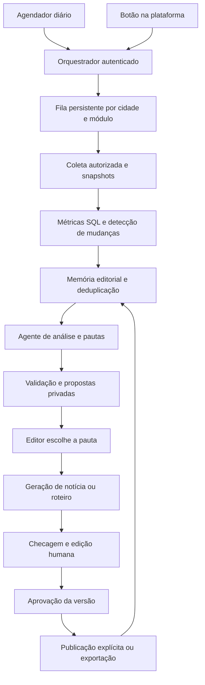

# Plano de IA jornalística e produção de conteúdo

**Plataforma:** Trombone Cidadão  
**Data:** 06/11/2026  
**Situação:** proposta de produto e arquitetura; não representa funcionalidades já implementadas.  
**Abrangência:** obras, broncas, ruas e arborização, com notícias e roteiros de vídeos.

**Atualização de desenvolvimento — 06/11/2026:** implementação local iniciada pelo piloto de obras. A Central Editorial, a migração 411 e a função de geração estão descritas no [guia de implantação e escopo entregue](IA_EDITORIAL_IMPLANTACAO.md). Este documento continua sendo o plano completo; funcionalidades de etapas posteriores não devem ser consideradas implementadas.

**Expansão — 06/11/2026:** a migração 412 acrescenta levantamentos agregados de broncas públicas, ruas, inventário arbóreo e perfis públicos da comunidade, além de filtros por assunto e análise diária geral. As instruções de geração e os vínculos da publicação agora respeitam cada tipo de fonte. Comparações históricas, busca semântica e apuração externa permanecem como evoluções planejadas.

**Estilos e roteiros — 06/11/2026:** a migração 413 acrescenta escolha de tom (informativo, conversado, leve, com humor ou crítico e construtivo), abordagem da notícia e orientação livre. Vídeos podem ter apresentação, narração ou diálogo entre apresentadores, com falas, cenas e texto na tela. As escolhas ficam vinculadas à versão e integram o cache, preservando a memória da pauta e a revisão dos fatos.

## 1. Proposta

Criar uma **Central Editorial** com um agente especializado em jornalismo local e comunicação de interesse público. Uma vez por dia, o sistema examina os dados da plataforma, identifica mudanças, compara com a cobertura anterior e organiza oportunidades de pauta. O editor também pode pedir propostas a qualquer momento, por módulo, cidade, bairro ou registro específico.

O agente deve responder a cinco perguntas:

1. O que aconteceu ou mudou?
2. Por que isso importa para a população?
3. Quais evidências sustentam a pauta e o que ainda precisa ser apurado?
4. Esse fato já foi proposto, trabalhado ou publicado?
5. Qual conteúdo faz sentido produzir agora?

O usuário escolhe a pauta, pede a notícia ou o roteiro, adapta o texto e aprova a versão final. **Aprovar conteúdo e publicar são ações diferentes.** O processamento diário entrega análise e propostas; a produção completa acontece quando solicitada. A IA não publica sozinha na primeira versão.

**Regra central:** um fato já proposto ou coberto não volta à fila só porque o usuário clicou novamente ou porque passou mais um dia. Ele só justifica nova proposta quando surge uma mudança editorialmente relevante, uma correção necessária ou um marco de acompanhamento previamente definido.

## 2. Base encontrada no projeto

Esta análise foi feita no código e nas migrações locais. Não houve consulta ao banco remoto, confirmação de extensões instaladas ou uso das credenciais do ambiente.

| Recurso existente | Evidência local | Como aproveitar |
| --- | --- | --- |
| Aplicação React/Vite com Supabase | `package.json`, `supabase/functions/` | Manter a interface e o backend existentes. |
| Cadastro e edição de notícias | `src/pages/admin/ManageNewsPage.jsx` | Integrar a publicação final ao módulo atual. |
| Notícias relacionadas a obras, broncas e outras notícias | Migrações `065`, `070`, `071` e `072` | Preservar vínculos e criar encadeamento entre cobertura inicial e desdobramentos. |
| Obras, medições, pagamentos e mídias | `ManageWorksPage.jsx`; migração `357` | Produzir análises documentadas de execução, prazos e finanças. |
| Ruas e documentos históricos | `PavementStreetPage.jsx`; migração `197` | Trabalhar infraestrutura e memória local, com fontes. |
| Inventário, espécies e cuidados de árvores | Migrações `363`, `401` e `410` | Distinguir inventário municipal, árvores da comunidade, manejo e plantio planejado. |
| IA para espécies e histórico de ruas | `generate-tree-species-summary`, `generate-street-history` | Reaproveitar padrões de autenticação, cotas e integração com provedor. |
| Permissões por módulo e cidade | `src/lib/modulePermissions.js` | Acrescentar permissões editoriais explícitas no servidor. |
| Solicitações municipais internas | Migração `307`: `reports.is_public` | Excluir informações internas da geração editorial pública. |
| Agendamentos previstos em migrações | Migrações `206` e `222` | Verificar disponibilidade real antes de implantar o processamento diário. |

### Pontos que exigem atenção

- `src/components/AIReports.jsx` contém tendências, tempo médio e recomendações com valores fixos. Esses valores não podem alimentar o agente nem servir como dados reais. A evolução deve substituí-los por indicadores calculados ou indicar ausência de dados.
- O fluxo atual de salvar notícia escreve diretamente em `news`. O plano não pressupõe suporte existente a rascunho privado: propostas e textos de IA ficam em tabelas editoriais separadas até a publicação explícita.
- As migrações históricas dos vínculos de notícias incluem políticas permissivas. Revisar as políticas efetivas do ambiente e os caminhos de escrita antes de conectar a nova publicação; a autorização precisa valer no banco e na API.
- A configuração local distingue desenvolvimento e produção. A implantação deve confirmar o ambiente de destino e manter filas, segredos e dados editoriais separados.

## 3. Experiência do usuário

### 3.1 Central Editorial

Entrada no painel administrativo: **Editorial**.

Abas propostas: **Pautas**, **Conteúdos**, **Histórico** e **Configurações**.

Controles principais:

- Cidade, módulo, bairro, período e prioridade.
- **Analisar agora** para procurar oportunidades no recorte selecionado.
- **Gerar propostas** na página de uma obra, bronca, rua ou árvore.
- Última análise concluída, intervalo analisado e indicação de processamento parcial ou falha.

Cada proposta apresenta título curto, assunto, prioridade, novidade principal e ações. Fontes, justificativa detalhada, pontuação e lacunas ficam em **Ver análise**. Erros, fontes insuficientes e restrições de publicação aparecem junto à ação afetada.

Aplicar as regras do projeto: página com `.page-shell-fluid` ou gutters equivalentes; margens externas de até 64 px a partir de 1200 px; conferir 1440 px e 1920 px sem rolagem horizontal. Limitar apenas a coluna interna do editor de texto quando necessário. Evitar subtítulos e explicações permanentes em todos os cartões.

### 3.2 Fluxo de uma pauta

1. O usuário abre **Obras** e clica em **Gerar propostas**.
2. O backend verifica permissões, consulta alterações e procura pautas equivalentes.
3. O sistema retorna propostas novas e as já existentes que ainda estão abertas. Se nada mudou, informa **Sem novas pautas neste recorte** e oferece acesso às existentes.
4. O usuário escolhe uma proposta e assume a pauta. Os demais editores veem o responsável.
5. Seleciona **Notícia** ou **Roteiro**, define tamanho ou duração e solicita o texto.
6. Edita manualmente ou pede ajustes, como “mais objetivo”, “explicar o prazo” ou “roteiro de 60 segundos”.
7. Confere fontes, pendências e diferenças em relação à versão anterior.
8. Aprova a versão. O conteúdo fica pronto para publicação ou exportação.
9. Um usuário com permissão de publicação executa a ação final. Notificações são uma escolha explícita.

Pedidos de ajuste não podem introduzir fatos sem evidência. Se o editor acrescentar informação nova, deve anexar a fonte ou registrar a apuração correspondente.

### 3.3 Exemplo ilustrativo: obra com novo prazo

Os nomes e números deste exemplo são fictícios.

| Momento | Dados | Comportamento esperado |
| --- | --- | --- |
| Dia 1 | Documento cadastrado informa novo prazo para a Obra A | Sugerir pauta sobre a alteração do cronograma, citando o documento. |
| Mesmo dia | Outro editor clica no mesmo botão | Retornar a mesma pauta, com responsável e estado atual. |
| Dia 2 | Apenas correção de acento no título da obra | Não criar proposta nova. |
| Dia 5 | Editor pede roteiro sobre o prazo já noticiado | Criar adaptação vinculada à mesma cobertura; não cadastrar nova descoberta. |
| Dia 10 | Novo documento muda novamente a previsão | Criar desdobramento e mostrar o que mudou desde a última cobertura. |
| Dia 15 | Vence prazo documentado e não há confirmação de conclusão | Sugerir apuração do cumprimento do prazo; não afirmar paralisação por ausência de atualização. |

## 4. O que analisar em cada módulo

| Módulo | Sinais e comparações | Possíveis pautas | Cuidados de interpretação |
| --- | --- | --- | --- |
| Obras | Prazos documentados; mudança de situação; medições; valores contratuais; pagamentos; novas evidências | Mudança de cronograma, avanço documentado, entrega, prestação de contas, necessidade de esclarecimento | Pagamento não equivale a execução física. Cadastro desatualizado não prova obra parada. Alteração de contrato não prova irregularidade. |
| Broncas | Entradas, soluções, reaberturas, categorias, respostas oficiais, recorrência e concentração territorial | Problema recorrente, solução acompanhada, concentração de demandas, cobrança de resposta | Relato é alegação atribuída. Vários relatos podem se referir à mesma ocorrência. Crescimento de cadastros não prova crescimento do problema na cidade. |
| Ruas | Situação de pavimentação, vínculos com broncas e obras, mudanças de cadastro, documentos e histórico | Intervenção documentada, demandas de uma rua, memória local sustentada por fontes | Mudança no desenho do mapa não comprova intervenção física. Biografia gerada por IA não é fonte primária. |
| Arborização | Plantio realizado, locais planejados, manejo, espécies, solicitações vinculadas, adoções e sobrevivência quando acompanhada | Plantios confirmados, ações de manejo, espécies locais, participação comunitária | Planejado não é plantado; muda reservada ou entregue não comprova plantio. Cadastro ampliado não comprova aumento da cobertura vegetal. |

### Análises entre módulos

- Broncas de uma rua e uma intervenção relacionada: investigar a sequência dos fatos sem presumir que a mobilização causou a intervenção.
- Planejamento arbóreo e registros de plantio: mostrar cumprimento documentado, preservando a diferença entre previsto e realizado.
- Concentração de broncas e obras no mesmo bairro: apontar sobreposição; relação causal exige apuração.
- Problema encerrado e novos registros no mesmo trecho: sugerir investigação de recorrência, validando localização, categoria e período.

Vincular registros por identificadores, geometria e regras verificáveis. Sem vínculo confirmado, apresentar a associação como hipótese para apuração. Proximidade geográfica isolada não basta.

## 5. Como decidir o que merece pauta

### 5.1 Primeiro, elegibilidade

Antes de pontuar, verificar: dados acessíveis ao fluxo editorial público, cidade definida, fontes identificáveis, datas coerentes, ausência de duplicidade e condições mínimas de evidência. Um registro relevante mas incompleto pode virar **Apuração**, em vez de notícia pronta.

Dados internos não entram na seleção, no texto, nos anexos nem nos agregados publicados. Um usuário com acesso administrativo não ganha automaticamente autorização para enviar esses dados ao provedor ou torná-los públicos.

### 5.2 Pontuação explicável

Configuração inicial sugerida, a calibrar no piloto:

| Critério | Peso máximo | Evidência esperada |
| --- | --- | --- |
| Interesse público e impacto documentado | 25 | Serviço afetado, abrangência conhecida ou relevância coletiva. |
| Novidade em relação à cobertura | 25 | Fato novo, mudança material ou marco temporal ainda não coberto. |
| Urgência | 15 | Prazo ou condição documentada que exige atenção. |
| Força e atualidade das evidências | 20 | Registros rastreáveis, documentos e datas de referência. |
| Relevância territorial e recorrência | 10 | Distribuição e repetição verificadas, sem confundir duplicatas. |
| Utilidade prática | 5 | Informação que permite acompanhar, participar ou acessar serviço. |

Faixas iniciais: **75–100: prioridade alta**; **55–74: avaliar**; **abaixo de 55: acompanhar**. A pontuação ordena candidatos; não autoriza publicação. Evidência insuficiente continua bloqueando afirmações, qualquer que seja a pontuação.

Os componentes calculáveis vêm de regras do backend. A IA pode sugerir uma avaliação qualitativa com referências e justificar seu parecer, mas não inventar população atingida, risco técnico ou fonte. Guardar componentes, justificativa e versão da regra. A classificação de evidência é uma rubrica editorial, não uma probabilidade de veracidade fornecida pelo modelo.

### 5.3 Diversidade e abstenção

- Evitar que um único bairro, módulo ou assunto ocupe toda a fila; aplicar limite configurável por assunto e revisar cobertura territorial.
- Incluir soluções, entregas e conteúdos de serviço, além de problemas e cobranças.
- Curtidas e engajamento entram como sinais secundários; não substituem interesse público.
- Aceitar dias sem novas propostas. Não preencher uma quantidade mínima com notícias fracas.
- Sinal potencialmente urgente pode entrar como prioridade de apuração mesmo com baixo volume de registros. O agente editorial não substitui atendimento emergencial.

## 6. Memória editorial e prevenção de repetição

### 6.1 Três identidades diferentes

**Assunto:** a entidade ou conjunto acompanhado, como uma obra ou ocorrências de uma categoria em uma rua.

**Fato e ângulo:** o acontecimento específico e a pergunta editorial, como alteração de prazo, início de execução, solução de uma bronca ou balanço mensal.

**Conteúdo:** a forma de apresentar esse fato, como notícia, roteiro curto ou roteiro longo. Mudar formato ou título não transforma o mesmo fato em uma nova pauta.

Guardar essa memória de forma compartilhada pela equipe da cidade. Preferências individuais não devem permitir duplicar pautas entre editores.

### 6.2 Identificação e comparação

1. Construir uma chave de assunto com `city_id`, tipo, IDs canônicos e recorte territorial quando houver agrupamento.
2. Representar o fato por tipo de evento, fontes e datas efetivas. Representar o ângulo por código controlado. Identificadores de assunto e pauta são estáveis, mesmo quando a composição de um agrupamento evolui.
3. Produzir um snapshot normalizado e um `facts_hash` dos campos relevantes, com serialização estável, arrays ordenados, datas e valores normalizados. Não usar o hash da linha inteira.
4. Comparar com o último snapshot analisado para evitar processamento desnecessário e com os fatos já cobertos para medir a novidade acumulada.
5. Verificar equivalência editorial entre pautas de diferentes módulos. Uma obra e uma bronca vinculada podem relatar o mesmo acontecimento.
6. Persistir a decisão de criar, atualizar, suprimir ou encaminhar para apuração, com motivo auditável.

Busca semântica pode complementar a comparação de pautas e notícias sem vínculos estruturados. Ela não substitui chaves, regras e restrições de unicidade. Não é necessário começar com banco vetorial: identificadores, eventos e busca textual cobrem o primeiro piloto.

### 6.3 Mudança de dados versus novidade jornalística

| Alteração | Atualizar análise? | Nova pauta? |
| --- | --- | --- |
| Acento, ordem de fotos ou atualização técnica de timestamp | Quando afetar apresentação | Não. |
| Nova fonte que apenas confirma o mesmo fato | Sim | Normalmente não; anexar à pauta existente. |
| Prazo, situação ou valor relevante alterado com evidência | Sim | Pode gerar desdobramento após verificar materialidade. |
| Pequenas alterações acumuladas | Sim | Avaliar o acumulado desde a última cobertura, não só desde ontem. |
| Novo mês com balanço comparável | Sim | Pode gerar novo balanço, com período explícito e ganho informativo. |
| Prazo vencido sem confirmação de resultado | Sim, mesmo sem mudança de linha | Pauta de acompanhamento/apuração, sem afirmar resultado desconhecido. |
| Informação anterior corrigida ou fonte retirada | Sim | Revisão/correção prioritária, vinculada à publicação afetada. |

Os limiares de materialidade variam por tipo de evento. Mudança documentada de situação pode ser relevante imediatamente; pequenas oscilações de contagem exigem base e contexto. Os parâmetros ficam versionados e visíveis à equipe. Um novo `facts_hash` é condição de reavaliação, não autorização automática para produzir nova pauta.

### 6.4 Estados e memória de decisões

| Estado da pauta | Comportamento |
| --- | --- |
| Proposta | Reapresentar o mesmo registro quando solicitado; não criar outro. |
| Em produção | Preservar responsável, versões e avisar sobre novos dados. |
| Em revisão | Alteração de fatos relevantes exige revalidação do texto. |
| Aprovada | Mesmos fatos continuam cobertos; edição de conteúdo invalida a aprovação. |
| Publicada/exportada | Registrar fatos efetivamente utilizados e destino da versão. |
| Adiada | Manter fora da fila principal até a data ou evento indicado. |
| Descartada | Registrar motivo e não repetir a mesma proposta com os mesmos fatos. |
| Arquivada | Preservar histórico e cobertura; arquivamento não zera a memória. |

“Falta de dados” permite reavaliar quando chegar a evidência ausente. “Já coberto” vincula à cobertura anterior. “Fora da linha editorial” pode criar bloqueio de assunto, aplicado por editor autorizado. Mudança relevante não ultrapassa automaticamente um bloqueio editorial explícito.

Gerar uma proposta já registra que ela foi apresentada, mesmo antes da aceitação. Aprovar reserva os fatos selecionados na cobertura planejada. Publicar/exportar registra a cobertura realizada. Cancelar um conteúdo não apaga decisões; a retomada ocorre na mesma pauta, por ação explícita.

Não marcar todos os dados de uma entidade como cobertos quando uma notícia só utilizou parte deles. Registrar os fatos efetivamente incluídos. Isso permite outro ângulo legítimo sem repetir a notícia anterior.

### 6.5 Mudanças durante a produção

Se surgir novidade antes da publicação, atualizar a pauta existente e mostrar a diferença ao editor; não sobrescrever texto humano. Depois de publicada, avaliar desdobramento vinculado. Se houver contradição, abrir revisão/correção mesmo que a pontuação de relevância seja baixa.

Antes da aprovação e da publicação, conferir a versão das fontes, a visibilidade e o hash do conteúdo. Se a base estiver desatualizada, solicitar revisão. A aprovação se refere à combinação exata de texto e evidências, nunca a um registro mutável sem versão.

## 7. Rotina diária e solicitações sob demanda

### 7.1 Rotina diária

Horário inicial sugerido: **06h, America/Fortaleza**, configurável. Na configuração UTC correspondente atual, isso equivale a `0 9 * * *`. Guardar a preferência de fuso e evitar assumir que toda cidade usará o mesmo horário.

1. Criar uma execução por cidade e data local, com chave única e limite de custo.
2. Fixar o limite superior da coleta e ler mudanças desde o último ponto concluído, com pequena sobreposição para capturas tardias.
3. Reavaliar também prazos vencidos, pautas adiadas e acompanhamentos programados. Eles podem mudar de relevância sem atualização do registro original.
4. Calcular indicadores em SQL e reunir snapshots sanitizados.
5. Agrupar sinais, comparar com a memória e eliminar duplicações.
6. Encaminhar somente candidatos elegíveis ao agente para avaliação editorial.
7. Validar o resultado e persistir propostas ou razões de não propor.
8. Atualizar o resumo da Central Editorial. Não enviar conteúdo a canais externos nesta etapa.

A análise inicial cria uma linha de base; não trata todo cadastro antigo como novidade. Pode oferecer uma seleção histórica separada e identificada. Importar notícias e decisões anteriores para a memória antes de ativar a recorrência; quando não for possível determinar os fatos já cobertos, pedir curadoria e marcar a cobertura como incerta.

### 7.2 Sob demanda

Usar a mesma lógica, memória e autorização da rotina diária. O botão verifica alterações recentes, inclusive posteriores à análise diária. Se a base e as regras não mudaram, reaproveitar o resultado persistido.

Separar **Analisar agora**, **Gerar conteúdo** e **Reescrever versão**. A primeira procura fatos novos; a segunda usa uma pauta escolhida; a terceira trabalha no conteúdo existente. Reescrever não cria nova pauta nem consome novamente a novidade editorial.

### 7.3 Confiabilidade

- Fila persistente e processamento em lotes pequenos; a página recebe um identificador e acompanha o estado.
- Agendador dedicado no servidor: a rotina não depende de alguém abrir o aplicativo.
- Checkpoint por cidade/módulo/lote. Só avançar o ponto de coleta após persistir os resultados correspondentes; uma falha não pode omitir dados no dia seguinte.
- Restrição única por execução lógica e por proposta equivalente. Locks/leases evitam disputa entre botão e agendador.
- Entrega de fila pode ocasionar nova tentativa. Todos os efeitos no banco e a publicação devem ser idempotentes; não presumir processamento completo exatamente uma vez.
- Retentativas limitadas com espera progressiva para falhas transitórias; falhas definitivas ficam visíveis para reprocessamento. Se o provedor respondeu e a gravação falhou, pode haver cobrança repetida: registrar tentativas e limitar esse risco.
- Exclusões e mudanças de visibilidade entram como eventos de invalidação; não depender somente de `updated_at`. Reconciliar periodicamente os dados para detectar eventos perdidos.
- Se um módulo falhar, indicar execução parcial; não apresentar “nenhuma pauta” como se toda a análise tivesse concluído.

## 8. Arquitetura recomendada

### 8.1 Backend

Manter Supabase/Postgres e Edge Functions. A documentação oficial descreve agendamentos com `pg_cron` e `pg_net`, com segredos no Vault; a implantação deve verificar a disponibilidade no ambiente. [Agendamento de Edge Functions](https://supabase.com/docs/guides/functions/schedule-functions).

Usar Supabase Queues/`pgmq` se disponível. Se não estiver habilitado, uma tabela transacional de jobs com lease, tentativas e recuperação é uma alternativa inicial. A escolha da fila não muda as regras de idempotência do produto. [Supabase Queues](https://supabase.com/docs/guides/queues).

Dividir coleta, análise e redação em tarefas curtas. Os limites de duração e CPU das Edge Functions precisam orientar o tamanho dos lotes; não concentrar a cidade inteira em uma única requisição longa. [Limites de Edge Functions](https://supabase.com/docs/guides/functions/limits).

### 8.2 Provedor de IA

Começar avaliando o provedor Gemini já integrado no projeto, com configuração própria para o editorial. Essa recomendação reduz o trabalho de integração; **não pressupõe que o modelo hoje usado para resumos de espécies seja suficiente para jornalismo**.

Criar uma interface interna de provedor, com operações `analyzeCandidates`, `draftContent` e `reviewContent`. Escolher modelo de análise e redação após comparar qualidade em português, fidelidade às fontes, resposta estruturada, latência e custo com os mesmos casos de teste. Permitir substituição sem migrar a memória editorial.

Não há necessidade inicial de fine-tuning. A especialização vem de política editorial, dados recuperados, ferramentas limitadas, exemplos e avaliação. Conversas do provedor não são o armazenamento oficial da memória.

Antes de habilitar envio de dados, confirmar as condições vigentes de retenção, uso de conteúdo e tratamento de dados do provedor/plano escolhido. Registrar essa decisão na configuração de implantação.

### 8.3 Etapas especializadas do agente

| Etapa | Responsabilidade | Limite |
| --- | --- | --- |
| Analista | Interpretar métricas já calculadas, detectar perguntas relevantes e apontar lacunas | Não inventar estatísticas nem executar SQL livre. |
| Editor de pautas | Avaliar interesse público, novidade e equilíbrio de cobertura | Não decidir sozinho o que será publicado. |
| Redator/produtor | Escrever notícia ou roteiro a partir da pauta e evidências selecionadas | Não acrescentar acontecimentos, falas ou imagens inexistentes. |
| Revisor | Apontar afirmações sem fonte, contradições e linguagem inadequada | Sua revisão não substitui validações determinísticas nem aprovação humana. |

Essas são etapas de uma execução controlada, não a exigência de quatro agentes autônomos. Uma primeira versão pode executá-las sequencialmente. A segunda passagem de IA reduz alguns erros, mas não comprova veracidade.

Ferramentas permitidas: consultar fatos sanitizados do recorte autorizado, recuperar cobertura anterior, consultar diferenças e propor conteúdo estruturado. O modelo não recebe credencial de banco, SQL arbitrário, ferramenta de publicação ou envio de mensagens.

## 9. Modelo de dados proposto

Os nomes abaixo são novos e indicativos; validar tipos e convenções antes de escrever as migrações.

| Tabela | Conteúdo principal |
| --- | --- |
| `editorial_settings` | Cidade, fuso, horário, módulos ativos, limites, limiares e versões de política. |
| `editorial_runs` | Gatilho, recorte, período, checkpoints, estado, métricas de execução e gasto. |
| `editorial_jobs` | Execução, etapa, chave idempotente, tentativas e lease; usar quando necessário como controle da fila. |
| `editorial_source_events` | Alterações, exclusões e invalidações de fontes, com referência e versão. |
| `editorial_snapshots` | Evidências sanitizadas, datas de referência e captura, hash e versão do extrator. |
| `editorial_topics` | Identidade estável do assunto, cidade, entidades e vínculos entre módulos. |
| `editorial_candidates` | Pauta, ângulo, novidade, prioridade, lacunas, decisão, responsável e estado. |
| `editorial_candidate_sources` | Fontes e fatos selecionados para a pauta, incluindo caminho do campo e versão. |
| `editorial_contents` | Peça de conteúdo, formato, pauta de origem, versão atual e estado. |
| `editorial_content_versions` | Texto/roteiro imutável por versão, alterações humanas, modelo/prompt e hash. |
| `editorial_claims` | Afirmação, referências às evidências, situação de verificação e posição no conteúdo. |
| `editorial_coverage` | Fatos propostos, reservados e efetivamente cobertos; versão publicada, destino e `news_id` quando aplicável. |
| `editorial_decisions` | Aprovação, descarte, adiamento, correção e reabertura, com autor, motivo e versão. |
| `editorial_publications` | Chave idempotente, conteúdo/versão, destino, resultado e referência pública. |
| `editorial_usage` | Tokens/uso informado pelo provedor, custo estimado, custo confirmado quando disponível e tentativa. |

Regras de integridade:

- `city_id` obrigatório nos dados editoriais; referências entre cidades devem ser impedidas por constraints/RPCs, além de RLS.
- Constraints únicas para execução diária lógica, fatos equivalentes dentro do assunto/ângulo e versão publicada por destino.
- Eventos equivalentes vindos de módulos diferentes devem apontar ao mesmo fato canônico. Pautas temáticas sobrepostas passam também por comparação editorial.
- Índices por cidade, estado, prioridade, assunto e datas. Hashes e referências de fontes precisam ser consultáveis sem varrer textos completos.
- Edições usam controle de versão otimista; uma gravação não sobrescreve silenciosamente o trabalho de outro editor.
- Vínculos públicos existentes com obras e broncas são reaproveitados. Criar vínculos equivalentes com ruas e árvores se a experiência pública precisar deles; snapshots editoriais não devem ser expostos como substitutos.
- Dados de geração e rascunhos permanecem privados, inclusive em URLs de mídia e anexos.

### Contratos de API sugeridos

| Operação | Entrada mínima | Resultado |
| --- | --- | --- |
| `editorial-analyze` | Cidade, módulo/entidade, recorte e chave idempotente | Execução nova ou já existente. |
| `editorial-generate` | Pauta, formato, parâmetros e versão dos fatos | Conteúdo/versionamento ou job de produção. |
| `editorial-revise` | Conteúdo, versão-base e pedido de ajuste | Nova versão; conflito se a base mudou. |
| `editorial-decide` | Pauta/conteúdo, versão e decisão | Transição autorizada e auditada. |
| `editorial-publish` | Versão aprovada, destino, notificações e chave idempotente | Publicação existente ou resultado da nova publicação. |

Todas as operações autenticam o usuário e autorizam cidade, módulo e ação no servidor. Recortes vindos do navegador são solicitações, não provas de permissão. O agendador usa identidade técnica separada e validação própria, sem endpoint de execução pública.

## 10. Dados, métricas e fontes

### 10.1 Cálculos verificáveis

Calcular contagens, percentuais, medianas, séries e diferenças no banco. Entregar ao modelo valor, unidade, universo, período, filtros, fonte e data da atualização. Para cada indicador, definir sua fórmula antes do uso editorial.

Exemplos:

- “Broncas abertas no período” e “broncas resolvidas no período” são medidas diferentes. Não dividir uma pela outra e chamar de taxa de resolução sem definir a coorte.
- Medir tempo de resolução somente quando houver datas confiáveis de abertura e resolução; declarar exclusões e quantidade de casos válidos. Preferir mediana e distribuição quando a média esconder extremos.
- Comparar períodos de mesma duração e critérios. Base anterior zero produz diferença absoluta; não produzir percentual infinito.
- Diferenciar registros duplicados de ocorrências distintas e declarar se a deduplicação foi possível.
- Somar pagamentos preservando estornos e revisões; manter separado valor contratado, empenhado, liquidado e pago quando essas grandezas existirem.
- Diferenciar contagem de árvores cadastradas de árvores comprovadamente existentes/plantadas. Não estimar cobertura de copa com contagem de cadastros.

Recortes pequenos, cobertura incompleta e mudanças na forma de cadastramento precisam acompanhar a interpretação. Sem denominador válido, não afirmar que um bairro tem o “pior serviço” só porque possui mais registros.

### 10.2 Proveniência por afirmação

Cada afirmação factual deve apontar para uma ou mais evidências com identificador, campo/documento, trecho aplicável, data do fato e data da coleta. A interface permite abrir a origem. Guardar cópia sanitizada do que sustentou a versão, sujeita à política de retenção e retirada.

Classificar a origem: registro administrativo, relato cidadão, documento oficial, notícia anterior ou apuração adicionada pelo editor. Não promover automaticamente relato a fato comprovado. Uma notícia anterior da própria IA pode orientar contexto e memória, mas não vira confirmação independente.

Validar referências, datas e números automaticamente. Afirmações sem sustentação ficam bloqueadas ou são removidas. Mudanças manuais no texto também passam por essa conferência antes da aprovação. O editor pode documentar uma apuração própria, com identificação e registro de fonte; um simples botão de ignorar não deve dispensar a evidência.

### 10.3 Uso de fontes externas

Na primeira versão, trabalhar com os dados da plataforma e documentos já vinculados. Pesquisa na web fica para evolução posterior, com fontes permitidas, registro de consulta e revisão do material recuperado. Não depender da memória do modelo para biografias, legislação, datas históricas ou falas.

Documentos e páginas externas são dados não confiáveis: limitar tamanho, validar tipo de arquivo e restringir destinos de download para impedir acesso a endereços internos. Tratar instruções contidas nesses materiais como conteúdo, nunca como comando ao agente.

## 11. Conteúdos produzidos

### 11.1 Proposta de pauta

Campos: título, cidade, módulo, entidades relacionadas, fato novo, ângulo, interesse público, justificativa da prioridade, fontes, lacunas, formato sugerido e ligação com cobertura anterior.

Adicionar uma classificação: **Pronta para redigir**, **Exige apuração** ou **Acompanhar**. “Exige apuração” pode gerar perguntas, roteiro de entrevista e pedido de esclarecimentos para o editor, sem enviá-los automaticamente.

### 11.2 Notícia

Entregar título, abertura, corpo, contexto essencial, fontes e pendências. Subtítulo e chamada para redes são opcionais. A notícia deve:

- Explicitar datas de referência e atribuir relatos ou posicionamentos.
- Diferenciar previsão, anúncio, execução e entrega.
- Não inventar entrevistas, citações, causa de problema, responsáveis por culpa ou resultado de vistoria.
- Evitar linguagem acusatória ou promocional sem base; alegações sensíveis exigem apuração e revisão reforçada.
- Não afirmar que um órgão foi procurado ou deixou de responder sem registro da tentativa e do prazo.
- Registrar a assistência de IA e a revisão editorial de forma padronizada, com responsável humano.

### 11.3 Roteiro de vídeo

Presets iniciais: **30 segundos**, **60 segundos** e **2–3 minutos**. A duração é uma estimativa a conferir na leitura, não uma garantia do modelo.

Estrutura: objetivo, abertura, blocos com tempo estimado, locução, texto na tela, imagem sugerida, fonte de cada afirmação e encerramento. Distinguir mídia disponível de imagem a captar. Informar data e local de arquivos antigos para evitar apresentá-los como imagens atuais.

Quando faltar imagem, indicar captação ou uso de mapa/gráfico baseado nos dados. Não fabricar cena documental. O primeiro escopo gera roteiro e lista de materiais, sem renderizar vídeo, sintetizar voz ou publicar em redes sociais.

### 11.4 Adaptações

A partir da mesma pauta e fatos aprovados, permitir resumo, legenda e novo formato de roteiro. Cada adaptação recebe versão e aprovação próprias, preserva as fontes e aponta para a cobertura de origem. Exportar não significa que houve publicação externa: registrar isso apenas quando confirmado pelo editor ou por integração futura.

## 12. Publicação e permissões

Permissões propostas, a integrar ao sistema atual:

- `editorial.view`: consultar análise e pautas da cidade.
- `editorial.analyze`: solicitar processamento dentro das cotas.
- `editorial.write`: assumir pauta, produzir e editar conteúdo.
- `editorial.approve`: aprovar uma versão após a revisão.
- `editorial.publish`: publicar ou retirar conteúdo do canal administrado.
- `editorial.configure`: alterar orçamento, política e agendamentos.

Não herdar publicação apenas de uma permissão municipal para editar obras ou árvores. Atribuições editoriais são independentes e limitadas por cidade. A política deve definir se uma mesma pessoa pode escrever, aprovar e publicar; para casos sensíveis, exigir outro revisor.

O fluxo de publicação deve revalidar permissão, versão aprovada, fontes públicas e estado da pauta. Em uma transação de banco, gravar `news`, vínculos aplicáveis, referência editorial e registro idempotente de publicação. Se alguma etapa obrigatória falhar, não deixar notícia parcialmente vinculada.

Notificações entram em uma outbox persistente após a confirmação da transação e só quando solicitadas. O processamento da outbox tem sua própria deduplicação; retentativa não publica outra notícia nem envia repetidamente a mesma notificação.

Notícias manuais e importadas também alimentam a memória editorial. Adotar curadoria inicial e processamento de novos itens para reduzir propostas sobre fatos já publicados fora do fluxo de IA. Preservar origem e autoria, sem reescrever material de terceiros como se fosse apuração própria.

## 13. Proteção de dados e segredos

- Credenciais do Supabase com privilégio elevado e chaves do provedor ficam somente no servidor/Vault/Secrets. Nunca usar prefixo `VITE_` para segredos nem incluí-los em prompts, exemplos ou logs.
- A seleção editorial usa lista explícita de campos e regras de visibilidade. Uma conexão de serviço que ignora RLS precisa aplicar essas regras no backend; não basta confiar no privilégio da conexão.
- Não enviar contatos privados, documentos pessoais, identidade de denunciantes anônimos, dados internos de atendimento ou campos de acesso restrito. Dados pessoais presentes em texto livre e mídia também exigem tratamento.
- Para conteúdo público, preferir bairro/rua e agregação quando o endereço exato expuser a residência de um cidadão sem necessidade editorial. Examinar rostos, placas e outros identificadores antes de usar mídias.
- Registrar acessos e decisões sem copiar segredos ou todo o texto bruto nos logs. Respostas do modelo passam por validação estrutural e sanitização de HTML antes de chegar ao editor público.
- Definir retenção de snapshots, prompts, respostas, conteúdo e auditoria antes da produção. Sugestão inicial: 90 dias para artefatos operacionais não publicados, com revisão conforme necessidade; preservar evidências necessárias à cobertura publicada pelo prazo aprovado na política editorial.
- Se uma fonte for excluída ou ficar privada, invalidar derivados, bloquear novas publicações e abrir revisão dos conteúdos já públicos. Retirar cópias e embeddings quando aplicável; preservar somente o registro mínimo de auditoria permitido pela política.

**Providência específica deste planejamento:** uma credencial `SUPABASE_SERVICE_ROLE_KEY` foi incluída no contexto compartilhado. Tratá-la como exposta e providenciar sua rotação, com atualização dos serviços dependentes. Nenhum valor de credencial foi reproduzido neste documento e nenhuma rotação foi executada nesta tarefa.

## 14. Custos e controles de consumo

Evitar enviar toda a base à IA diariamente. A maior parte do trabalho deve ser seleção incremental, indicadores SQL e comparação com memória. Gerar textos completos somente a pedido.

Controles mínimos:

- Teto diário e mensal por cidade/projeto, mais limite por usuário para ações manuais.
- Limites de candidatos, evidências, tamanho do contexto e saída por etapa.
- Reserva atômica de orçamento antes da chamada, incluindo retentativas, seguida de reconciliação do uso.
- Cache por fatos, configuração e versão de política. Alterar o modelo não apaga a memória nem recria pautas automaticamente.
- Ao atingir o teto, manter o que já foi produzido e pausar novas chamadas com estado visível. Não usar respostas fictícias como fallback.
- Monitorar chamadas, tokens, tentativas, custo por pauta aceita e custo por conteúdo aprovado.

Estimativa de custo mensal:

`custo = soma(tokens_entrada × tarifa_entrada + tokens_saída × tarifa_saída) + recursos adicionais do provedor + infraestrutura`

As tarifas devem usar a mesma unidade dos tokens, por exemplo preço por milhão. Separar análise, redação, revisão e retentativas. O número de cidades e candidatos altera o custo mais que a simples quantidade de registros cadastrados quando a seleção incremental está bem implementada.

Exemplo de dimensionamento, sem compromisso de preço: uma cidade com 20 candidatos por dia, analisados em lotes de até 5, teria cerca de 120 chamadas mensais de avaliação em 30 dias; 30 conteúdos com uma chamada de redação e uma de revisão acrescentariam 60 chamadas. O total de tokens de cada chamada ainda precisa ser medido. Fazer um piloto de 7–14 dias antes de fixar orçamento em reais.

## 15. Implantação por etapas

### Etapa 0 — Preparação e linha de base

Entregas: inventário do schema efetivo, regras de visibilidade, glossário de indicadores, política editorial inicial, permissões, comparação de modelos, orçamento de piloto e memória das notícias existentes. Tratar credenciais expostas antes de habilitar o novo serviço.

Aceite: fontes e fórmulas conhecidas; distinção entre fatos reais e indicadores simulados; conjunto inicial de casos revisado por responsável editorial. Sem esta base, não ativar geração diária para produção.

### Etapa 1 — Piloto completo em obras

Entregas: análise manual de uma cidade, detecção de mudanças, memória persistente, propostas, responsável, descarte/adiamento, notícia, roteiro e versões privadas. Aprovação e publicação explícita pelo fluxo seguro.

Aceite: repetir o botão não duplica pauta; fato novo reabre análise; editor adapta e aprova; publicação ocorre uma única vez; fontes e vínculos permanecem acessíveis.

### Etapa 2 — Análise diária e quatro módulos

Entregas: fila, agendador, checkpoints, cotas, observabilidade e adaptadores de broncas, ruas e arborização. Métricas reais substituem os valores simulados no fluxo de relatórios que for integrado à Central Editorial.

Aceite: análise diária independente do navegador, falhas recuperáveis, exclusão de dados internos, estados de plantio corretos e mesma memória compartilhada entre execução diária e manual.

### Etapa 3 — Cobertura entre módulos e acompanhamento

Entregas: agrupamento de ocorrências, fatos canônicos entre módulos, balanços por período, marcos temporais, correções e ligação entre notícias de acompanhamento. Busca semântica entra somente se o piloto demonstrar lacunas nas regras estruturadas.

Aceite: ausência de repetição por troca de módulo/título, novidade acumulada identificada e acompanhamento sem afirmações causais indevidas.

### Etapa 4 — Evoluções opcionais

Pesquisa externa controlada, apuração assistida, calendário editorial, adaptação por canal e integrações de distribuição. Geração audiovisual e publicação externa exigem escopo próprio, controle de direitos de mídia, custos e autorização de canal.

Não é possível estimar prazo fechado de implantação sem validar o schema remoto, o volume das cidades e a capacidade da equipe. As etapas acima são unidades de entrega e validação, não compromissos de calendário.

## 16. Validação e critérios de aceite

Manter um conjunto de avaliação versionado, começando com pelo menos 40 situações revisadas por humano, distribuídas entre módulos, casos sem novidade e casos sensíveis. Não avaliar a qualidade somente com outro modelo.

| Cenário | Resultado exigido |
| --- | --- |
| Mesmos dados, botão clicado várias vezes e em dias diferentes | Mesma pauta ou estado sem novidade; nenhuma duplicação. |
| Botão e agendador executados juntos | Uma proposta lógica e responsáveis preservados. |
| Nova fonte sem fato novo | Evidência anexada; não gerar outra notícia automaticamente. |
| Pequenas mudanças cujo acumulado é relevante | Comparação com a cobertura anterior detecta o avanço. |
| Pauta descartada/adiada ou assunto bloqueado | Respeitar motivo, prazo e política de reabertura. |
| Mesmo fato visto em obra, rua e bronca | Consolidar ou vincular, sem propostas equivalentes. |
| Nova informação enquanto o editor escreve | Avisar e preservar edição; revalidar antes de aprovar. |
| Versão aprovada alterada manualmente | Aprovação invalidada; nova revisão necessária. |
| Falha após publicação, antes da resposta ao cliente | Retentativa retorna a publicação existente. |
| Falha em vínculo obrigatório de notícia | Nenhuma publicação parcial. |
| Fonte retirada ou alterada para privada | Bloquear derivados e encaminhar publicação existente à revisão. |
| Registro interno ou usuário de outra cidade | Nenhum dado ou derivado acessível/encaminhado ao provedor. |
| Mês com mais cadastros e cobertura territorial incompleta | Descrever dados registrados, sem concluir piora geral do serviço. |
| Planejamento de plantio ou entrega de muda | Não contar como árvore efetivamente plantada. |
| PDF com instrução maliciosa | Tratar como texto da fonte, sem executar instruções. |
| Modelo inventa número, fala ou referência | Validação bloqueia aprovação/publicação. |
| Nenhuma pauta relevante | Resultado vazio explicável, sem produção forçada. |
| Provedor indisponível ou limite de custo atingido | Estado visível, retentativa controlada e nenhum conteúdo fictício. |

Metas iniciais do piloto:

- Zero vazamento conhecido de dados internos nos testes e zero publicação sem ação autorizada.
- Todas as afirmações factuais publicadas com evidência identificada e aprovação humana registrada.
- Zero duplicação nos cenários determinísticos de concorrência e retentativa.
- Pelo menos 80% das propostas do conjunto de avaliação consideradas pertinentes pelo editor; medir separadamente fatos relevantes perdidos.
- Registrar motivos de descarte, tempo de revisão, correções pós-publicação e distribuição por cidade/bairro/módulo.
- Ajustar relevância, custo e latência com observação real; aprovação de pautas isoladamente não comprova qualidade jornalística.

## 17. Decisões recomendadas para começar

| Tema | Padrão proposto |
| --- | --- |
| Público inicial | Equipe editorial autorizada, com permissões por cidade. |
| Automação | Análise e propostas diárias; conteúdo completo sob demanda. |
| Publicação | Explícita, após revisão e aprovação de versão. |
| Primeiro piloto | Obras em uma cidade, com notícia e roteiro. |
| Provedor | Avaliar primeiro a integração Gemini existente, com modelo escolhido por teste. |
| Memória | Persistente no Postgres e compartilhada pela equipe. |
| Repetição | Bloqueada por fato/ângulo e cobertura; mudanças relevantes geram atualização ou desdobramento. |
| Dados privados | Excluídos do fluxo editorial público desde a coleta. |
| Fontes externas | Fora do primeiro escopo, salvo documentos já vinculados e tratados com segurança. |
| Treinamento de modelo | Não necessário no início. |

Antes da implementação, confirmar responsáveis editoriais, cidade piloto, orçamento, horário diário e condições do provedor. Na ausência de preferência, os padrões deste documento orientam o desenho; nenhum agendamento, serviço de IA ou publicação foi ativado por este planejamento.
