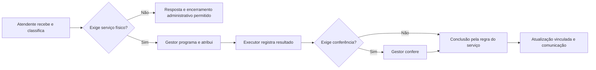

# Plano de implementação — painel municipal por responsabilidades

**Data:** 21/10/2026; atualização da execução em 22/10/2026.

**Estado:** implementação local em validação; aplicação das migrações novas e homologação das contas reais pendentes.  
**Base:** revisão do código local e diagnósticos remotos somente de leitura em 21–22/10/2026. Nesta execução, o agente não alterou o banco remoto. A presença de funções das evoluções 377–380 foi consultada; a função de estatísticas dos executores estava ausente no último diagnóstico.
**Objetivo:** cada funcionário entender onde trabalha, o que deve fazer e quais decisões pode tomar, em um único ambiente municipal.

## 1. Resultado esperado e escopo

**Decisão de organização revisada:** a secretaria determina os tipos de solicitação, os mapas e os serviços pelos quais responde. O cadastro do funcionário informa a secretaria e o cargo; não repete a seleção de módulos. A autorização efetiva é a combinação **escopo da secretaria × ações do cargo × vínculo ativo**.

Exemplo: Agricultura pode receber Poda e cuidar do inventário de árvores. Seu gestor não recebe postes nem execução elétrica. Iluminação pode receber solicitações de lâmpada apagada, manter postes e habilitar eletricistas. Os nomes das secretarias não concedem acesso: o administrador configura essas áreas explicitamente.


Um painel municipal com contexto explícito de **prefeitura → secretaria → atividade**, navegação compartilhada e ações autorizadas por responsabilidade. O inventário de árvores, ruas e postes passa a fazer parte desse ambiente. Quem cuida exclusivamente do mapa entra diretamente no seu inventário e não recebe acesso ao atendimento interno.

A execução de campo conserva uma apresentação adequada ao celular e os recursos existentes de iluminação. Uma pessoa que acumule gestão, inventário ou execução consegue alternar atividades sem trocar de conta nem perder a prefeitura selecionada.

Este plano orienta a próxima implementação. Substitui as decisões de navegação separada e de leitura obrigatória do atendimento do [plano anterior de ruas e arborização](./PLANO_PAINEL_RUAS_E_ARBORIZACAO.md). As entregas e verificações registradas naquele documento permanecem como histórico. As autorizações independentes dos inventários, códigos AR, mapas públicos e cadastros existentes serão reaproveitados.

Não faz parte desta etapa redesenhar a experiência do cidadão, substituir o banco de inventários, recriar ordens de iluminação ou alterar permissões globais de admin/master.

## 2. Diagnóstico que orienta a mudança

| Ponto atual | Evidência local | Mudança necessária |
| --- | --- | --- |
| Arborização/ruas possuem outra moldura de painel e um atalho para atendimento | `TerritorialPanelPage.jsx` e `MunicipalityLayout.jsx` | Incorporar os conteúdos ao mesmo layout e contexto institucional. |
| Gestor e atendente/técnico compartilham operações amplas | `canOperateAgency`, `editableChannelIds`, RPCs de casos e ordens | Autorizar cada ação; separar comunicação, programação e execução. |
| Só há um `papel` por vínculo de secretaria | `orgao_membros` | Representar atendimento e execução de forma independente, mantendo as concessões de inventário. |
| Uma conta de inventário recebe leitura de atendimento para se encaixar no vínculo | Convite e plano anteriores | Criar a opção real de nenhum acesso interno ao atendimento. |
| Eletricista exclusivo é inferido pela ausência de gestão/operação | `useMunicipalityWorkspace.js` e guards do layout | Resolver acesso por atividade; gestão acumulada não remove a execução. |
| Cadastro de postes pode ser editado por gestor de iluminação ou administrador municipal | `canEditLighting` e RPCs de iluminação | Conceder edição técnica do inventário explicitamente. |
| Cidade territorial e prefeitura são resolvidas por mecanismos diferentes | `CityContext`, `territorialAccess` e workspace municipal | Usar um contexto municipal compartilhado e conferir a cidade no servidor. |
| Há fluxos de resolução direta, por ordem e por execução do eletricista | Migrações 333, 339 e 366, entre outras | Definir qual operação atualiza cada registro e preservar as regras válidas. |

## 3. Matriz de responsabilidades de destino

As colunas representam responsabilidades acumuláveis, não novos tipos globais de conta. O administrador municipal continua em `prefeitura_membros`; admin/master da plataforma continuam separados.

| Ação | Administrador municipal | Gestor da secretaria | Atendente | Responsável pelo inventário | Executor de campo |
| --- | --- | --- | --- | --- | --- |
| Configurar secretarias e regras municipais | Sim | Não | Não | Não | Não |
| Convidar, suspender e conceder acessos | Sim, no município | Não nesta entrega | Não | Não | Não |
| Consultar atendimento interno | Município | Secretaria | Secretaria | Somente com concessão adicional | Serviços atribuídos e ofertas elegíveis |
| Receber, classificar e solicitar informações | Excepcional, auditado | Sim | Sim | Não | Não |
| Responder ao cidadão | Excepcional, auditado | Sim | Sim, sem declarar execução técnica | Não | Evidência técnica; comunicação segue a regra do serviço |
| Criar ordem de serviço | Excepcional, auditado | Sim | Preparar rascunho | Não | Não |
| Priorizar, programar e atribuir ordem | Excepcional, auditado | Sim | Não | Não | Não |
| Aceitar oferta/iniciar serviço | Com função de executor | Com função de executor | Com função de executor | Com função de executor | Sim, conforme especialidade |
| Registrar execução, fotos e impedimentos | Com função técnica correspondente | Com função técnica correspondente | Não | Cuidados avulsos autorizados, sem encerrar atendimento | Sim, no serviço autorizado |
| Conferir execução quando exigido | Excepcional, auditado | Sim | Não | Não | Não confere o próprio serviço |
| Cancelar, recusar tecnicamente ou reabrir serviço | Excepcional, com motivo | Sim, com motivo | Não | Não | Informa impedimento, sem cancelar a demanda |
| Encerrar atendimento sem serviço físico | Excepcional, auditado | Sim | Sim, somente motivo administrativo permitido e resposta registrada | Não | Não |
| Editar cadastro de árvore, rua ou poste | Com cargo correspondente na secretaria | Nos módulos da secretaria | Consulta, sem edição | Nos módulos da secretaria | Somente campos necessários à execução |
| Consultar indicadores | Município | Secretaria | Acompanhamento da sua fila | Cadastro do módulo | Próprios serviços |

Regras complementares:

- O administrador municipal configura o escopo das secretarias e os cargos. Não recebe escrita técnica de todos os mapas implicitamente; para atuar no inventário, também precisa de um cargo correspondente na secretaria.
- Intervenções administrativas não substituem a atribuição técnica do executor. Registrar autor real, motivo e contexto de toda intervenção.
- O atendente pode preparar uma ordem, mas somente o gestor a libera para programação/execução. O rascunho não aparece como oferta para equipes de campo.
- A triagem entre secretarias fica com o administrador municipal nesta entrega. Atendentes trabalham na secretaria concedida; encaminhamentos fora dela geram pedido de redistribuição. Uma central de atendimento municipal com escopo próprio fica para evolução posterior.
- Decisão atualizada em 22/10: toda secretaria com categorias vinculadas pode ter executores. O fluxo comum reaproveita ordens, aceite, evidências e conclusão por solicitação. Iluminação conserva a especialidade elétrica; Poda com mapa de árvores usa Arborização; Buracos com mapa de ruas usa Ruas; as demais combinações usam Serviços gerais. O servidor determina essa associação por IDs de categorias e módulos, sem inferir o nome da secretaria.
- Atendente e gestor podem consultar a posição dos ativos vinculados a um serviço sem receber poder de editar o inventário.
- Ser membro da secretaria não concede leitura de solicitações internas por si só.

## 4. Modelo de acesso proposto

### 4.1 Fontes de autoridade

A prefeitura mantém sua administração em `prefeitura_membros`. O vínculo de trabalho continua em `orgao_membros`. Cada secretaria possui:

| Configuração da secretaria | Fonte |
| --- | --- |
| Tipos de solicitação recebidos | `orgao_categorias`, preservando a unicidade por cidade/categoria |
| Mapas e cadastros sob responsabilidade | `orgao_canais.municipal_modules`: ruas, arborização e/ou iluminação |
| Serviços de campo habilitados | `orgao_canais.execution_specialties`; eletricista é a primeira especialidade implementada |
| Revisão concorrente do cadastro | `orgao_canais.access_version` |

No funcionário, `orgao_membro_acessos.cargos` registra apenas **gestor, atendente, responsável pelo inventário, executor e/ou somente leitura**. É possível acumular cargos sem escolher módulos individuais. As colunas de atendimento, execução e iluminação introduzidas anteriormente passam a ser valores derivados; os RPCs que permitiam escolhê-las individualmente são revogados.

- **Gestor:** administra solicitações, programação e inventários configurados na secretaria. Execução física exige também o cargo de executor.
- **Atendente:** recebe, responde e prepara rascunhos; consulta os mapas da secretaria sem editar.
- **Inventário:** opera os cadastros da secretaria sem receber leitura do atendimento.
- **Executor:** trabalha nos serviços de campo habilitados naquela secretaria. O formulário não oferece esse cargo quando não há execução disponível.
- **Leitura:** consulta solicitações e mapas da secretaria, sem escrita.

As concessões territoriais anteriores permanecem como histórico e compatibilidade para acessos legados da plataforma. Os novos vínculos municipais derivam o inventário diretamente da secretaria e do cargo; não exigem gravar uma concessão manual de árvores/ruas para cada funcionário. Bloqueios individuais explícitos continuam prevalecendo.

Salvar secretaria reúne dados institucionais, categorias, inventários e execução em uma transação. Alterar suas áreas recalcula o acesso dos funcionários vinculados. Salvar cargo também usa versão e auditoria. `orgao_membros.papel` permanece como apresentação do legado, sem se tornar autoridade alternativa.

### 4.2 Decisão efetiva no servidor

Criar helpers com contrato por **usuário autenticado, prefeitura/cidade, secretaria, ação e registro**, além de uma RPC de workspace que entregue somente contextos e ações efetivamente autorizados. Os nomes finais serão definidos na implementação.

Uma ação exige vínculo municipal e da secretaria ativos, prefeitura e secretaria ativas, área configurada na secretaria e cargo correspondente, além de categoria habilitada quando aplicável. Bloqueios individuais existentes continuam prevalecendo nas operações a que se aplicam. Ausência de configuração após ativação significa acesso negado, com orientação para regularização.

O servidor deriva a prefeitura do registro e verifica o canal de destino. Trocar IDs ou enviar uma secretaria autorizada para operar um registro de outra secretaria deve ser rejeitado.

Inventário legado de ruas sem vínculo institucional mantém seu contrato anterior até regularização explícita. Essas contas não ganham atendimento e não recebem vínculos fictícios para entrar no layout novo. Admin/master continuam na experiência da plataforma, com seus contratos atuais; não se tornam funcionários municipais automaticamente.

O frontend recebe capacidades como `canReceive`, `canReply`, `canDispatch`, `canExecute`, `canReview` e autorizações de inventário. Elas organizam menus e formulários; o servidor recalcula a permissão em cada operação. Não confiar em capacidades armazenadas no cliente, em texto de secretaria ou em parâmetros de usuário não validados.

### 4.3 Superfícies que precisam adotar a regra

- Leitura e alteração de casos, solicitações internas, ordens, vínculos e histórico.
- RPCs de listagem, contagem, busca, mapa, exportação e indicadores.
- Anexos privados, comprovantes, emissão de URLs e notificações; uma conta de inventário não pode consultar demandas por essas vias.
- Convites, aceite, edição de equipe, suspensão, reativação e redistribuição de secretaria.
- Escrita de postes, árvores, espécies, cuidados, ruas, bairros e anexos associados, preservando os limites de cada módulo.
- RPCs antigas com testes diretos de `gestor`/`operador`/`eletricista`, inclusive resolução direta e conclusão de serviços.

Leitura pública e cadastro cidadão autorizado continuam com seus contratos próprios. “Sem atendimento” bloqueia dados internos; não bloqueia o que já é público.

## 5. Navegação e experiência

### 5.1 Estrutura compartilhada

Usar `MunicipalityLayout` como base, extraindo uma moldura e um provider compartilhados. Reutilizar `PavementContent`, `ArborizationContent` e os conteúdos atuais de iluminação. O painel territorial deixa de montar outro cabeçalho, seletor de cidade e menu.

```text
Prefeitura de Floresta | Meio Ambiente | Atividade: Gestão

Início
Solicitações
Ordens de serviço
Mapa e inventário
  Arborização
Indicadores

Administração municipal   [somente administrador municipal]
  Secretarias
  Equipe e acessos
  Regras de atendimento
```

O seletor de atividade aparece apenas para funções acumuladas. Ele altera a apresentação e a página inicial; nunca concede permissões. Quem só cuida de árvores vê diretamente Arborização. Quem só executa vê Meus serviços, Disponíveis quando houver, Mapa de trabalho e Histórico.

Uma única carga de workspace deve alimentar cabeçalho, menu, guards e páginas. Trocar conta, prefeitura ou secretaria descarta dados incompatíveis, cancela requisições antigas e recalcula ações. Preferência local de contexto só é usada se ainda estiver autorizada. Erro de consulta não aparece como ausência de registros.

### 5.2 URLs e entrada

- Manter `/prefeitura/visao-geral`, `/prefeitura/broncas`, `/prefeitura/demandas` e as URLs de iluminação e eletricista.
- Manter `/prefeitura/gestao-territorial/...` inicialmente como URL compatível, renderizada dentro da estrutura comum. Não é necessário renomear todas as rotas para unificar a experiência.
- Resolver a prefeitura a partir da cidade explícita de um link autorizado antes de montar os dados; não combinar `?cidade=...` com outra prefeitura salva no navegador.
- Acesso direto à URL sem permissão mostra acesso indisponível e um destino válido. Evitar redirecionamentos recíprocos entre visão geral, territorial e eletricista.
- Destino inicial: admin/master mantêm entrada atual; administrador municipal abre visão geral; demais usam última atividade válida ou, no primeiro acesso, gestão → atendimento → execução → inventário → leitura. Essa ordem escolhe a entrada e não remove as outras atividades.
- Links diretos autorizados de ordens, árvores, ruas e notificações prevalecem sobre a preferência de início.
- O município/secretaria de um detalhe precisa ser autorizado antes da carga. Dados de outra cidade não podem aparecer durante a troca de contexto.

A apresentação do eletricista continua adequada ao aplicativo e ao celular. A limitação atual de desktop deve ser tratada apenas na área de execução: não pode impedir a pessoa de usar gestão ou inventário no desktop. Redesenhar a execução inteira para desktop fica fora desta primeira entrega.

### 5.3 Layout obrigatório

Usar largura disponível com `.page-shell-fluid` ou gutters equivalentes. Em viewports a partir de 1200 px, margens externas de até 64 px; limitar apenas colunas internas de leitura/formulário. Conferir 390, 1440 e 1920 px, sem rolagem horizontal e sem cabeçalhos duplicados.

## 6. Contrato do trabalho e dos registros

| Registro | Responsabilidade | Relação com os demais |
| --- | --- | --- |
| Solicitação | Relato, triagem e comunicação com o solicitante | Pode ser respondida sem ordem quando não exigir serviço físico. |
| Ordem de serviço | Programação, atribuição e execução | Pode agrupar solicitações, preservando o resultado individual de cada uma. |
| Inventário e histórico de cuidados | Cadastro do ativo e intervenções | Referencia a execução correspondente sem duplicar o atendimento. |



Regras de implementação:

1. Identificar os estados existentes de solicitação, caso e ordem; documentar transições e o autor permitido antes de alterar RPCs. Não renomear todos os estados nesta entrega.
2. Introduzir rascunho de ordem sem exposição ao executor e sem iniciar prazo de execução. Solucionar isso no contrato da ordem, sem criar uma segunda tabela de ordens.
3. Depois de vinculada uma ordem, a execução progride por ela. A tela de solicitação leva à ordem e não oferece uma conclusão paralela.
4. Registrar cuidado avulso de árvore mantém seu histórico, mas não encerra solicitação/ordem por proximidade, por mesmo ativo ou por simples mudança cadastral.
5. Execução vinculada atualiza os registros correspondentes em transação e com proteção de versão. Repetição da mesma operação não duplica cuidado, material, evento ou mensagem.
6. Preservar a conclusão individual e agregada já existente na iluminação. Na configuração inicial, manter a regra efetiva validada; conferência obrigatória só é ativada explicitamente por tipo de serviço. Alterar quem pode acionar a resolução é parte da separação de funções.
7. Concluir uma ordem com várias solicitações exige tratar todas as vinculadas ou registrar o desmembramento autorizado; uma execução parcial não encerra as demais.
8. O eletricista mantém ofertas elegíveis no município conforme o contrato atual. Aceite exige validação atômica de disponibilidade e atribuição. A secretaria de origem da ordem não é alterada pelo aceite.
9. Campos de poste necessários à execução continuam disponíveis no serviço; alterar livremente localização, catálogo ou remover o ativo exige concessão de inventário. A lista de campos será extraída dos RPCs atuais e documentada nos testes.
10. Fotos e resultado técnico ficam associados ao executor real. Mensagem oficial segue a visibilidade e a regra do serviço; uma anotação interna não é publicada automaticamente.

A solicitação de 22/10 antecipa o fluxo comum de execução para Arborização, Ruas e Serviços gerais. As migrações incrementais descritas ao final registram o contrato implementado e suas verificações. A integração de cuidados da árvore exige vínculo explícito; cuidados avulsos continuam sem encerrar atendimento. Recursos técnicos exclusivos de iluminação permanecem no fluxo elétrico.

## 7. Entregas e sequência de implementação

| Etapa | Trabalho concreto | Arquivos/áreas principais | Critério para avançar |
| --- | --- | --- | --- |
| **0 — levantamento** | Mapear operações, RPCs/policies/storage, estados e concessões; gerar comparativo de acesso atual e proposto, incluindo pendências institucionais | `supabase/migrations`, testes de banco, equipe, helpers e layouts | Toda ação da matriz tem fonte de autoridade e usuários afetados identificáveis. |
| **1 — contrato e acesso no banco** | Criar configuração por vínculo, auditoria e workspace; atualizar helpers, policies e RPCs por ação; preparar backfill e testes | Novas migrações após a última existente; `supabase/tests`; contratos de convites/equipe | Nenhuma leitura privada para inventário exclusivo; atendente não despacha/conclui execução; executor limitado ao contrato. |
| **2 — contexto e navegação únicos** | Criar provider compartilhado, menu por capacidades, guards e seleção de atividade; incorporar os inventários e compatibilizar URLs | `App.jsx`, `MunicipalityLayout`, `ElectricianLayout`, `TerritorialPanelPage`, `useMunicipalityWorkspace`, `municipalityAccess`, `territorialAccess`, `CityContext`, `Header` | Uma conta com funções acumuladas acessa todas as atividades autorizadas; sem molduras duplicadas, troca indevida de cidade ou ciclos. |
| **3 — equipe e convites** | Configurar categorias, inventários e execução na secretaria; selecionar apenas cargos no funcionário; mostrar o acesso herdado | `MunicipalityTeamPage`, `MunicipalityInvitePage`, `MunicipalAssetResponsibilities`, RPCs de convite/aceite/equipe | Convidar com cargo de inventário não permite leitura do atendimento; Agricultura não herda iluminação; alterações são transacionais e municipais. |
| **4 — operação da secretaria** | Separar receber/responder, rascunhar, despachar, executar e conferir; integrar links entre solicitação, ordem e ativo | `MunicipalReportsPage`, `MunicipalDemandsPage`, drawers, `AgencyCaseWorkflow`, `agencyPanel`, `municipalDemand`, RPCs | O fluxo completo de iluminação funciona com autores distintos; bloqueios também funcionam por chamada direta. |
| **5 — piloto e ativação** | Ensaiar migrações, converter acessos revisados, homologar com perfis representativos e disponibilizar cliente compatível | Fixtures/testes, relatório de conversão e roteiro operacional | Comparativo de acessos resolvido, fluxos validados e retorno de versão ensaiado. |
| **6 — expansão de campo** | Implementar execução de poda/vistoria e, depois, ruas, com evidências e ligação ao inventário | Contratos de ordens, formulários de especialidade e histórico de ativos | Cada especialidade tem ações, validações e testes próprios antes de ser liberada. |

As etapas 1 a 4 são desenvolvidas e verificadas em ambiente local/homologação como uma versão compatível. A ordem acima não autoriza publicar um backend restritivo isolado antes dos formulários e do cliente necessários. A primeira entrega utilizável encerra na etapa 5: painel único, separação efetiva e iluminação preservada. A expansão da etapa 6 é independente.

Não fixar números novos de migração neste planejamento. A implementação deve conferir a última migração disponível, criar arquivos novos e não reescrever o histórico 369–371 que já pode existir em outros ambientes.

## 8. Conversão de acessos e implantação

1. Confirmar quais migrações realmente existem no ambiente de destino. O estado local não prova aplicação em produção.
2. Fazer inventário dos vínculos, cidades, concessões explícitas, bloqueios individuais, convites pendentes e ordens em andamento. Registrar a configuração anterior para comparação e recuperação.
3. Preparar o modelo novo sem ativá-lo como autoridade. Produzir um relatório por pessoa/secretaria com a proposta: `gestor` → gestão, `operador` → atendimento, `leitura` → leitura, `eletricista` → execução. Essas propostas precisam evidenciar as reduções de ação; não executar conversões silenciosas.
4. Revisar os casos ambíguos: operador que também executa; gestor que cuida do cadastro de postes; leitura usada apenas para habilitar árvores; contas com múltiplas secretarias/cidades; concessões territoriais legadas. Não inferir inventário exclusivo apenas porque há uma concessão de árvores.
5. Preservar concessões explícitas de árvores/ruas. Revisar os módulos de cada secretaria e os cargos herdados; gestores passam a administrar os inventários configurados naquela secretaria. Não estender a autorização para outras cidades ou secretarias.
6. Resolver pendências e conferir que cada serviço em andamento continua com executor habilitado ou será reatribuído por gestor, sem mudar seu histórico. Novos poderes de execução de poda/ruas não são inferidos de serviços antigos.
7. Migrar convites pendentes para o contrato novo; quando o conteúdo não representar o acesso revisado, invalidar e reemitir pelo fluxo institucional. Links já aceitos nunca reaplicam concessões revogadas.
8. Aplicar a ativação do contrato novo com o backend e o cliente preparados. A troca das policies/helpers que estabelecem a autoridade deve ser transacional. Não manter uma condição “permissão nova OU papel legado” após a ativação.
9. Clientes antigos devem receber erro claro de atualização ou permissão nas operações incompatíveis. Não criar fallback permissivo para manter uma versão antiga funcionando.
10. Monitorar recusas de permissão, falhas de convite, redirecionamentos, aceite concorrente e conclusão duplicada. Reconciliar o relatório esperado com as permissões efetivas.

Retorno de versão: preferir voltar a apresentação mantendo as novas verificações do servidor. Preparar correção progressiva para dados e contratos. Uma reversão de permissões exige o comparativo salvo e não pode restaurar acessos já revogados, apagar auditoria ou desfazer serviços concluídos. O piloto só avança com esse procedimento ensaiado em ambiente descartável.

## 9. Verificações obrigatórias

### Acesso e segurança dos dados

- Inventário exclusivo de árvores/ruas/postes: opera seu cadastro, não lê solicitações internas, anexos, buscas, totais, exportações ou notificações de atendimento.
- Atendente: recebe/responde e prepara rascunho; tentativa direta de atribuir, resolver tecnicamente ou editar inventário sem concessão é rejeitada.
- Gestor: programa e distribui apenas no escopo autorizado; não concede poderes administrativos nem executa tecnicamente sem função correspondente.
- Eletricista: consulta/aceita oferta elegível e opera o atribuído; não muda prioridade, responsável, secretaria ou cadastro técnico fora dos campos autorizados.
- Funções acumuladas na mesma secretaria e em secretarias diferentes: cada ação usa o registro e o escopo corretos, sem união indevida entre cidades.
- Suspender município, secretaria, funcionário ou concessão bloqueia a próxima operação no servidor, inclusive com aba antiga aberta; frontend limpa dados ao receber a revogação/revalidar.
- Acesso direto a tabelas, RPCs antigas, storage e URLs privadas não contorna as novas regras.
- Admin/master e gestores territoriais legados conservam os contratos explicitamente previstos.

### Fluxos e concorrência

- Convite, aceite, edição e revogação sem gravação parcial; erro/concorrência não sobrescreve responsabilidade de outra secretaria.
- Solicitação sem serviço encerra apenas com motivo administrativo permitido; solicitação com ordem segue o fluxo da ordem.
- Dois eletricistas aceitando a mesma oferta: somente um assume; repetição do registro não duplica resultado.
- Iluminação com uma e com várias solicitações, execução parcial, impedimento, conclusão automática vigente e conferência explicitamente configurada.
- Cuidado avulso em árvore não resolve atendimento; execução vinculada atualiza os registros exatamente uma vez quando essa integração for entregue.

### Navegação e regressões

- Primeiro acesso, URL direta, atualização da página, notificações, rotas antigas e preferência de atividade revogada.
- Troca de conta, prefeitura e secretaria com requisição anterior ainda em andamento; sem dados cruzados ou cidade divergente do cabeçalho.
- Perfis somente inventário, somente leitura, atendente, gestor, eletricista, administrador municipal e combinações gestão + inventário + execução.
- Visual em 390, 1440 e 1920 px; fluxo nativo do eletricista e acesso desktop às demais atividades de quem acumula execução.
- Mapas públicos, cadastro cidadão de árvore, fotos, códigos AR permanentes, UUIDs, filtros, indicadores e exportações existentes preservados.

Reaproveitar os testes `agencyMunicipalityFlow`, `municipalityAccess`, `territorialAccess`, `permissionsRefresh`, `municipalDemand` e os de eletricista. Estender `supabase/tests/territorial_access.sql` e `municipal_team_territorial.sql` e os validadores de atendimento/ordens. Verificadores existentes também precisam ter suas expectativas atualizadas para a matriz nova, sem apenas aceitar o comportamento antigo.

Comandos existentes úteis, a executar na implementação conforme a etapa:

```powershell
node --import ./tools/test-alias.mjs --test src/test/agencyMunicipalityFlow.test.mjs src/test/municipalityAccess.test.mjs src/test/territorialAccess.test.mjs src/test/municipalDemand.test.mjs
./tools/validate-arborization-db.ps1 -TestFile supabase/tests/territorial_access.sql
./tools/validate-arborization-db.ps1 -TestFile supabase/tests/municipal_team_territorial.sql
node tools/validate-tree-inventory-ui.mjs --territorial
node tools/validate-tree-inventory-ui.mjs --team
npm test
node node_modules/vite/bin/vite.js build
```

Os comandos de banco usam ambiente local descartável conforme o validador. Acrescentar ESLint dos arquivos de aplicação alterados. Este documento não registra execução desses testes nem homologação da implementação futura.

## 10. Conclusão da primeira entrega

A entrega estará pronta quando o administrador conseguir configurar acessos municipais sem intervenção do master; o responsável exclusivo pelo mapa trabalhar sem outro painel nem acesso interno ao atendimento; o atendente não despachar nem declarar execução; o gestor distribuir os serviços da secretaria; o eletricista executar sem perder sua experiência atual; e uma pessoa com funções acumuladas acessar todas as suas atividades no mesmo contexto.

Além do comportamento visível, essas regras devem ser demonstradas por chamadas diretas ao servidor, conversão de acessos revisada e preservação de dados, links e serviços em andamento. A interface única, sozinha, não encerra esta implementação.

## 11. Implementação local e migrações

A revisão solicitada mantém as migrações já existentes. A hierarquia de secretaria e cargos está na **374_department_scope_and_staff_roles.sql**; privacidade de mensagens internas e conferência opcional de ordens estão na **375_department_workflow_privacy_and_review.sql**. As migrações 369–373 não devem ser reescritas para implantar esta evolução.

A 374 converte as configurações anteriores em cargos e determina o escopo inicial das secretarias por categorias e vínculos explícitos, sem associação por nome. A conversão conserva leitura quando ela existia: uma conta com leitura e inventário pode receber ambos os cargos. O administrador pode simplificá-la para inventário exclusivo depois da revisão. O efeito de herdar inventários como gestor precisa constar do comparativo antes de implantar.

O salvamento de secretaria passa a usar uma RPC transacional. Equipe e convite passam a solicitar apenas cargos; módulos não são mais selecionados em cada funcionário. Os inventários municipais usam a moldura compartilhada e a mesma prefeitura/secretaria do atendimento. Contas territoriais legadas da plataforma conservam sua entrada compatível.

A conferência configurável refere-se ao **encerramento da ordem**: preserva a resolução individual já existente das solicitações de iluminação. Quando habilitada, outro gestor registra parecer para concluir a ordem, mantendo o crédito do executor. O padrão permanece sem conferência obrigatória.

Verificações da evolução:

```powershell
./tools/validate-arborization-db.ps1 -TestFile supabase/tests/department_scope.sql
./tools/validate-municipal-responsibilities-db.ps1
node tools/validate-municipal-responsibilities-ui.mjs
```

Os validadores usam bancos locais descartáveis e dados simulados. O teste de interface usa os componentes reais de layout, equipe e secretaria, com conteúdo dos mapas simulado. A publicação e a aplicação das migrações novas no ambiente do usuário não são executadas por esses comandos.

### Correção incremental 376 — indicadores e identificação da sessão

A **376_department_policy_dependencies_and_workspace_identity.sql** corrige as policies que continuaram ligadas ao OID de `can_write_before_departments` após o renomeamento da 374. Essa dependência foi confirmada no erro real de `city_tree_request_counts`: `42501 — permission denied for function can_write_before_departments`. A migração religa as expressões à função atual, preserva a regra de acesso e mantém a função antiga sem execução direta por anon/authenticated. A leitura pública do avaliador atual volta a ser permitida para as policies que a utilizam.

O carregamento de bairros e indicadores na interface passa a ser independente. O resumo não consulta o catálogo de espécies, que não é necessário para esses dados. Falhas de contagem continuam visíveis e não viram zero.

No diagnóstico de `eletricista@teste.com`, os dois vínculos estavam ativos e o cargo era exclusivamente `executor`, com especialidade `eletricista`. A consulta do workspace em uma transação remota somente de leitura, usando a identidade dessa conta, retornou a prefeitura e a execução autorizadas. Não foi necessário conceder atendimento nem outro cargo. O bloqueio mostrado no navegador ainda não foi reproduzido nessa sessão; a hipótese de falta de vínculo foi descartada pelo diagnóstico.

A 376 acrescenta `actor_user_id` à resposta do workspace. O cliente confere essa identidade antes de interpretar os vínculos, mostra a conta aberta nas mensagens de erro e oferece saída para renovar a sessão. Resposta de outra conta ou sem identidade não pode aparecer como ausência de vínculo. O cliente atualizado requer a 376; depois de aplicá-la, atualizar a página e entrar novamente permite conferir o contexto real do navegador.

Verificações locais concluídas: testes SQL de escopo, dependências de policy, indicadores públicos sem vazamento de solicitações privadas e identidade do workspace; 32 verificações dos fluxos reais de atendimento e execução; testes de interface em 390, 1440 e 1920 px, incluindo executor exclusivo, sessão divergente e falhas independentes dos indicadores; 18 testes unitários de acesso e inventário. A suíte geral anterior registrou 1429 aprovações e duas falhas preexistentes em `councilorAdmin` e `directoryCategories`, relacionadas à leitura de migrações com CRLF.

```powershell
node tools/validate-tree-inventory-ui.mjs --summary
```

As migrações 369–375 permanecem como arquivos anteriores; a correção incremental deve ser aplicada pela 376. O diagnóstico remoto não aplicou migrações nem alterou a conta de teste.


## 12. Execução por categorias da secretaria — 22/10/2026

A secretaria passa a disponibilizar execução para todas as suas categorias. No convite ou na edição do funcionário, selecionar somente os cargos. Novos convites começam com **nenhum cargo marcado**; a edição conserva os cargos gravados. O botão de gerar exige secretaria, e-mail e pelo menos um cargo. Erros retornados pelo servidor e falhas de conexão aparecem dentro do formulário, preservando os dados para correção.

| Configuração institucional | Atividade do executor | Mapa |
| --- | --- | --- |
| Categoria Iluminação | Eletricista | Postes, preservando o fluxo existente |
| Categoria Poda + módulo Arborização | Arborização | Árvores e serviços autorizados |
| Categoria Buracos + módulo Ruas | Ruas | Traçados das ruas e serviços autorizados |
| Demais categorias, inclusive sem inventário configurado | Serviços gerais | Ocorrências das categorias da secretaria |

As categorias precisam continuar habilitadas no município. Habilitar uma atividade na secretaria não concede cargo a quem não é executor. Alterações de categorias ou mapas recalculam as especialidades dos executores existentes. Sem categoria, o servidor não habilita execução e orienta o administrador a configurar a secretaria.

O painel usa a mesma moldura do eletricista, navegação inferior, cartões de serviço, prévia de aceite em painel inferior e apresentação de estatísticas. O mapa usa a mesma base de controles de iluminação, ocupa a área entre cabeçalho e navegação e mantém busca, zoom, localização, satélite, legenda e rota. O mapa reúne ofertas disponíveis e serviços atribuídos ao próprio executor, sem abas de situação. Os marcadores e os dados técnicos acompanham cada atividade. A restrição atual de execução no desktop web também se aplica aos demais executores; as atividades de gestão e inventário continuam acessíveis no desktop. A apresentação larga do executor foi conferida simulando o modo nativo.

O executor pode consultar ofertas elegíveis, aceitar um serviço, iniciar o atribuído, informar impedimento e registrar a execução, com resultado, nota técnica e anexos opcionais após a correção 382. Concluir uma solicitação não encerra as outras da ordem. A conferência opcional continua exigindo outro gestor. O executor não recebe consulta geral do atendimento, despacho, mudança de responsável, cancelamento nem edição livre dos inventários. Indicadores dos novos executores consideram sua própria produção na atividade autorizada.

O rascunho com arquivos é guardado por conta, prefeitura, atividade e ordem. O envio utiliza operação identificada e versão da ordem; repetição não duplica cuidados ou resultados. A gravação do manejo de árvore utiliza vínculo explícito com a execução e um texto público genérico: resultado detalhado, nota e anexos continuam internos.

### Histórico incremental preservado

- **377–378:** contrato inicial de atividades e fluxo dos executores, já encontrado no ambiente remoto durante o diagnóstico. Não reaplicar para receber as correções posteriores.
- **379_department_executors_from_categories.sql:** deriva execução de todas as categorias da secretaria, recalcula acessos existentes, introduz o salvamento institucional simplificado e corrige a validação do aceite de convites fora de Iluminação. Resolve o caso de Agricultura com Poda configurada e lista de execução vazia.
- **380_executor_records_and_reopening.sql:** exige registro técnico para as novas execuções, protege o vínculo de cuidados, preserva reabertura e encerramento sem inventar atendimento adicional e inclui ordens antigas sem responsável ou com executor válido. Atribuições administrativas antigas exigem redistribuição explícita.
- **381_executor_statistics_and_map_contract.sql:** instala a função `estatisticas_executor`, suas permissões e recarga do schema. Completa dados de localização das solicitações vinculadas, mantém todas as etapas autorizadas no mapa e a ordenação da fila. A consulta remota confirmou a ausência dessa função no erro apresentado em 22/10.

O cliente e os contratos correspondentes devem ser disponibilizados juntos. Os diagnósticos não criaram convite, não alteraram cargos nem aplicaram essas migrações no banco remoto. A existência de algumas funções não comprova a implantação completa de uma migração.

### Verificação desta evolução

```powershell
./tools/validate-arborization-db.ps1 -TestFile supabase/tests/department_execution_scope.sql
./tools/validate-municipal-responsibilities-db.ps1
node tools/validate-municipal-responsibilities-ui.mjs
node --import ./tools/test-alias.mjs --test src/test/*.test.mjs
node node_modules/vite/bin/vite.js build
```

Os testes locais de banco aprovaram convite/aceite/revogação e 41 verificações operacionais, incluindo aceite concorrente em duas conexões, conclusão parcial, evidências privadas, reabertura, conferência, isolamento municipal e suspensão. A interface foi conferida em 390, 1440 e 1920 px, com componentes reais de navegação, equipe, secretaria, execução, estatísticas e Leaflet. Dados e tiles são simulados; essas capturas não homologam o carregamento de mapas no ambiente real. ESLint dos arquivos alterados passou. A suíte geral registrou 1438 testes, 1436 aprovações e as mesmas duas falhas anteriores em `councilorAdmin` e `directoryCategories`, relacionadas à extração de SQL com CRLF.


### Ajustes de execução — 22/10/2026

O mapa reúne as consultas autorizadas de ofertas e dos serviços atribuídos ao executor. Não há mais os filtros “Meus serviços” e “Disponíveis” dentro do mapa. Amarelo identifica serviço disponível; vermelho identifica serviço atribuído ou aceito; verde identifica as demais árvores do inventário. A associação com a árvore usa o vínculo explícito do serviço, sem inferir pela proximidade. Clicar em qualquer árvore abre a ficha de identificação, localização e manejo em modo de consulta, com atalhos para seus serviços quando houver.

A **382_executor_optional_completion_notes.sql** torna opcionais o resultado, a nota técnica e os anexos na conclusão das atividades do executor. Preserva os serviços executados obrigatórios, a atribuição, a versão, a auditoria, os limites de texto/arquivos e a validação dos anexos enviados. Informar impedimento continua exigindo o motivo. As migrações anteriores permanecem intactas; a nova regra depende da aplicação da 382 no ambiente de destino. Nenhuma migração remota foi aplicada nesta alteração.
