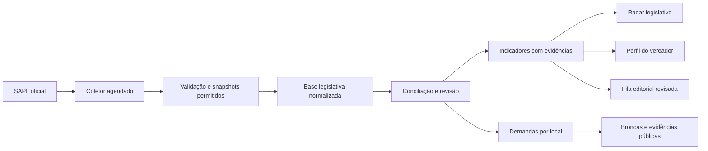

# Radar legislativo e evolução dos perfis de vereadores

**Proposta para o Trombone Cidadão · 13/11/2026**  
**Piloto:** Floresta–PE, `city_id = 64`.  
**Situação:** desenho do produto e de suas etapas. O MVP foi implementado posteriormente neste mesmo trabalho, com banco, coletor, carga inicial e rotina diária em **desenvolvimento**. Consulte o [estado real da implementação e a operação](RADAR_LEGISLATIVO_IMPLEMENTACAO.md). Produção não recebeu implantação legislativa.

**Revisão posterior com o guia fornecido:** [ajustes e conformidade com os prompts](RADAR_LEGISLATIVO_CONFORMIDADE_GUIA.md). A solicitação posterior acrescentou os cinco grupos automáticos identificados como estimativas, busca territorial, fichas de todos os parlamentares oficiais e as opções de criar ou vincular perfil. Este plano preserva o desenho e as etapas originalmente propostos; os documentos de implementação/conformidade descrevem o comportamento atual.

## 1. Decisão recomendada

Implementar um **módulo de acompanhamento da Câmara**, começando por Floresta, que alimente dois produtos com a mesma base:

1. **Radar legislativo da cidade:** visão do conjunto da Câmara, matérias recentes, composição da produção, votações e demandas recorrentes.
2. **Perfil legislativo ampliado:** expandir a página de vereador já existente com proposições, autoria, tramitações, presenças, votos disponíveis e atuação relacionada aos problemas locais.

O diferencial do Trombone será conectar **o que foi solicitado na Câmara**, **o que a população registra** e **a comprovação de atendimento**, com links para cada evidência. A relação entre esses fatos precisa ser documentada; a coincidência de endereço não prova que um vereador conseguiu executar uma obra.

**A melhor primeira entrega é um acervo legislativo confiável e atualizado diariamente, com perfis ampliados.** Comparações sensíveis, recorrência territorial e textos editoriais entram depois de validar cobertura e metodologia. Não começar por uma nota geral de desempenho ou um ranking de “melhor vereador”.

Floresta já possui uma fonte estruturada que torna esse piloto mais simples que um projeto baseado apenas em PDFs. A Câmara encaminha a consulta de matérias ao SAPL em sua [página de perguntas frequentes](https://floresta.pe.leg.br/perguntas-frequentes/). O [SAPL/Interlegis](https://www12.senado.leg.br/interlegis/produtos/sapl) organiza proposições, sessões, leis e consultas legislativas.

Os números citados na referência Radar PTlândia são exemplos trazidos pelo usuário. **Não foram auditados nem são indicadores de Floresta.** A proposta aproveita a ideia de fiscalização local e terá cálculos próprios, explicáveis e reproduzíveis.

## 2. O que o sistema já oferece

| Base existente | Como aproveitar | Limite atual |
| --- | --- | --- |
| `src/pages/CouncilorProfilePage.jsx` | Manter a URL e ampliar o perfil público | O conteúdo legislativo hoje se concentra nas ruas nomeadas |
| `src/lib/councilorPublicResource.js` | Preservar o carregamento atual e acrescentar uma consulta legislativa independente | Busca ruas da cidade e relaciona autores por nome/slug; não é um acervo completo da Câmara |
| `councilors`, criada na migração 243 e ampliada pelas posteriores | Preservar IDs, foto, nome, apelido, partido, biografia e vínculos de conta | Ainda não representa mandatos e períodos de exercício em uma estrutura histórica |
| `councilor_link_requests` e gestão de vínculos | Reutilizar o reconhecimento de conta responsável | Conta verificada não deve poder alterar votos ou estatísticas oficiais |
| `ManageMyCouncilorPage.jsx` | Manter edição de apresentação e canais de contato | Não transformar essa edição em controle sobre os fatos importados |
| `pavement_streets.historical_documents` e `pavementStreetHistory.js` | Relacionar matérias oficiais aos projetos de denominação e às ruas existentes | Uma rua cadastrada não equivale necessariamente a uma proposição distinta |
| `CouncilorStoryModal.jsx`, `CouncilorStoryCard.jsx` e `share-councilor` | Evoluir compartilhamento e metadados com período, fonte e cobertura | Os cards atuais não sustentam métricas do conjunto da atividade legislativa |
| `/agora`, em `AgoraPage.jsx` | Oferecer acesso ao novo módulo e destaques selecionados | Já significa **Radar da cidade**, com acontecimentos e avisos; evitar confusão de nomes |
| Estrutura editorial das migrações 411–413 | Reaproveitar evidência, revisão, versões e publicação | Já atende outros assuntos, mas precisa de extensão explícita para fontes legislativas |

O cadastro atual é também formado a partir do acervo de ruas. Antes da importação, será necessário conciliar nomes completos, apelidos e nomes parlamentares. Uma correspondência aproximada serve como sugestão para revisão, não como autorização para unir duas pessoas automaticamente.

Hoje as permissões administrativas de vereadores estão associadas a `pavement`. A expansão deve ganhar acesso próprio ao módulo legislativo, com migração dos acessos existentes, sem remover a gestão atual das ruas.

## 3. Fontes oficiais verificadas em Floresta

### 3.1. O que foi confirmado

Em 13/11/2026, foram feitas requisições HTTP de leitura, sem autenticação, à [API pública do SAPL de Floresta](https://sapl.floresta.pe.leg.br/api/). Os recursos abaixo responderam com JSON e HTTP 200. Foram consultadas páginas de amostra e os totais declarados pela API; **isso confirma acesso e formato, não a completude histórica de cada campo**.

| Informação | Recurso oficial | Observação da consulta |
| --- | --- | --- |
| Parlamentares | [`parlamentares/parlamentar`](https://sapl.floresta.pe.leg.br/api/parlamentares/parlamentar/?page_size=1) | 32 registros no cadastro consultado, incluindo históricos; não significa 32 vereadores em exercício |
| Legislaturas e mandatos | [`legislatura`](https://sapl.floresta.pe.leg.br/api/parlamentares/legislatura/?page_size=30) e [`mandato`](https://sapl.floresta.pe.leg.br/api/parlamentares/mandato/?page_size=1) | Há datas e vínculos, com uma inconsistência de período a conferir |
| Matérias de 2025 | [`materialegislativa?ano=2025`](https://sapl.floresta.pe.leg.br/api/materia/materialegislativa/?ano=2025&page_size=1) | 609 registros declarados |
| Matérias de 2026 | [`materialegislativa?ano=2026`](https://sapl.floresta.pe.leg.br/api/materia/materialegislativa/?ano=2026&page_size=1) | 506 registros declarados na data da consulta |
| Tipos de matéria | [`tipomaterialegislativa`](https://sapl.floresta.pe.leg.br/api/materia/tipomaterialegislativa/?page_size=30) | 34 tipos, distribuídos em duas páginas nessa consulta |
| Autoria e identificação de autores | [`autoria`](https://sapl.floresta.pe.leg.br/api/materia/autoria/?page_size=1) e [`base/autor`](https://sapl.floresta.pe.leg.br/api/base/autor/?page_size=1) | Existem relações próprias; autor pode ser parlamentar ou outro órgão/ente |
| Tramitações | [`tramitacao`](https://sapl.floresta.pe.leg.br/api/materia/tramitacao/?page_size=1) | Histórico com matéria, data, unidade e status |
| Sessões | [`sessaoplenaria`](https://sapl.floresta.pe.leg.br/api/sessao/sessaoplenaria/?page_size=1) | 659 registros no conjunto histórico consultado |
| Pautas e ordem do dia | [`expedientemateria`](https://sapl.floresta.pe.leg.br/api/sessao/expedientemateria/?page_size=1) e [`ordemdia`](https://sapl.floresta.pe.leg.br/api/sessao/ordemdia/?page_size=1) | Necessários para relacionar votação, matéria e sessão |
| Resultados de votação | [`registrovotacao`](https://sapl.floresta.pe.leg.br/api/sessao/registrovotacao/?page_size=1) | 3.053 registros históricos de resultado/placar |
| Votos individuais | [`votoparlamentar`](https://sapl.floresta.pe.leg.br/api/sessao/votoparlamentar/?page_size=1) | 382 registros históricos de votos individuais; não são 382 votações |
| Presenças | [`sessaoplenariapresenca`](https://sapl.floresta.pe.leg.br/api/sessao/sessaoplenariapresenca/?page_size=1) e [`presencaordemdia`](https://sapl.floresta.pe.leg.br/api/sessao/presencaordemdia/?page_size=1) | São escopos diferentes de presença |
| Leis e outras normas | [`normajuridica`](https://sapl.floresta.pe.leg.br/api/norma/normajuridica/?page_size=1) | Há vínculo com matéria em registros de amostra; conferir por tipo de norma |

Esses totais são fotografias da consulta, não metas fixas para o coletor. O registro resumido da verificação está em [RADAR_LEGISLATIVO_FLORESTA_FONTES_2026-11-13.json](research/RADAR_LEGISLATIVO_FLORESTA_FONTES_2026-11-13.json).

Para conferência humana, a Câmara oferece [pesquisa de matérias](https://sapl.floresta.pe.leg.br/materia/pesquisar-materia), [consulta de parlamentares](https://sapl.floresta.pe.leg.br/parlamentar/) e [relatórios de autoria, presença, atas e votações](https://sapl.floresta.pe.leg.br/sistema/relatorios/).

### 3.2. Achados que mudam a implementação

**API antes de raspagem.** Não há motivo para começar com um robô navegando pelo site. O primeiro conector deve consumir JSON. HTML e PDFs entram como complementos e alternativas controladas.

**Paginação diferente da suposição mais comum.** A resposta observada usa `pagination.total_entries`, `pagination.next_page`, `pagination.links` e `results`. Não implementar esperando apenas `count` e `next` na raiz. A lista de tipos tem mais de uma página; esquecer a segunda exclui categorias do levantamento.

**Links HTTP dentro de respostas HTTPS.** Foram observados links de próxima página, PDFs e recursos com `http://sapl.floresta.pe.leg.br`. Construir URLs canônicas HTTPS no mesmo host autorizado, validando o destino. Não seguir indiscriminadamente qualquer URL retornada.

**Período cadastrado precisa de revisão.** A legislatura de ID externo 9 apareceu como “7ª (2025–2026)”, com início em 01/01/2025 e fim em 31/12/2026. Um mandato de amostra também encerra em 2026. Preservar o valor da fonte e abrir pendência para confrontar composição, posse e documentação oficial. Não assumir que esse cadastro define sozinho o fim do mandato nem alterar o estado público de todos os vereadores com base nele.

**Resultados agregados não identificam o voto de cada pessoa.** Os conjuntos de placares e votos individuais têm tamanhos diferentes e abrangem vários anos. A diferença não permite calcular cobertura nominal simplesmente dividindo um pelo outro. Será preciso relacionar sessão, tipo de votação e integrantes elegíveis no período.

**Autores não são necessariamente vereadores.** Há `autor_related`, `object_id`, tipo de autor e autoria própria da matéria. Um autógrafo associado à Mesa não deve ser atribuído ao presidente como se fosse um projeto de sua autoria.

**Campos técnicos dispensáveis aparecem na API.** Amostras incluíram `ip` e `user`. O conector deve descartar esses campos e trabalhar com uma lista de campos legislativos necessários. Não republicar a resposta inteira como “dados abertos do Trombone”.

### 3.3. Um exemplo local útil para o piloto

O [Pedido de Providência nº 1/2026, matéria 7190](https://sapl.floresta.pe.leg.br/api/materia/materialegislativa/7190/) traz demanda de ampliação de esgoto na Rua Benevides Ferraz de Sá, no bairro Caitano II. É uma boa amostra para validar extração de serviço, rua, bairro, destinatário e autoria.

O exemplo prova que existe material territorial aproveitável. **Não prova recorrência nem ausência de execução.** Essas conclusões dependem de outros documentos e evidências.

## 4. Escopo da primeira versão

### Entrar no MVP

- Floresta como primeira cidade integrada, com fonte configurada no banco.
- Carga de matérias de 2025 até a data corrente, com filtros por ano e intervalo de apresentação.
- Cadastro conciliado de parlamentares e autores, sem duplicar os perfis existentes.
- Autoria e coautoria; ementa, tipo oficial, documento original e tramitação disponível.
- Lista de vereadores e seus perfis atuais ampliados.
- Radar com matérias recentes, distribuição por tipo, temas revisados e mudanças de tramitação.
- Atualização diária com histórico de execuções, erros, cobertura e última coleta bem-sucedida.
- Administração para conciliar identidades, revisar classificações e corrigir relações.
- Fonte acessível em cada matéria e em cada indicador publicado.

### Liberar somente após a auditoria correspondente

- Percentuais de presença e ausência.
- Comparações entre vereadores a partir de votos individuais.
- Indicadores de unanimidade.
- Afirmações sobre quantidade de homenagens em relação a outras propostas.
- Alertas de pedidos repetidos para um mesmo local e serviço.

Esses recursos podem ser coletados desde o piloto, mas só ficam públicos quando os vínculos, denominadores e limites estiverem validados. Uma falha nessa etapa não precisa impedir o lançamento do acervo de proposições.

Na implementação, a consulta documental pode mostrar os votos individuais já publicados pela Câmara, identificados como registros da fonte. Isso não libera índices de unanimidade, ranking ou porcentagens de ausência sem a auditoria correspondente.

### Deixar para uma expansão posterior

- Despesas, diárias, remuneração, verbas e emendas com execução financeira.
- Compromissos de campanha e avaliação de cumprimento.
- Transcrição integral de vídeos e análise de discursos.
- Cobertura automática de todas as câmaras brasileiras.
- Comparação entre cidades antes de compatibilizar os dados e as regras locais.

Esses conjuntos dependem de fontes e regras adicionais. A existência do SAPL não confirma disponibilidade de cada um deles.

## 5. Experiência no produto

### 5.1. Entrada e navegação

Usar **Câmara** como entrada em Explorar e **Radar legislativo** como nome do painel analítico. Preservar **Radar da cidade** em `/agora` para os acontecimentos atuais.

Rotas propostas:

| Rota | Função |
| --- | --- |
| `/camara/:cityId` | Visão geral e radar legislativo |
| `/camara/:cityId/vereadores` | Diretório de parlamentares, com período e situação |
| `/camara/:cityId/materias` | Busca e filtros de proposições |
| `/camara/:cityId/materias/:matterId` | Documento, autores, tramitação e evidências |
| `/camara/:cityId/sessoes/:sessionId` | Pauta, presença e votações disponíveis |
| `/vereadores/:cityId/:slug` | Perfil existente, ampliado, sem trocar sua identidade |
| `/admin/legislativo` | Fontes, conciliação, cobertura, classificações e correções |

Os identificadores de matéria e sessão nas rotas devem apontar para o registro interno, mantendo o ID externo da fonte como referência. Links antigos de perfis, compartilhamentos e solicitações de vínculo continuam válidos.

### 5.2. Radar da Câmara

Filtros no topo: cidade, período, vereador, tipo de matéria e tema. O período padrão só pode ser apresentado como “desde a posse” depois da conferência dos mandatos. Até lá, usar datas explícitas, por exemplo, “01/01/2025 a 13/11/2026”.

Conteúdo principal:

1. Indicadores compactos: matérias distintas, propostas normativas, pedidos de providência e votações com dados disponíveis.
2. Lista de matérias recentes e mudanças relevantes.
3. Distribuição por tipo e por tema, com acesso aos documentos que compõem cada número.
4. Sessões e votações recentes, conforme cobertura.
5. Demandas recorrentes por local, quando a análise territorial estiver validada.

Cada card analítico precisa de período, fonte, quantidade de registros e ação **Ver documentos**. Explicações extensas ficam em **Como calculamos**. Não preencher o painel com parágrafos descritivos permanentes.

### 5.3. Perfil do vereador

Preservar foto, apelido, apresentação, contato e conta responsável. Acrescentar abas ou seções:

| Seção | Conteúdo |
| --- | --- |
| Visão geral | Resumo do período, matérias recentes e temas de atuação |
| Proposições | Autoria principal e coautoria, filtros e situação das matérias |
| Votações | Voto nominal quando publicado; link para a votação e sua cobertura |
| Presença | Sessões elegíveis, registros publicados, justificativas e limitações |
| Fiscalização e demandas | Pedidos de informação, requerimentos e providências, classificados pelo conteúdo |
| Ruas e homenagens | Acervo atual de ruas, documentos oficiais relacionados e outras homenagens confirmadas |

Partido deve poder ser consultado na data da atuação, além da filiação atual. Suplência e afastamentos precisam aparecer como intervalos de exercício; o nome da pessoa não deve ser associado a votos ocorridos fora desses intervalos.

As broncas registradas pela conta do vereador permanecem identificadas como **atividade no Trombone**, separadas da produção oficial da Câmara. Não somar uma publicação no aplicativo a um projeto de lei.

### 5.4. Matéria e sessão

A matéria mostra título/ementa, número, ano, tipo, autores, datas, tramitação e documento original. Links de votação, norma resultante, rua e bronca aparecem quando a relação estiver confirmada. Um PDF sem texto extraído continua consultável pelo documento original.

A sessão reúne seus registros sem transformar uma leitura de matéria em votação. Se a Câmara publica só o resultado geral, informar isso; não preencher uma tabela de votos individuais por dedução.

### 5.5. Regras de layout

Usar `.page-shell-fluid`, margens externas de até 64 px em desktop e painéis que crescem com a tela. Validar 1440 e 1920 px, além do celular. Limitar largura apenas em textos de leitura ou formulários internos.

Mostrar campos curtos na mesma linha quando couberem; preservar quebra de linha para ementas e endereços. Mapas territoriais, quando introduzidos, reutilizam `MapDisplayControls` e `MapBaseLayer`, com localização atual por ação do usuário e opção de satélite.

## 6. Metodologia dos indicadores

### 6.1. Regras comuns

- Uma matéria oficial distinta tem chave da fonte e ID externo; número e ano, isoladamente, não são suficientes.
- Contar proposições por data de apresentação; contar votações pela data da sessão, não pela data de digitação/importação do voto.
- Excluir do total de “projetos apresentados” documentos de outras etapas, como autógrafos e pareceres. Preservá-los no acervo e relacioná-los à proposição original quando houver evidência.
- No total da Câmara, usar matérias distintas. No perfil, atribuir a mesma matéria a cada coautor confirmado e avisar que a soma dos perfis pode superar o total da Câmara.
- Separar autoria parlamentar, Executivo, Mesa e comissões.
- Não representar “sem dados”, “cobertura parcial” ou “fonte indisponível” pelo número zero.
- Salvar período, versão do cálculo, conjunto de evidências e cobertura de cada resultado.
- Não inferir qualidade do mandato apenas pelo volume de documentos, unanimidade ou quantidade de ausências.

### 6.2. Homenagens e outras propostas

Classificar em **dois eixos**, para evitar uma comparação enganosa:

1. Tipo formal: PLO, PLC, requerimento, pedido de providência, decreto legislativo etc.
2. Finalidade: homenagem/denominação, serviços urbanos, saúde, educação, fiscalização, orçamento e outras, com possibilidade de “não classificada”.

Uma homenagem também pode ser um projeto de lei. Portanto, o texto “cinco homenagens para cada projeto de lei” pode colocar o mesmo documento no numerador e no denominador.

Apresentação preferida: **“X de Y propostas normativas classificadas tratam de homenagens ou denominações.”** Se houver razão comparativa, usar grupos disjuntos:

`razão = propostas normativas honoríficas / demais propostas normativas classificadas`

Se o denominador for zero, exibir “sem base para comparação”, com os totais. Exibir também a quantidade não classificada. Não classificar todo projeto de decreto legislativo ou toda moção como homenagem; não classificar toda denominação como homenagem pessoal sem ler o conteúdo.

Palavras-chave e documentos do acervo de ruas podem sugerir rótulos. Casos ambíguos precisam de revisão. As regras têm versão, justificativa e trecho de evidência.

### 6.3. Unanimidade e concordância

Publicar separadamente:

- **Aprovação unânime segundo o placar:** votação válida, com votos favoráveis, nenhum contrário e nenhuma abstenção, conforme o registro oficial. Não equivale a todos os vereadores da cidade terem votado.
- **Concordância nominal:** comparação apenas entre votos individuais efetivamente publicados e em votações com a cobertura necessária conferida. Ausência de registro não é voto favorável nem contrário.

Para percentuais, o denominador precisa ser o número de votações elegíveis para aquela métrica, com tipo, turno, quórum e cobertura informados. Votações secretas, anuladas e registros incompletos ficam fora do cálculo correspondente.

Não confundir duas votações regimentais da mesma proposição com dois projetos. É possível contar ambas como eventos de votação, desde que a interface identifique os turnos. O [noticiário oficial da Câmara sobre a sessão de 02/09/2026](https://floresta.pe.leg.br/camara-de-floresta-aprova-cinco-projetos-por-unanimidade-e-debate-demandas-da-populacao/) exemplifica matérias apreciadas em duas sessões e turnos.

Não traduzir unanimidade automaticamente como conluio ou falta de independência. O sistema publica o padrão registrado e permite examinar os assuntos votados.

### 6.4. Presença

`presença = sessões com presença confirmada / sessões elegíveis com registro conferido`

Considerar somente o intervalo de exercício da pessoa, os tipos de sessão escolhidos e as sessões efetivamente realizadas. Presença na sessão e presença na ordem do dia são indicadores distintos.

Um nome ausente de uma tabela da API não basta para declarar falta. Até validar a lista e as atas, registrar **presença não informada**. Justificativa, afastamento e substituição não devem ser apagados por uma fórmula simples.

### 6.5. Proposta apresentada, aprovada e transformada em norma

Manter estados separados: apresentada, em tramitação, aprovada, rejeitada, retirada, arquivada e relacionada a norma, conforme a fonte. A ligação com norma exige chave ou evidência documental, não apenas título parecido.

Não transformar aprovação de pedido de poda em execução de poda. Não chamar toda norma de lei: resolução, decreto e outros tipos mantêm sua identidade.

## 7. Demandas repetidas e conexão com o território

Este é o recurso com maior potencial de diferenciação, mas depende de mais tratamento que a simples importação de matérias.

Fluxo recomendado:

1. Identificar pedidos de providência, indicações e requerimentos relacionados a serviços.
2. Extrair tipo de serviço, rua/localidade, bairro, equipamento e destinatário, sempre com trecho do documento.
3. Conciliar nomes e variações com `pavement_streets`, bairros e equipamentos locais; guardar também o texto original.
4. Agrupar por **local + serviço + período**. O endereço pode se referir a um trecho, não à rua inteira.
5. Contar matérias distintas. Não somar o mesmo pedido novamente porque aparece na pauta, na ata e no PDF.
6. Sugerir relações com broncas públicas e evidências de atendimento; revisar as correspondências antes de publicá-las.

Um limiar inicial configurável, por exemplo três matérias distintas para o mesmo local e serviço, pode abrir uma pauta para revisão. O limiar é uma regra editorial proposta, não um fato da fonte nem uma prova de irregularidade.

Vocabulário público:

| Evidência disponível | Apresentação adequada |
| --- | --- |
| Só documentos legislativos repetidos | “Há X pedidos oficiais sobre este serviço no período” |
| Nenhuma resposta/execução encontrada nas fontes consultadas | “Sem comprovação pública de atendimento nas fontes consultadas” |
| Resposta de órgão com documento | “Órgão informou atendimento em data X” |
| Foto/registro de cidadão com data | “Registro de morador em data X”, sujeito à moderação |
| Confirmação de execução com evidência suficiente | Mostrar quem confirmou, quando e qual evidência foi usada |

Não publicar “o mato continua lá” apenas porque o SAPL não recebeu uma resposta. Não atribuir ao vereador a obrigação operacional da prefeitura; mostrar a cobrança legislativa e o destinatário responsável pelo serviço.

Broncas privadas, denúncias restritas, relatos não aprovados e dados pessoais não devem entrar nesse cruzamento público. Usar o mesmo contrato de visibilidade já aplicado no produto, com recorte por cidade. Localizações e informações sensíveis precisam respeitar as restrições do registro original.

## 8. Arquitetura recomendada

Manter React/Vite no produto e Supabase/Postgres na persistência. Começar com um conector SAPL versionado e tarefas curtas em servidor. Não é necessário adicionar outro banco ou uma plataforma de processamento distribuído para o piloto.



### 8.1. Coleta diária

Agendar uma execução diária às **03h em `America/Fortaleza`**, equivalente a **06h UTC** nessa configuração. Registrar o fuso; não depender do fuso do navegador.

- Confirmar `pg_cron` e o mecanismo de chamada autenticada antes de marcar a automação como ativa. Ter apenas um agendador dono do fluxo.
- Usar `pg_cron` para enfileirar/desencadear tarefas, não para executar uma coleta longa de internet dentro de uma transação do banco.
- Buscar páginas em tarefas curtas com cursor, estado persistido, limite de duração e retomada. Não processar todo o histórico em uma única Edge Function.
- Começar com baixa concorrência e limite conservador de requisições; ajustar conforme as respostas da fonte. Retentativas para 429/5xx usam espera progressiva e `Retry-After` quando disponível.
- Impedir duas execuções simultâneas da mesma fonte/recurso usando trava e prazo de execução renovável.
- Detectar ciclos de paginação, itens repetidos, filtros ignorados e contagem incompatível com as páginas recebidas.

Na primeira carga, importar o período de 2025 em diante e os catálogos necessários. Consultar histórico anterior para resolver referências, sem misturá-lo aos indicadores do período. Todas as páginas do recorte devem ser conferidas.

Depois da carga inicial, consultar alterações quando houver filtro confiável. Quando isso não estiver validado, refazer o recorte corrente com comparação por hash. Revalidar periodicamente anos anteriores e matérias em tramitação: um documento antigo pode ser corrigido hoje.

`data_ultima_atualizacao`, `ultima_edicao`, data da sessão e data da apresentação têm funções diferentes. O conector não deve escolher uma delas como relógio universal sem verificar cada entidade.

### 8.2. Idempotência, correções e publicação

Usar `source_id + entity_kind + external_id` como identidade externa. Uma segunda coleta do mesmo documento não cria nova matéria. Mudança do documento cria revisão e recalcula apenas os resultados afetados.

Preservar a última versão pública consistente enquanto uma coleta está incompleta. Publicar um lote analítico somente depois de validar relações e cobertura; um recurso que falhou não pode zerar o painel inteiro.

Não apagar documento porque ele sumiu de uma página. Reconsultar pelo ID, registrar indisponibilidade e exigir confirmação para remoção lógica. Exclusões e correções relevantes precisam de histórico.

Guardar origem, URL, data da coleta, hash, versão do conector e campos legislativos permitidos. Guardar PDFs apenas quando necessário e com limites de tamanho/tipo, deduplicação e política de armazenamento. O arquivo de auditoria não precisa conter IP, usuário técnico ou outros campos descartados.

### 8.3. Leitura do aplicativo

O navegador consulta a base do Trombone, não o SAPL diretamente. Isso permite cache, busca, cobertura consistente e funcionamento quando a Câmara estiver fora do ar.

Criar consultas/RPCs públicas paginadas para radar, perfil, matéria e sessão. Os agregados devem rodar no servidor: não baixar todas as matérias ou todas as ruas para calcular indicadores no aparelho.

A consulta legislativa nova deve falhar de forma independente do acervo atual. Se a integração estiver temporariamente indisponível, a página de vereador continua mostrando o perfil e as ruas já existentes.

## 9. Modelo de dados proposto

Os nomes abaixo são uma proposta de implementação, não tabelas já existentes. Separar identidade da pessoa, autoria oficial e período de exercício.

| Grupo/tabela sugerida | Responsabilidade e chaves principais |
| --- | --- |
| `legislative_sources` | Cidade, casa legislativa, URL autorizada, adaptador, capacidades, ativação e configuração de coleta |
| `legislative_ingestion_runs` / `legislative_ingestion_jobs` | Execuções, filas, cursores, prazos, retentativas e contagens por recurso |
| `legislative_source_objects` / revisões | Identidade externa, hash, versão, URL e snapshot dos campos permitidos |
| `legislative_councilor_links` | Relação revisada entre ID parlamentar da fonte e `councilors.id`; aliases como apoio à conciliação |
| `legislative_terms` / intervalos de exercício e filiação | Legislatura de origem, mandato, suplência, afastamento, datas e partido no período |
| `legislative_matters` / `legislative_matter_authors` | Documento original e relações de autoria, preservando autores institucionais e não conciliados |
| `legislative_proceedings` | Tramitação, status de origem, unidades, data e referência à matéria |
| `legislative_sessions` / `legislative_agenda_items` | Sessões, expediente, ordem do dia, matéria e turno/evento correspondente |
| `legislative_ballots` / `legislative_votes` | Resultado agregado separado dos votos individuais e de sua cobertura |
| `legislative_attendance` | Registro de presença por sessão/pessoa/escopo, com justificativa e origem |
| `legislative_classifications` | Rótulo, evidência, regra/modelo, versão, confiança e decisão de revisão |
| `legislative_place_mentions` / `legislative_evidence_links` | Menções de local e relações revisadas com ruas, matérias, normas, broncas e comprovantes |
| `legislative_metric_snapshots` | Período, filtros, método, cobertura, valores e conjunto de evidências do resultado publicado |

Tabelas históricas e relações adicionais entram junto com o recurso correspondente. O primeiro corte precisa de fontes, ingestão, identidades, matérias, autoria, tramitações e publicação de consultas. Não criar toda a expansão antes do MVP.

Regras de integridade:

- IDs externos são nomes no contexto de uma fonte, nunca IDs globais compartilhados por cidades.
- Toda relação deve validar cidade e fonte. Uma votação não pode apontar para uma matéria de outra Câmara.
- Não converter `base.autor.id` diretamente em ID de parlamentar: usar a relação e o tipo oficiais.
- Unicidade de voto considera a votação e o parlamentar da fonte; manter estado “não conciliado” quando necessário, sem inventar identidade.
- Consultas públicas expõem somente versões e campos publicados. Snapshots de coleta, pendências e dados administrativos ficam restritos.
- Conta de gabinete continua com as permissões de apresentação; apenas o coletor e revisores autorizados podem alterar a camada oficial/revisada, com auditoria.

## 10. Conciliação e transição do acervo atual

1. Exportar os perfis existentes de Floresta e seus vínculos antes da primeira conciliação.
2. Importar parlamentares, autores e mandatos para uma área de revisão.
3. Sugerir correspondências por nome, apelido e fonte, dentro da cidade.
4. Confirmar os vínculos com os IDs atuais de `councilors`. Não recriar uma página já reivindicada por uma conta.
5. Criar perfis ausentes após revisão de identidade. Não criar um perfil de vereador para o Executivo ou uma comissão.
6. Associar documentos do acervo de ruas ao ID oficial da matéria quando possível; manter a relação antiga quando não houver confirmação.
7. Preservar fotos, biografias, contatos e histórico de reivindicação. Definir precedência entre informação oficial importada e apresentação enviada pelo gabinete.

Revisar a sincronização que cria vereadores a partir de nomes de autores em ruas. A nova base não pode ser desfeita por um gatilho legado que crie outro perfil com uma variação do mesmo nome.

## 11. Classificação, IA e publicação editorial

O MVP pode operar sem IA: importação estruturada, regras claras e revisão humana já entregam bastante valor.

Se houver uso de modelo, restringi-lo a sugerir temas, resumir ementas, extrair locais e preparar pautas. Cálculos, contagens, identificação de votos e datas vêm de regras determinísticas. Cada sugestão deve apontar documento e trecho; sem evidência, o resultado continua pendente.

Textos e PDFs externos são dados, nunca instruções para o coletor ou para o modelo. Definir limites de tamanho, orçamento e reprocessamento; hash de documento evita pagar novamente pela mesma análise.

Para notícias e cards comparativos, estender a estrutura editorial existente com tópicos e fontes legislativas. A migração 411 não deve receber registros de matéria fingindo que são obras. A publicação precisa reconhecer o novo domínio e gerar a atribuição correta.

Fluxo: **dados conferidos → pauta sugerida → revisão → publicação**. O painel factual pode atualizar automaticamente depois da validação; interpretações, títulos acusatórios e relações territoriais ambíguas não devem ser publicados automaticamente.

Um card de vereador compartilhado deve levar nome, cidade, período, indicador, fonte e link para os documentos. Contagem parcial não pode aparecer como atuação total do mandato. A verificação da conta responsável continua sendo um selo de identidade, não um aval sobre a qualidade do mandato.

## 12. Administração e operação

Uma tela própria deve mostrar, por cidade e recurso:

- Coleta ativa/desativada, última tentativa, último sucesso e período coberto.
- Quantidade declarada pela fonte, coletada, validada, publicada e pendente.
- Erros, retentativas e ação de reprocessar um recurso, sem duplicar o histórico.
- IDs de autores não conciliados, mudanças de nome e divergências de mandato.
- Classificações e correspondências territoriais para revisar.
- Mudanças relevantes em documentos já publicados e correções solicitadas.

Proposta de operação: alerta interno quando passar mais de 36 horas sem coleta diária bem-sucedida, com limite configurável. Esse estado informa atraso do **coletor**, separadamente da data em que a Câmara atualizou seus dados.

Manter os últimos dados válidos com aviso de atualização pendente. Uma cidade não configurada mostra “Integração oficial ainda não disponível”, sem painel de zeros.

Adicionar ação pública **Informar erro**, vinculada ao documento/indicador e à versão consultada. Registrar revisão e justificativa. A resposta de um gabinete pode ser anexada como manifestação identificada, sem substituir silenciosamente o documento oficial.

## 13. Expansão para outras cidades

Construir desde o início o contrato de um conector: descobrir recursos, listar páginas, buscar documento, normalizar dados e declarar capacidades. Implementar **somente o adaptador SAPL de Floresta no primeiro ciclo**.

Capacidades por cidade, por exemplo: `matters`, `authors`, `proceedings`, `attendance`, `aggregate_votes`, `roll_call_votes`, `committees` e `norms`. A interface habilita somente o que foi validado naquele local e período.

Uma segunda cidade com SAPL deve passar por descoberta de endpoints, tipos, identidade, datas, paginação e cobertura. Não assumir que IDs de tipo, campos, configuração ou qualidade são iguais só porque a plataforma tem o mesmo nome. Cidades em outras plataformas recebem adaptadores próprios; PDFs podem exigir operação editorial maior.

Esse desenho evita reescrever o produto para cada Câmara, sem prometer um coletor universal antes de comprovar o piloto.

## 14. Implantação por etapas

Estimativa inicial para uma pessoa desenvolvedora dedicada, com acesso a alguém para revisão das fontes: **20 a 32 dias úteis de desenvolvimento**, aproximadamente quatro a sete semanas, além de períodos de observação. É uma estimativa de planejamento; qualidade do acervo, PDFs e disponibilidade de revisão podem mudar o esforço.

| Etapa | Entrega | Esforço estimado | Condição para avançar |
| --- | --- | --- | --- |
| 0 — Auditoria e contrato das fontes | Amostras completas, identidade, datas, paginação e matriz de cobertura | 2–4 dias | Validar escopo de 2025 em diante e registrar limitações |
| 1 — MVP | Coletor, carga inicial, administração mínima, matérias, radar básico e perfil ampliado | 8–12 dias | Totais reconciliados e documentos rastreáveis |
| 2 — Sessões e indicadores | Presenças, votações, classificações e metodologia pública | 5–8 dias | Denominadores, identidade e cobertura aprovados por indicador |
| 3 — Território e evidências | Pedidos recorrentes, relações com ruas/broncas e pauta editorial | 5–8 dias | Correspondências revisadas e linguagem de atendimento validada |

Despesas e expansão nacional não estão incluídas nesse esforço. Se a etapa 2 revelar lacunas de voto nominal, entregar os resultados agregados disponíveis e manter a limitação explícita.

Antes de produção: migrations revisadas, carga em dev, comparação com relatórios oficiais e observação de pelo menos sete execuções diárias. O agendador deve ficar desativado por padrão até a configuração do ambiente e da fonte estar concluída.

Liberar o piloto por cidade. Pausar a nova navegação ou o coletor não pode indisponibilizar os perfis e o acervo de ruas existentes. Retomar uma execução interrompida deve ser seguro.

## 15. Critérios de aceite

### Dados e métricas

- Todas as páginas do recorte foram percorridas e reconciliadas com os totais da fonte, sem usar apenas a primeira página.
- Uma reexecução não duplica matéria, autoria, voto, sessão ou documento.
- Correções da fonte geram revisão e recálculo, sem apagar o histórico.
- Autores conciliados estão ligados aos perfis corretos; pendências não viram estatísticas pessoais definitivas.
- Cada indicador abre seus documentos e informa período, método e cobertura.
- Projeto, autógrafo, parecer, norma e votação não são contados como a mesma unidade de produção.
- Presença não publicada, voto secreto e voto não informado não viram falta ou voto presumido.
- Dados de origem diferentes não são misturados entre cidades.

### Operação e segurança

- Retentativas, paginação cíclica, execução simultânea e falha no meio do lote foram exercitadas em dev.
- Falha do coletor mantém a última publicação consistente e gera estado verificável de atraso.
- Escrita da camada oficial está restrita ao servidor; credenciais nunca chegam ao navegador.
- Gabinete vinculado não consegue modificar voto, autoria importada ou fórmula de indicador.
- IPs e identificadores técnicos dispensáveis não aparecem nas consultas públicas, exportações ou evidências.
- Não houve publicação de bronca privada nem vazamento de registros por relações com endereço.

### Produto

- Perfis e links existentes continuam funcionando.
- Navegação distingue Câmara/Radar legislativo do Radar da cidade.
- Layout conferido em 1440 e 1920 px e em celular, sem rolagem horizontal.
- Fonte vazia, falha de consulta e falta de cobertura produzem estados distintos.
- Páginas públicas têm títulos e metadados adequados; falhas temporárias não são tratadas como perfil inexistente.

## 16. Primeiro pacote de implementação sugerido

1. Produzir um relatório de cobertura de 2025–2026 e revisar a divergência de períodos da fonte.
2. Desenhar migrations de fontes, ingestão, identidades, matérias, autoria e tramitação, com RLS e índices por cidade/período/autor/tipo.
3. Implementar o adaptador SAPL e executar carga de desenvolvimento com amostras sanitizadas para testes.
4. Criar conciliação administrativa com os `councilors.id` existentes.
5. Implementar `CouncilorLegislativeOverview`, `CouncilorMatters` e páginas da Câmara consumindo consultas paginadas do servidor.
6. Lançar o radar básico e os perfis ampliados após reconciliação e observação da coleta.
7. Acrescentar os indicadores condicionais e o cruzamento territorial nas etapas seguintes.

Estrutura de código proposta:

```text
src/pages/LegislativeRadarPage.jsx
src/pages/LegislativeMattersPage.jsx
src/pages/LegislativeMatterPage.jsx
src/pages/LegislativeSessionPage.jsx
src/pages/admin/ManageLegislativePage.jsx
src/components/councilor/CouncilorLegislativeOverview.jsx
src/components/councilor/CouncilorMatters.jsx
src/hooks/useLegislativeData.js
src/lib/legislativeMetrics.js
src/lib/legislativeSources.js
supabase/functions/collect-legislative-data/
supabase/functions/_shared/legislative/sapl.ts
```

A árvore acima registra a divisão inicialmente sugerida. A implementação consolidou as páginas públicas em `LegislativePage.jsx`, o adaptador compartilhado em `sapl.js` e os utilitários em `src/lib/legislative.js`. Os arquivos efetivamente criados, as migrações e as verificações estão no [documento de implementação](RADAR_LEGISLATIVO_IMPLEMENTACAO.md).

## 17. Custos e escolhas a medir no piloto

Não é necessário contratar uma nova infraestrutura apenas para a primeira versão. Medir o uso adicional de Postgres, armazenamento de documentos, tráfego, execução do coletor e tempo de revisão. A soma de 609 registros declarados para 2025 e 506 para 2026 ajuda a dimensionar a carga inicial de matérias, mas não inclui autores, tramitações, sessões ou PDFs.

Começar sem download indiscriminado de todos os anexos e sem transcrição de vídeos. Deduplicar documentos por hash e analisar primeiro a ementa e o texto oficial já extraído. Se houver IA, estabelecer teto de gasto e volume por cidade e exibir a fila restante, sem afetar a coleta estruturada.

Os principais custos de manutenção serão mudanças na fonte, conciliação de identidade, revisão de classificações e validação de evidências. O desenho recomendado concentra o investimento inicial na qualidade desse fluxo e permite ampliar a cobertura depois que Floresta estiver funcionando de forma confiável.
